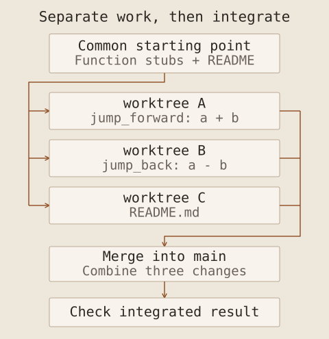

On Monday 12 October 2026, I attended a one-day AI Agent development course at company headquarters. Building on the foundation course I attended in August, it moved from dividing work with **Claude Code** to building an AI application and coordinating multiple agents. I followed the handouts, completed all the exercises and confirmed that they worked.

I am recording the course in three Notes. This one covers the foundations and parallel development; the second covers API-based applications and agents with tools and memory; the third covers orchestration and the final project. I begin with the review of the August course.

## Four engineering perspectives

I learnt prompt, context, harness and agent engineering in the August foundation course and practised with Codex and Gemini. This time, I revisited those ideas and connected writing instructions to designing the working environment and human responsibilities.

I find the four perspectives easier to distinguish by what each one designs. In practice, the goal, relevant information, execution procedure and delegation boundary need to be considered together.

| Perspective         | What it designs                                                      | First question                                            |
| ------------------- | -------------------------------------------------------------------- | --------------------------------------------------------- |
| Prompt engineering  | Goals, instructions, constraints and output format                   | What should be done, and against which criteria?          |
| Context engineering | Relevant material, state and tool information alongside instructions | What information does this decision need?                 |
| Harness engineering | Execution, validation and recovery procedures                        | How can work continue across long tasks or interruptions? |
| Agent engineering   | Delegation, roles and human review points                            | What is delegated, and who judges the result?             |

### Prompts: define the task and completion criteria

Prompt engineering designs instructions and improves them by examining the results. Beyond assigning a role, it needs a clear purpose, input, constraints and expected output. Anthropic's [prompt engineering guidance](https://platform.claude.com/docs/en/build-with-claude/prompt-engineering/overview) starts with success criteria and a way to test them.

For a log-analysis example, I could specify the period, events to investigate, evidence fields and output format. That makes the supporting records visible alongside a finding. The useful question is whether I can evaluate the answer, rather than how long the instruction is.

### Context: supply relevant information when needed

Context engineering manages what the model receives beyond instructions: reference material, conversation history, current state and tool results. It selects information for the current decision. Anthropic's [context engineering article](https://www.anthropic.com/engineering/effective-context-engineering-for-ai-agents) describes this as an iterative process of curating the information available to the model.

In log analysis, missing field definitions, time zones or a baseline of normal behaviour could change the interpretation. In development, relevant code, requirements, settled decisions and unresolved issues serve that role. Persistent rules in `AGENTS.md` or `CLAUDE.md`, with detailed material retrieved when needed, also fit this perspective.

### Harnesses: support execution, validation and continuity

A harness is the environment and procedure around a model that enables work to proceed. Tools, permissions, staged plans, tests and progress records contribute to it. Across sessions, it must be possible to recover what is finished and what remains. Anthropic's [long-running harness example](https://www.anthropic.com/engineering/effective-harnesses-for-long-running-agents) combines progress notes, Git history and feature-level verification.

For example, a procedure can require tests after implementation, corrections after failures and another check. If work stops, the next session can read the progress record and continue. A custom command such as `/phase-harness` can encode staged implementation procedures. It belongs to the environment where it is defined, rather than being a standard command shared by every tool.

### Agents: design delegation and human judgement together

An important lesson in agent engineering was how to divide responsibility between people and AI. With Human-in-the-loop, I review the plan, examine the implementation and decide what follows. Approval of a plan and acceptance of the resulting software are separate judgements.

My responsibility is to define the goal, permitted scope and important decision criteria. I can delegate implementation and repeated checks while reviewing the changes and deciding whether to accept the result. The four perspectives therefore connect instructions to information, execution procedures and responsibility.

Designing the agent itself also requires a loop that checks tool results and selects the next action. [Anthropic's agent design article](https://www.anthropic.com/engineering/building-effective-agents) discusses execution evidence, stopping conditions and human feedback. Defining which actions repeat automatically and when to stop for review makes the delegation boundary operational.

## How the basic features support development

I also revisited project rule files, subagents working in separate contexts, reusable Skills and MCP connections to external tools. In this course, I used **Claude Code** and `CLAUDE.md` to record project purpose, technology choices and implementation and testing rules.

A rule file preserves the criteria for work; a Skill makes a procedure reusable. Connected tools enable actions, while delegation reduces the scope of an individual task. Connecting these features to the information and procedures they handle is more useful than memorising them separately.

## Manage several tasks with Agent View

The next stage used **Agent View** for parallel development. A subagent handles delegated work within a conversation; Agent View lets me dispatch and monitor multiple sessions on one screen. I can distinguish running tasks from those awaiting input and enter a session to respond or change direction. The [Claude Code documentation](https://code.claude.com/docs/en/agents) also distinguishes this model from subagents.

I renamed and resumed sessions, moved work into the background and opened sessions from another folder. A meaningful name identifies the assigned task without having to reconstruct it from the conversation history.

| Command used in the course       | Purpose                                  |
| -------------------------------- | ---------------------------------------- |
| `claude`                         | Start an interactive session             |
| `/rename`                        | Name the current session                 |
| `/resume`                        | Select and resume an earlier session     |
| `claude --resume "session-name"` | Resume a named session from the terminal |
| `/bg`                            | Move a session into the background       |
| `claude agents`                  | Open Agent View from the terminal        |

After moving a task into the background, I confirmed that it continued on the same computer when I left the foreground interface. Closing a conversation interface, ending a task and shutting down the computer are different events. Being able to return to a session does not establish that work continues while the computer is off. These commands record the interface used during the course.

## Separate working directories with Git worktrees

Opening several sessions does not prevent them from overwriting changes in a shared directory. Git worktrees addressed that problem. Branches separate development history; worktrees allow different branches to be checked out in separate directories at the same time. The [Git documentation](https://git-scm.com/docs/git-worktree) describes multiple working trees attached to one repository.

I practised parallel development with a small program that moves a year forwards or backwards. The Python file `timeline.py` accepts a current year `a` and a period `b`, then calculates a new year. `jump_forward` uses `a + b` for the later year; `jump_back` uses `a - b` for the earlier year. For example, a current year of `2026` and a period of `10` produce `2036` and `2016`, respectively. This illustrates the calculation.

After creating the two function stubs, I assigned the implementation of `jump_forward`, the implementation of `jump_back`, and the program description in `README.md` to three sessions. Each implemented and committed its work in a separate worktree before merging into `main`. I also checked that changes in those directories did not immediately appear in the main working directory.

The three tasks ran in parallel in separate directories, followed by a check of their merged result.

After changes to separate parts, the next exercise created conflicting content in the same `time.txt` file. I selected the content to retain and completed the merge. Worktrees isolate files during development, but integrating the results still requires decisions.

For my own parallel work, I need to define file ownership, task boundaries and the information exchanged between tasks. A merge without textual conflicts can still combine incompatible behaviour, so the integrated application needs another check. This issue returned when the final project combined frontend and backend changes.

## Two distinctions to carry forwards

This stage taught me to manage multiple development sessions. Later orchestration concerned agents inside an application dividing responsibilities and exchanging results. Distinguishing the agents used to build software from those running within the software makes the overall course easier to follow.

The next Note follows API connection testing, the PDF-analysis application and the addition of tools and memory with Deep Agents.
