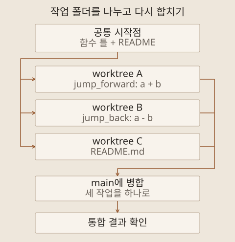

2026년 10월 12일 월요일, 회사 본사에서 하루 동안 AI Agent 개발 교육을 받았습니다. 8월에 들었던 기본과정을 바탕으로, **Claude Code**로 작업을 나누고 AI 기능이 있는 앱을 만든 뒤 여러 에이전트가 협업하는 구조까지 이어지는 과정이었습니다. 교재의 순서대로 실습을 모두 완료하고 정상 동작을 확인했습니다.

내용이 많아 세 편으로 나눠 남깁니다. 이 글에서는 기본 개념과 병렬 개발을, 두 번째 글에서는 API를 사용하는 앱과 도구·기억을 갖춘 에이전트를, 세 번째 글에서는 오케스트레이션과 최종 프로젝트를 다룹니다. 먼저 8월 기본과정을 복습한 부분부터 정리합니다.

## 네 가지 엔지니어링 관점 다시 보기

8월 기본과정에서 프롬프트, 컨텍스트, 하네스, 에이전트 엔지니어링을 배우고 Codex와 Gemini로 실습했습니다. 이번에는 그때 배운 내용을 다시 짚으면서, 지시를 작성하는 일부터 작업 환경과 사람의 역할을 설계하는 일까지 연결해 봤습니다.

네 관점은 설계할 대상에 따라 나눠 이해할 수 있습니다. 실제 개발에서는 작업 목적과 필요한 정보, 실행 절차와 위임 범위를 함께 정해야 합니다.

| 관점                | 설계할 대상                            | 먼저 확인할 질문                               |
| ------------------- | -------------------------------------- | ---------------------------------------------- |
| 프롬프트 엔지니어링 | 목표와 지시, 제약, 출력 형식           | 무엇을 어떤 기준으로 해 달라는 것인가?         |
| 컨텍스트 엔지니어링 | 지시와 함께 제공할 자료·상태·도구 정보 | 지금 판단하는 데 어떤 정보가 필요한가?         |
| 하네스 엔지니어링   | 실행 환경과 작업·검증·재개 절차        | 작업이 길어지거나 끊겨도 어떻게 이어갈 것인가? |
| 에이전트 엔지니어링 | 위임 범위, 역할과 사람의 검토 지점     | 어디까지 맡기고 누가 결과를 판단할 것인가?     |

### 프롬프트: 할 일과 완료 기준을 명확히 하기

프롬프트 엔지니어링은 모델에 전달하는 지시를 설계하고 결과를 보며 개선하는 작업입니다. 역할만 부여하기보다 작업의 목적, 입력, 제약과 원하는 결과를 분명히 해야 합니다. Anthropic의 [프롬프트 엔지니어링 안내](https://platform.claude.com/docs/en/build-with-claude/prompt-engineering/overview)도 성공 기준과 이를 시험할 방법을 먼저 정하도록 설명합니다.

로그 분석을 예로 들면, ‘로그를 분석해 줘’에서 한 걸음 더 나아가 분석 기간, 찾을 사건, 근거로 남길 필드와 출력 형식을 정할 수 있습니다. ‘이상 징후가 있다’는 답만 받는 대신 어떤 기록을 근거로 판단했는지 확인할 수 있도록 요청하는 것입니다. 문장을 길게 만드는 것보다 결과를 평가할 기준이 드러나는지가 중요합니다.

### 컨텍스트: 판단에 필요한 정보를 제때 제공하기

컨텍스트 엔지니어링은 지시문 외에도 참고 자료, 대화 이력, 현재 작업 상태와 도구 결과 가운데 무엇을 모델에 제공할지 관리하는 일입니다. 자료를 전부 넣는 것보다 현재 판단에 필요한 정보를 고르는 데 초점이 있습니다. Anthropic의 [컨텍스트 엔지니어링 설명](https://www.anthropic.com/engineering/effective-context-engineering-for-ai-agents)은 이러한 정보 구성을 반복해서 조정하는 작업으로 다룹니다.

같은 로그 분석이라도 필드 정의나 시간대, 정상 동작의 기준이 빠지면 판단이 달라질 수 있습니다. 코드 개발에서는 관련 소스, 요구사항, 이미 결정한 구조와 남은 문제가 그 역할을 합니다. `AGENTS.md`나 `CLAUDE.md`에 지속할 규칙을 적고, 세부 자료는 필요할 때 찾아 읽게 하는 것도 이 관점에서 이해할 수 있습니다.

### 하네스: 실행하고 검증하고 이어가는 장치 만들기

하네스는 모델을 둘러싸고 실제 작업이 진행되게 하는 환경과 절차입니다. 사용할 도구, 실행 권한, 단계별 계획, 테스트와 진행 기록이 여기에 연결됩니다. 작업을 여러 번 이어갈 때 무엇을 끝냈고 무엇이 남았는지 복구할 수 있어야 합니다. Anthropic의 [장시간 작업용 하네스 사례](https://www.anthropic.com/engineering/effective-harnesses-for-long-running-agents)에서도 진행 기록과 Git 이력, 기능별 검증을 함께 사용합니다.

예를 들어 코드 작성 후 테스트를 실행하고, 실패하면 원인을 고친 뒤 다시 확인하도록 절차를 구성할 수 있습니다. 중간에 작업이 멈추면 다음 세션이 진행 기록을 읽고 이어갑니다. 단계별 구현 절차를 묶은 `/phase-harness` 같은 맞춤 명령도 이 역할을 합니다. 해당 환경에서 정의한 명령이므로 모든 도구에서 공통으로 사용할 수 있는 것은 아닙니다.

### 에이전트: 위임과 사람의 판단을 함께 설계하기

에이전트 엔지니어링에서 중요하게 배운 것은 사람과 AI의 역할 분담이었습니다. AI가 계획을 작성하면 사람이 검토하고, 개발 결과도 확인해 다음 작업을 결정하는 Human-in-the-loop 방식입니다. 계획을 승인했다는 사실과 결과물이 요구사항을 만족한다는 판단은 각각 필요합니다.

내가 맡아야 할 일은 목표와 허용 범위, 중요한 판단 기준을 정하는 것입니다. 에이전트에는 구현과 반복 확인을 맡길 수 있지만, 변경 내용을 이해하고 결과를 받아들일지는 검토해야 합니다. 이 관점에서 보면 네 가지 엔지니어링은 프롬프트를 잘 쓰는 데서 시작해, 필요한 정보와 실행 절차, 책임의 경계까지 설계 범위를 넓히는 과정으로 연결됩니다.

에이전트 자체를 설계할 때는 도구 실행 결과를 확인하고 다음 행동을 결정하는 반복 구조도 필요합니다. [Anthropic의 에이전트 설계 설명](https://www.anthropic.com/engineering/building-effective-agents)에서는 실행 중 얻은 근거와 종료 조건, 사람의 피드백을 다룹니다. 무엇을 자동으로 반복하고 어떤 상황에서 멈춰 확인받을지까지 정해야 위임 범위가 실제 동작으로 이어집니다.

## 기본 기능이 개발 절차 안에서 맡는 역할

기본과정에서 다룬 기능도 다시 짚었습니다. 프로젝트 규칙을 기록하는 파일, 별도 맥락에서 일을 나누는 서브에이전트, 반복 절차를 재사용하는 Skills, 외부 도구를 연결하는 MCP입니다. 이번 교육에서는 **Claude Code**의 `CLAUDE.md`를 중심으로 프로젝트 목적과 기술 스택, 구현·테스트 규칙을 기록했습니다.

규칙 파일은 작업할 기준을 남기고, Skills는 특정 일을 하는 방법을 재사용하게 합니다. 도구 연결은 실제 행동을 가능하게 하고, 작업 분담은 한 번에 다뤄야 할 범위를 줄입니다. 이 기능들을 따로 외우기보다 어떤 정보와 절차를 맡기는지 연결해서 이해하는 편이 낫겠습니다.

## Agent View로 여러 작업 관리하기

다음은 **Agent View**를 이용한 병렬 개발이었습니다. 서브에이전트가 한 대화 안에서 위임받은 일을 처리한다면, Agent View에서는 여러 세션을 한 화면에서 보고 각각에 작업을 지시합니다. 진행 중인 작업과 입력을 기다리는 작업을 구분하고, 필요한 세션에 들어가 답하거나 방향을 조정할 수 있습니다. [Claude Code 공식 설명](https://code.claude.com/docs/en/agents)에서도 이 관리 방식과 서브에이전트를 구분합니다.

세션 이름을 바꾸고 이전 대화를 재개한 뒤, 백그라운드 작업으로 전환하고 다른 폴더에서 진행한 세션도 불러왔습니다. 이름을 붙여 두면 대화 이력만 보고 작업을 추측하는 대신 맡긴 일을 바로 구분할 수 있습니다.

| 교육에서 사용한 명령         | 역할                            |
| ---------------------------- | ------------------------------- |
| `claude`                     | 대화형 세션 시작                |
| `/rename`                    | 현재 세션에 이름 지정           |
| `/resume`                    | 이전 세션 선택·재개             |
| `claude --resume "세션이름"` | 터미널에서 지정한 세션 재개     |
| `/bg`                        | 세션을 백그라운드 작업으로 전환 |
| `claude agents`              | 터미널에서 Agent View 열기      |

백그라운드 작업으로 전환한 뒤 화면을 나가도 같은 컴퓨터에서 작업이 이어지는 것을 확인했습니다. 이를 이해할 때 대화 화면의 종료, 작업의 종료, 컴퓨터의 종료를 구분해야 합니다. 세션을 다시 볼 수 있다는 것과 컴퓨터가 꺼져도 작업이 계속된다는 것은 다른 조건입니다. 명령과 화면 조작은 교육 당시 사용한 방식으로 기록합니다.

## Git worktree로 작업 폴더 분리하기

여러 세션을 열어도 같은 폴더의 같은 파일을 수정하면 서로의 변경을 덮어쓸 수 있습니다. 여기서 Git worktree가 필요해졌습니다. 브랜치가 변경 이력을 나눈다면, worktree는 서로 다른 브랜치를 별도 작업 폴더에서 동시에 다루게 합니다. [Git 공식 문서](https://git-scm.com/docs/git-worktree)도 하나의 저장소에 연결된 여러 작업 트리로 설명합니다.

병렬 개발은 연도를 앞뒤로 이동시키는 작은 프로그램으로 실습했습니다. `timeline.py`는 현재 연도 `a`와 이동할 기간 `b`를 받아 새 연도를 계산하는 파이썬 파일입니다. `jump_forward`는 `a + b`로 이후 연도를, `jump_back`은 `a - b`로 이전 연도를 구합니다. 동작을 예로 들면, 현재 연도를 `2026`, 이동 기간을 `10`으로 넣었을 때 각각 `2036`과 `2016`을 계산하는 구조입니다.

먼저 두 함수의 틀만 만든 뒤, `jump_forward` 구현, `jump_back` 구현, 프로그램 설명을 담는 `README.md` 작성을 세 세션에 나눴습니다. 각 세션이 별도 worktree에서 구현하고 커밋한 뒤 `main`으로 병합했습니다. 각 작업 폴더의 변경이 바로 `main` 폴더에 나타나지 않는다는 점도 확인했습니다.

세 작업은 별도 폴더에서 병렬로 진행하고, 병합한 결과를 함께 확인했습니다.

서로 다른 부분을 수정한 예제 다음에는 같은 `time.txt`에 다른 내용을 작성해 충돌을 만들었습니다. 어떤 내용을 남길지 결정하고 병합하는 과정까지 진행했습니다. worktree는 작업 중 파일을 분리해 주지만, 하나의 결과물로 합칠 때 필요한 판단까지 없애 주지는 않습니다.

내가 병렬 작업을 나눌 때도 변경할 파일과 담당 범위, 서로 주고받을 결과를 먼저 정해야겠습니다. 텍스트 충돌이 없더라도 기능이 서로 맞지 않을 수 있으므로, 병합 뒤에는 하나의 앱으로 다시 확인해야 합니다. 이 문제는 마지막 프로젝트에서 프론트엔드와 백엔드를 합칠 때 다시 등장했습니다.

## 다음 단계로 이어지는 두 가지 구분

이번 단계에서는 사람이 여러 개발 세션을 관리하는 방법을 익혔습니다. 뒤에서 다룰 오케스트레이션은 앱 내부에서 여러 에이전트가 역할을 나누고 결과를 주고받는 구조입니다. 개발에 사용하는 에이전트와 개발 결과물 안에서 실행되는 에이전트를 구분해야 전체 흐름이 분명해집니다.

다음 글에서는 API 연결을 먼저 검증한 뒤 PDF 분석 앱을 만들고, Deep Agents로 도구와 기억을 갖춘 에이전트를 구성한 과정을 정리합니다.
