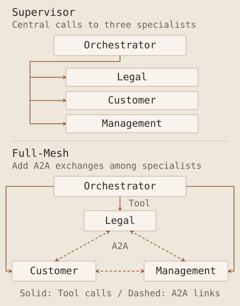

This is the final record of the AI Agent development course on 12 October. In the previous Note, I described a single agent's tools and memory. Here I cover invoking other agents, coordinating different perspectives and applying the approach in the final project.

The project was a training application examining fictional insurance cases. It gathered legal, customer and management perspectives and displayed the discussion. I implemented the role-based reviews and coordination, then checked their operation. This did not validate insurance decisions or an operational deployment.

## What orchestration needs to define

Orchestration assigns agent roles and coordinates who does what and when. Alongside the number of agents, it defines their inputs, where results go and when work stops.

This differs from managing development sessions in Agent View. Agent View helped build the application; orchestration defined how agents behaved inside it. The final project used both.

| Pattern                 | How it connects work                                                  |
| ----------------------- | --------------------------------------------------------------------- |
| Supervisor              | A central agent delegates work and gathers results                    |
| Hand-off                | Work moves to the agent suited to the next role                       |
| Parallel fan-out/fan-in | Independent tasks run concurrently before their results are collected |
| Group Chat              | Agents exchange views through a shared conversation                   |
| Full-Mesh               | Participating agents are connected to exchange views with one another |

Of these patterns, I first implemented a Supervisor structure, then extended it to Full-Mesh.

The Full-Mesh in the lower panel connects the legal, customer and management specialists. It retains the Orchestrator's calls to them and adds A2A links for exchanges between specialists. I would begin with the roles and information paths a problem needs, then decide how much coordination is useful.

## What Tool, MCP and A2A connect

The first example let one agent invoke a small agent that added emojis to a sentence. After examining a subagent example, I changed it to an ordinary agent invoked through a tool, to suit the later communication exercises. This was a design choice for the course, rather than a general rejection of subagents for collaboration.

I then connected the invocation through MCP before returning to a direct tool call to simplify the structure. Similar output can conceal different choices about how a capability is exposed and connected.

| Element       | Distinct role                                                                |
| ------------- | ---------------------------------------------------------------------------- |
| Tool          | A concrete function the model can select and invoke                          |
| MCP           | A shared protocol for connecting applications to external tools and material |
| A2A           | A protocol for exchanging messages and work between agents                   |
| Orchestration | Coordination of roles, invocation order and stopping conditions              |

The [MCP introduction](https://modelcontextprotocol.io/docs/getting-started/intro) and [A2A documentation](https://a2a-protocol.org/latest/topics/what-is-a2a/) distinguish tool and data connections from agent collaboration. Other services can also be called through functions or ordinary HTTP APIs. The design question is whether a shared interface is useful, rather than whether external calls are possible without MCP.

## Explore A2A through a small feedback loop

The A2A exercise connected an emoji-producing agent to a feedback agent. It generated a result, received feedback and revised it, with at most three attempts. Generation and review were separated, and the loop had an explicit end.

I used **FastA2A**, with `/agents/{name}` routes in one FastAPI application instead of several servers. This kept the exercise on one computer. A2A message and task handling, and the deployment of servers and processes, are separate aspects to understand. I checked the message exchanges in the exercise. I did not perform a separate protocol-conformance test.

As the code grew, I separated individual agents from shared code. This made it easier to follow which agent was created, what it received and where its response was processed. I checked the same flow again after refactoring.

## Begin the final project with a Supervisor

The final project aimed to make several AI-generated perspectives available for a person to review. It retained the premise that experts make actual business decisions, while the application displays the review and coordination process.

I first connected the request-handling Orchestrator to `LegalReview`. I then added `CustomerReview` for the customer's perspective and `CEO` for the management perspective. At this stage, the Orchestrator invoked each agent as needed through tools: a Supervisor structure.

| Component          | Role in the project                                              |
| ------------------ | ---------------------------------------------------------------- |
| Orchestrator       | Receive the input, request relevant reviews and organise results |
| `LegalReview`      | Provide a legal perspective                                      |
| `CustomerReview`   | Provide a customer perspective                                   |
| `CEO`              | Provide a management perspective                                 |
| Interface and logs | Display active agents, exchanges and responses                   |

Initially, radio buttons indicated the active agent. The interface later gained a graph and logs. Animation helps explain execution state; reviewing a judgement requires reading the agents' actual inputs and returned opinions.

## Develop separately, then integrate

I used separate Agent View sessions and worktrees for frontend improvements and backend agent additions. After merging them, I checked the result on one server. This applied the earlier isolation-and-merge exercise to a larger application.

The testing rule changed later in the course because of time constraints. Earlier stages used Playwright MCP for interface checks; partway through the project, the instructions replaced it with lightweight `curl` requests. Completing the exercises and checking their operation does not mean every stage received the same automated browser coverage.

In my own projects, I need to record reductions in test scope as well as passing checks. Confirming a server response covers a different boundary from following a multi-agent conversation through the interface.

## Add Full-Mesh communication, memory and stopping rules

The next stage added A2A so that specialists could request one another's feedback. I first had the customer and management agents review `LegalReview` output, then extended the exchanges to the other agents.

Within one case, each agent retained its earlier statements and received feedback. Refreshing the page reset that memory. This differed from the persona chatbot, which retained information across conversations and server restarts. Here the state supported discussion within a case.

The coordination loop allowed at most two rounds and ended earlier on agreement. This was a different limit from the emoji example's three attempts. The number controlled the exercise; it was not a criterion guaranteeing accuracy or agreement.

Several perspectives do not automatically make a final judgement sound. Agents sharing the same material or mistaken premise can reach similar errors. In an operational design, I would retain evidence, disagreements and points requiring human review alongside the outcome.

## A clean merge can still leave an inconsistent interface

An important integration problem appeared after parallel development. The backend had become Full-Mesh, but the frontend still drew the earlier connections because it had not incorporated that change. I identified the mismatch in the running interface, updated the frontend to match the new structure and merged again.

This differed from a Git conflict caused by competing edits to the same file. The files could merge while the two tasks assumed different behaviour. For future parallel work, I need a shared definition of the agent list, connections and state events consumed by the interface. A structural change should trigger a review of that contract and its display.

## Criteria to retain after the course

I finished by adding case-based conversations with in-progress, complete and deferred states, extending agent-role creation, editing and removal, and connecting reference documents to selected agents for use in their answers.

The day moved from a small API connection test through a single agent's tools and memory to multi-agent collaboration and integration of parallel development. Each added function introduced more inputs, outputs, execution states and results to inspect.

For my research, I would begin with a small problem one agent can handle. I can connect the necessary tools and material, verify the result, then separate the parts that actually benefit from another perspective. I need to explain what evidence each role contributes and who makes the final judgement.
