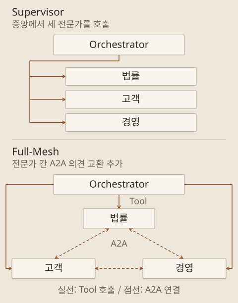

10월 12일 AI Agent 개발 교육의 마지막 기록입니다. 앞 글에서는 단일 에이전트가 도구와 기억을 사용하는 구조를 기술했습니다. 이어서는 다른 에이전트를 호출하는 방법과 여러 관점을 조율하는 방법을 배우고, 이를 최종 프로젝트에 적용했습니다.

프로젝트는 가상의 보험 심사 상황을 검토하는 앱이었습니다. 법률, 고객, 경영 관점을 나누어 의견을 모으고 그 과정을 화면에 보여 주는 교육용 예제였습니다. 역할별 검토와 의견 조율까지 구현하고 동작을 확인했습니다. 실제 보험금 지급 판단이나 업무 적용을 검증한 것은 아닙니다.

## 오케스트레이션에서 정할 것

오케스트레이션은 여러 에이전트의 역할을 나누고 누가, 언제, 무엇을 할지 조율하는 구조입니다. 에이전트 수를 늘리는 것뿐 아니라 어떤 입력을 주고, 결과를 누구에게 넘기며, 언제 작업을 끝낼지 정하는 일입니다.

이 단계의 협업은 앞서 Agent View에서 여러 개발 세션을 관리한 것과 구분됩니다. Agent View는 앱을 만드는 과정에서 사용했고, 오케스트레이션은 만들어진 앱 내부의 동작 구조였습니다. 마지막 프로젝트에서는 두 방식을 함께 사용했습니다.

| 협업 방식      | 작업을 연결하는 방법                                    |
| -------------- | ------------------------------------------------------- |
| Supervisor     | 중앙 에이전트가 다른 에이전트에 일을 맡기고 결과를 취합 |
| Hand-off       | 처리할 역할에 맞춰 다음 에이전트로 작업을 넘김          |
| 병렬 분산·취합 | 독립적인 작업을 동시에 처리한 뒤 결과를 모음            |
| Group Chat     | 여러 에이전트가 대화를 공유하며 의견을 교환             |
| Full-Mesh      | 참여 에이전트들이 서로 연결돼 의견을 주고받음           |

여러 협업 방식 가운데 Supervisor부터 구현하고, 이후 Full-Mesh로 확장했습니다.

도식 아래쪽의 Full-Mesh는 법률·고객·경영 전문가 사이의 연결을 뜻합니다. Orchestrator가 전문가를 호출하는 구조는 유지하고, 전문가끼리 의견을 주고받는 A2A 연결을 더했습니다. 모든 문제를 복잡한 협업으로 풀기보다, 필요한 역할과 정보 전달 경로부터 정해 보는 편이 합리적이라고 생각합니다.

## Tool, MCP, A2A는 각각 무엇을 연결하는가

먼저 문장에 이모지를 더하는 작은 에이전트를 다른 에이전트가 호출하도록 구성했습니다. 서브에이전트 예제를 살펴본 뒤, 교육의 이후 통신 구조에 맞춰 일반 에이전트를 Tool로 호출하는 방식으로 바꿨습니다. 이는 이번 예제의 설계 선택이었습니다. 서브에이전트가 일반적으로 협업에 부적합하다는 뜻으로 받아들일 필요는 없습니다.

다음에는 같은 호출을 MCP로 연결했다가, 구조를 단순하게 살펴보기 위해 다시 직접 Tool 호출로 돌렸습니다. 출력이 비슷해도 도구를 어떻게 공개하고 연결하는지는 달라질 수 있다는 예제였습니다.

| 요소           | 구분할 역할                                                   |
| -------------- | ------------------------------------------------------------- |
| Tool           | 모델이 선택해 호출할 수 있는 구체적인 기능                    |
| MCP            | 앱과 외부 도구·자료를 연결하는 공통 프로토콜                  |
| A2A            | 에이전트 사이의 메시지와 작업 교환을 위한 프로토콜            |
| 오케스트레이션 | 연결된 구성 요소들의 역할·호출 순서·종료 조건을 조율하는 구조 |

[MCP 소개](https://modelcontextprotocol.io/docs/getting-started/intro)와 [A2A 공식 설명](https://a2a-protocol.org/latest/topics/what-is-a2a/)에서도 도구·자료 연결과 에이전트 간 협업의 초점을 구분합니다. 직접 함수 호출이나 일반 HTTP API로도 다른 서비스를 이용할 수 있습니다. MCP를 써야만 외부 호출이 가능해지는 것은 아니며, 공통 인터페이스가 필요한 상황인지 판단해야 합니다.

## 작은 피드백 예제로 A2A 살펴보기

A2A 예제에서는 이모지를 추가하는 에이전트와 그 결과에 피드백을 주는 에이전트를 연결했습니다. 결과를 만든 뒤 피드백을 받아 수정하고, 재시도는 최대 세 번으로 제한했습니다. 결과 생성과 검토를 분리하면서 반복의 끝도 지정한 구조였습니다.

**FastA2A**를 사용해 여러 서버 대신 하나의 FastAPI 앱 안에 `/agents/{이름}` 경로를 뒀습니다. 한 컴퓨터에서 실습하기 위한 배치 방식이었습니다. A2A의 메시지와 작업 처리 규칙, 앱을 배치하는 서버·프로세스 구조는 각각 이해해야 할 항목입니다. 실습에서는 메시지를 주고받는 동작을 확인했습니다. 별도의 프로토콜 적합성 시험까지 수행하지는 않았습니다.

코드가 커진 뒤에는 에이전트별 파일과 공통 코드를 분리했습니다. 어떤 에이전트를 만들고 무엇을 전달하며 응답을 어디에서 처리하는지 따라 읽기 쉬워졌습니다. 분리한 뒤에도 같은 흐름이 동작하는지 다시 확인했습니다.

## 최종 프로젝트: 먼저 Supervisor로 구성하기

마지막 프로젝트의 목표는 AI가 제시하는 여러 의견을 사람이 검토할 수 있게 하는 것이었습니다. 실제 업무의 최종 결론은 전문가가 판단한다는 전제를 두고, 앱은 관점별 검토와 조율 과정을 보여 주도록 구성했습니다.

처음에는 요청을 받는 Orchestrator와 법률 검토 역할인 `LegalReview`를 연결했습니다. 이후 고객 관점의 `CustomerReview`, 경영 관점의 `CEO`를 추가했습니다. 이 단계에서는 Orchestrator가 필요에 따라 각 에이전트를 Tool로 호출하는 Supervisor 구조였습니다.

| 구성 요소        | 프로젝트에서 맡은 역할                        |
| ---------------- | --------------------------------------------- |
| Orchestrator     | 입력을 받아 필요한 검토를 요청하고 결과 정리  |
| `LegalReview`    | 법률 관점의 의견 제시                         |
| `CustomerReview` | 고객 관점의 의견 제시                         |
| `CEO`            | 경영 관점의 의견 제시                         |
| 화면과 로그      | 현재 동작 중인 에이전트와 전달·응답 내용 표시 |

화면에는 우선 라디오 버튼으로 동작 중인 에이전트를 표시했습니다. 이후 그래프와 로그로 확장했습니다. 화면의 움직임은 실행 상태를 이해하기 위한 표현입니다. 판단 내용을 검토하려면 각 에이전트가 받은 입력과 실제로 반환한 의견을 함께 읽어야 합니다.

## 역할을 나눠 개발하고 다시 합치기

프론트엔드 개선과 백엔드 에이전트 추가는 Agent View에서 세션을 나누고 별도 worktree로 개발했습니다. 각 작업을 병합한 뒤에는 하나의 서버에서 결과를 다시 확인했습니다. 작업 분리와 병합을 앞의 작은 예제보다 큰 앱에서 적용한 셈입니다.

교육 후반에는 시간 제약으로 테스트 규칙도 달라졌습니다. 앞에서는 Playwright MCP로 화면 동작을 확인했지만, 프로젝트 중에는 이를 생략하고 `curl`을 이용한 가벼운 요청 확인으로 바꿨습니다. 실습 완료와 정상 동작을 확인했더라도, 모든 단계가 같은 범위의 자동 브라우저 테스트를 거쳤다는 뜻은 아닙니다.

내 프로젝트에 적용할 때는 어떤 검증을 줄였는지도 작업 기록에 남겨야겠습니다. 서버가 응답하는지 확인하는 것과 화면에서 여러 역할의 대화가 제대로 이어지는지 확인하는 것은 범위가 다릅니다.

## Full-Mesh로 확장하며 기억과 종료 조건 정하기

다음 단계에서는 각 전문가가 다른 전문가에게 피드백을 요청하도록 A2A를 더했습니다. 먼저 `LegalReview`의 결과를 고객·경영 에이전트가 검토하게 하고, 이후 다른 에이전트에서도 서로 의견을 요청할 수 있도록 확장했습니다.

하나의 사건을 검토하는 동안은 각 에이전트가 자신이 앞서 말한 내용과 받은 피드백을 기억하도록 했습니다. 반면 페이지를 새로고침하면 그 기억을 초기화하는 조건을 뒀습니다. 앞의 페르소나 챗봇이 대화와 서버 재시작을 넘어 기억을 유지했던 것과는 목적이 다릅니다. 이 프로젝트의 기억은 사건 안에서 의견을 조율하기 위한 상태였습니다.

의견 조율은 최대 두 번, 동의하면 일찍 끝내도록 정했습니다. 앞의 이모지 예제의 세 번과는 다른 설정입니다. 반복 횟수는 교육 예제의 제어 조건이며, 그 횟수가 정확도나 합의를 보장하는 기준은 아닙니다.

여러 관점을 만들었다고 해서 최종 판단이 자동으로 타당해지는 것도 아닙니다. 같은 자료나 잘못된 전제를 공유하면 의견이 비슷하게 틀릴 수 있습니다. 실제 업무에서는 근거와 불일치한 의견, 사람이 확인할 지점을 결과와 함께 남기는 방식으로 설계해야겠습니다.

## 충돌 없이 병합했어도 화면이 맞지 않을 수 있다

병렬 개발 뒤에는 중요한 통합 문제가 등장했습니다. 백엔드는 Full-Mesh로 바뀌었는데, 프론트엔드는 그 변경을 모르고 이전 연결 구조를 그렸습니다. 실행 화면에서 이 차이를 확인하고 새 구조에 맞게 프론트엔드를 수정한 뒤 다시 병합했습니다.

이 문제는 같은 파일을 다르게 수정해서 발생하는 Git 충돌과 달랐습니다. 파일은 합칠 수 있어도 두 작업이 가정한 동작 구조가 달랐던 것입니다. 앞으로 작업을 나눌 때는 화면이 참조할 에이전트 목록, 연결 정보와 상태 이벤트를 함께 정해 둬야겠습니다. 구조를 바꾸면 그 계약과 화면도 같이 확인해야 합니다.

## 교육을 마치고 남겨 둘 기준

마지막에는 사건별 대화와 진행·완료·보류 상태를 추가하고, 에이전트 역할을 추가·수정·삭제할 수 있도록 확장했습니다. 참고 문서를 특정 에이전트에 연결해 답변에 활용하는 기능까지 구현했습니다.

하루의 흐름은 작은 API 연결 검증에서 시작해 단일 에이전트의 도구·기억, 여러 에이전트의 협업, 병렬 개발 결과의 통합으로 이어졌습니다. 각 기능을 추가할 때마다 입력과 출력, 실행 상태와 확인할 결과가 늘어났습니다.

내 연구에 적용한다면 먼저 한 에이전트로 처리할 수 있는 작은 문제부터 정하고 싶습니다. 필요한 도구와 자료를 연결해 결과를 검증한 뒤, 실제로 다른 관점의 검토가 필요한 부분을 나누는 순서가 좋겠습니다. 역할을 많이 만드는 것보다 그 역할이 어떤 근거를 더하고 누가 최종적으로 판단하는지를 설명할 수 있어야 합니다.
