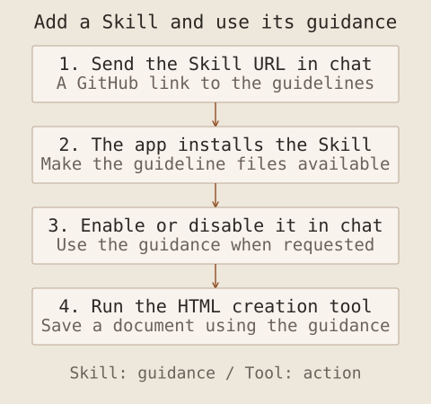

This is the second record of the AI Agent development course on 12 October. In the previous Note, I described dividing development work across Claude Code sessions and Git worktrees. Here I cover building an API-based AI application and adding tools and memory to explore how an agent operates.

The examples were a defect-report analysis application and a persona chatbot. I built both applications and checked their operation. The central method was to check input material, the API connection, the basic application, tools and memory in stages.

## Prepare the material for analysis

The first example accepted smartphone defect reports, analysed them, displayed a summary and dashboard, and supported conversation about their contents. I used a PDF-generation Skill to create fictional reports instead of using real business data. Document generation and application development were separate projects.

In the document project, `CLAUDE.md` defined a two-page report. The first page contained document identification, product, department, defect type and preparation, review and approval fields. The second contained defect rates, severity, action status, reproduction steps and improvements. The aim was to prepare numerical material for later analysis and charts.

`PLAN.md` outlined ten scenarios, of which five were produced as PDFs during the course. I checked one sample before generating the others. Defining the input fields first provided a basis for checking whether the later analysis retained the required information.

The defect rates and causes were generated for the exercise, rather than measured product-quality results. In my research, I also need to distinguish checking functionality with synthetic data from validating an analysis against real material.

## Test the API before building the application

Before the dashboard, I developed a PoC: a Proof of Concept, or a small technical test of whether the required functionality could be implemented. I first opened a web page and checked that a request to the Claude API returned a response.

I used FastAPI for the backend and HTML and JavaScript for the frontend. Starting with a minimal web application, I added API-key input, a connection check, simple chat and error reporting. For this PoC, I connected to the API directly without an SDK. In another project, the required features and maintenance approach can guide that choice.

Checking a small PoC first helped separate connection problems from application problems. I entered the API key in the PoC interface to check the connection, then used `.env` to load it in the later examples. In an actual project, I need to keep credentials out of source code, public repositories and error logs.

## Define requirements and extend to PDF analysis

After checking the API, I cleared the PoC-specific purpose and conversation context before moving to the analysis application. One report became `sample.pdf` as a format reference, while `CLAUDE.md` and `docs/PRD.md` described the application. The PRD, or Product Requirements Document, set out its required behaviour.

| Requirement                 | Flow to check                                             |
| --------------------------- | --------------------------------------------------------- |
| API connection              | Enter the main interface after checking the connection    |
| Multiple-PDF analysis       | Load reports, analyse them and retain the results as text |
| Inspect analysis            | Read the collected material                               |
| Summary and dashboard       | Summarise the reports and inspect charts                  |
| Document-based conversation | Ask and answer questions about the reports                |

The requirements provided a basis for finding missing functions as well as judging the interface. I could also follow how preparing the material connected to summarising and presenting it.

For a research application, I would add checks that values match their sources, fields from different documents are combined consistently, and answers identify their supporting documents. These remain criteria to add when applying the approach to my own research.

## Extend to an agent that calls tools

I then built a tool-using agent with **Deep Agents**. Connecting tools to an LLM lets the model select a function and use its result to continue the task.

The distinction between a workflow and an agent lies in control: a workflow follows predefined API paths, while an agent lets the model select subsequent actions and tool use. Anthropic's [agent design article](https://www.anthropic.com/engineering/building-effective-agents) distinguishes the two. Applications with AI features need not all have the same autonomy.

Deep Agents provided the framework for this work. Its [official documentation](https://docs.langchain.com/oss/python/deepagents/overview) describes a harness supporting tool execution, context management and delegation. I began with a small example that created an agent, ran it with `invoke` and read the response messages. The `invoke` call passes input to the prepared agent, runs it and returns the result.

The system prompt held the role, goal and constraints. The same model can perform different tasks depending on that role and the tools provided. I specified `claude-sonnet-4-6` and `medium` effort for the exercises. These were implementation conditions, rather than settings selected through a model-performance comparison.

## Add tools and a Skill to the persona chatbot

The persona chatbot began with character selection and basic conversation, without tools or Skills. I then added a current-time tool, an HTML creation and storage tool, and a design-guideline Skill.

| Component          | Role in the exercise                                       |
| ------------------ | ---------------------------------------------------------- |
| System prompt      | Specify the selected character's personality and responses |
| Current-time tool  | Query the time instead of relying on a model's guess       |
| HTML creation tool | Save a document on the server and return a link            |
| Design Skill       | Supply presentation and design guidance                    |
| Memory             | Preserve information for later conversations               |

A Skill supplies procedures and guidance; a tool performs an action. I used the public `brand-guidelines` Skill to create an HTML card displaying the current time. I could see the distinction between the criteria for making a document and the mechanism for creating and saving it.

I also built a way to add new working instructions to the chatbot by importing a Skill published on GitHub. For example, sending the GitHub page URL for `brand-guidelines` in chat lets the application retrieve and install that Skill for use. I made it possible to request that the Skill be used or left unused in subsequent conversation. This allows design guidance to be added when needed.

The Skill supplies the criteria for making a document; the HTML creation tool creates and saves the actual file using that guidance. For my own environment, I need to examine external instructions and executable code and define the permitted scope. Reading development guidance and executing arbitrary code require separate permission decisions.

## Separate conversation history from persistent memory

I implemented memory by saving conversation information to a file and loading it on a later run. In the small example, I designated `AGENTS.md` as the memory file. Here it was the agent application's memory store, a different role from a development project's working instructions despite the shared filename.

The persona chatbot gained character selection, new conversations and a recent-conversation list. I configured and checked continuity with the same character across new conversations and after restarting the server. I checked both storage and retrieval in a later exchange.

In an application of my own, I also need to define ownership and retention. Sharing every memory across characters or always restoring outdated information could mix contexts. The storage boundary and retrieval criteria matter alongside the amount saved.

## Check code and interface together

Development began with small pieces of code that I read and ran before adding functionality. I followed the path from a FastAPI request through model and tool use to the response displayed on screen. As the code grew, separating the web-server and agent components made it easier to review.

I also connected Playwright MCP to check chat responses automatically and retain screenshots. I then used the interface directly. Reviewing both execution reports and the actual interaction gave Human-in-the-loop a concrete form.

This stage connected a single agent's tools and memory. The next Note covers invoking other agents, the roles of MCP and A2A, and the final project coordinating several perspectives.
