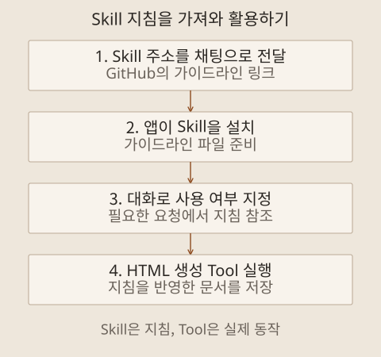

10월 12일 AI Agent 개발 교육의 두 번째 기록입니다. 앞 글에서는 Claude Code의 여러 세션과 Git worktree로 개발 작업을 나누는 방법을 기술했습니다. 다음 단계에서는 API를 사용하는 AI 앱을 만들고, 도구와 기억을 더하면서 에이전트가 어떻게 동작하는지 살펴봤습니다.

예제는 불량 보고서를 분석하는 웹 앱과 페르소나 챗봇이었습니다. 두 앱을 직접 만들고 동작을 확인했습니다. 기능을 한 번에 붙이기보다 입력 자료, API 연결, 기본 앱, 도구와 기억으로 나누어 확인하는 순서가 이 단계의 중심이었습니다.

## 분석할 자료부터 준비하기

첫 예제는 스마트폰 불량 보고서를 올리면 내용을 분석하고, 요약과 대시보드를 보여 주며 관련 내용에 대해 대화하는 앱이었습니다. 실제 업무 자료 대신 PDF 생성 Skill을 사용해 가상의 보고서를 만들었습니다. 문서 생성과 분석 앱 개발을 별도 프로젝트로 나눴습니다.

문서 생성 프로젝트에서는 `CLAUDE.md`에 두 페이지 보고서의 구조를 기록했습니다. 첫 페이지에는 문서번호와 제품·부서·불량 유형, 작성과 검토·승인 항목을 넣고, 둘째 페이지에는 불량률, 심각도, 조치 상태와 재현 방법·개선 내용을 담도록 했습니다. 이후 분석과 차트에 사용할 수 있도록 수치가 있는 자료를 준비하는 것이 목적이었습니다.

`PLAN.md`에는 열 개의 시나리오를 계획하고, 실제 교육에서는 그중 다섯 개를 PDF로 생성했습니다. 먼저 한 개를 만든 뒤 형식을 확인하고 나머지를 추가했습니다. 입력 자료의 항목을 먼저 정해 두면 뒤에서 분석 결과가 필요한 내용을 담았는지 비교할 수 있습니다.

여기서 불량률이나 원인 설명은 예제용으로 생성한 내용입니다. 실제 제품 품질을 측정한 결과로 읽어서는 안 됩니다. 내 연구에 적용할 때도 합성 데이터로 기능을 확인하는 단계와 실제 자료에서 분석의 타당성을 검증하는 단계를 구분해야겠습니다.

## 전체 앱 전에 API 연결부터 검증하기

곧바로 대시보드를 만들기 전에 PoC를 진행했습니다. PoC는 Proof of Concept, 필요한 기능을 구현할 수 있는지 작은 형태로 확인하는 기술검증입니다. 먼저 웹페이지를 띄우고, Claude API에 요청해 응답을 받을 수 있는지 확인했습니다.

백엔드는 FastAPI, 프론트엔드는 HTML과 JavaScript로 구성했습니다. 가장 작은 웹 앱에서 시작해 API 키 입력, 연결 확인, 간단한 채팅과 오류 표시를 추가했습니다. 이 PoC에서는 SDK 없이 API를 직접 연결했습니다. 다른 프로젝트에서는 필요한 기능과 유지보수 방식을 보고 SDK 사용 여부를 결정하면 됩니다.

작은 PoC에서 응답을 확인한 뒤 확장하니, 연결 자체의 문제와 앱 기능의 문제를 나눠 볼 수 있었습니다. PoC 화면에서 API 키를 입력해 연결을 확인했고, 뒤의 예제에서는 `.env`에서 키를 읽는 방식을 사용했습니다. 실제 프로젝트에서는 키가 코드·공개 저장소·오류 로그에 남지 않도록 관리해야 합니다.

## 요구사항을 적고 PDF 분석 앱으로 확장하기

API 연결을 확인한 뒤에는 PoC의 목적과 대화 맥락을 정리하고 분석 앱으로 넘어갔습니다. 예제 PDF 하나를 `sample.pdf`로 준비해 형식을 참조하게 하고, `CLAUDE.md`와 `docs/PRD.md`에 만들 앱을 설명했습니다. PRD는 제품 요구사항 문서로, 어떤 기능이 있어야 하는지 정리한 문서입니다.

| 요구사항        | 앱에서 확인할 흐름                            |
| --------------- | --------------------------------------------- |
| API 연결 확인   | 연결 확인 뒤 본 화면으로 진입                 |
| 여러 PDF 분석   | 보고서를 불러와 내용을 분석하고 텍스트로 정리 |
| 분석 내용 확인  | 정리한 자료를 모아 읽기                       |
| 요약과 대시보드 | 전체 내용을 요약하고 차트로 살펴보기          |
| 자료 기반 대화  | 불량 보고서 내용을 바탕으로 질문하고 응답받기 |

요구사항 문서가 있으니 화면의 모양뿐 아니라 빠진 기능을 확인할 기준도 생겼습니다. 분석할 자료를 정리하는 단계와 그 자료를 요약·표현하는 단계가 연결돼 있다는 점도 볼 수 있었습니다.

연구 자료를 다루는 앱이라면 여기서 한 단계 더 확인해야 합니다. 수치가 원문과 맞는지, 서로 다른 문서의 항목을 같은 기준으로 합쳤는지, 답변이 어느 문서에 근거하는지 살펴봐야 합니다. 이 부분은 내 연구에 적용할 때 추가할 검증 기준으로 남겨 둡니다.

## 도구를 호출하는 에이전트로 확장하기

다음에는 **Deep Agents**로 도구를 사용하는 에이전트를 만들었습니다. LLM에 Tool을 연결하면 모델이 필요한 도구를 고르고 실행 결과를 이용해 다음 작업을 이어갈 수 있습니다.

미리 정한 순서대로 API를 호출하는 워크플로와 모델이 다음 행동과 도구 사용을 선택하는 에이전트는 제어 방식이 다릅니다. Anthropic의 [에이전트 설계 설명](https://www.anthropic.com/engineering/building-effective-agents)도 이 차이를 구분합니다. AI 기능이 있다는 이유만으로 모든 앱을 같은 수준의 자율성을 가진 에이전트로 볼 필요는 없습니다.

Deep Agents는 이 과정을 구성하는 프레임워크였습니다. [공식 문서](https://docs.langchain.com/oss/python/deepagents/overview)는 도구 실행과 컨텍스트 관리, 위임 등을 지원하는 하네스로 설명합니다. 먼저 에이전트를 생성하고 `invoke`로 실행한 뒤 응답 메시지를 읽는 작은 예제부터 만들었습니다. `invoke`는 준비한 에이전트에 입력을 전달해 실행하고 결과를 돌려받는 호출입니다.

역할과 목표, 제약은 시스템 프롬프트에 담았습니다. 같은 모델을 사용하더라도 부여한 역할과 제공한 도구에 따라 할 수 있는 작업이 달라집니다. 실습에서는 모델을 `claude-sonnet-4-6`, effort를 `medium`으로 지정했습니다. 다른 모델과 비교해 고른 설정은 아니며, 이번 구현에 사용한 조건입니다.

## 페르소나 챗봇에 Tool과 Skill 추가하기

페르소나 챗봇은 캐릭터를 고르고 대화하는 앱이었습니다. 처음에는 도구와 Skill 없이 최소한의 채팅부터 구성했습니다. 이후 현재 시각을 확인하는 도구, HTML 문서를 만들어 저장하는 도구, 디자인 가이드라인 Skill을 차례로 더했습니다.

| 구성 요소       | 실습에서 맡은 역할                          |
| --------------- | ------------------------------------------- |
| 시스템 프롬프트 | 선택한 캐릭터의 성격과 응답 방식 지정       |
| 현재 시각 Tool  | 모델의 추측 대신 실행 시각 조회             |
| HTML 생성 Tool  | 문서를 서버에 저장하고 열 수 있는 링크 반환 |
| 디자인 Skill    | 문서를 만들 때 참고할 표현·디자인 지침 제공 |
| 기억            | 이후 대화에서 다시 사용할 정보 보존         |

Skill은 작업 방법과 지침을 제공하고, Tool은 실제 행동을 수행합니다. 공개된 `brand-guidelines` Skill을 사용해 현재 시각을 보여 주는 HTML 카드를 만들었습니다. ‘어떤 기준으로 만들 것인가’와 ‘파일을 어떻게 만들고 저장할 것인가’가 나뉘는 구조를 확인할 수 있었습니다.

챗봇에 새로운 작업 지침을 추가할 수 있도록, GitHub에 공개된 Skill을 가져오는 기능도 만들었습니다. 예를 들어 `brand-guidelines`가 있는 GitHub 페이지의 주소를 채팅으로 전달하면, 앱이 해당 Skill을 가져와 사용할 수 있도록 설치합니다. 이후 대화에서 그 Skill을 사용하거나 사용하지 않도록 요청할 수 있게 했습니다. 디자인 지침을 적용하고 싶을 때 필요한 Skill을 추가해 쓰는 방식입니다.

Skill은 문서를 어떤 기준으로 만들지 알려 주는 지침이고, HTML 생성 Tool은 그 지침을 반영한 파일을 실제로 만들고 저장하는 기능입니다. 내 환경에 적용할 때는 외부 지침과 실행 코드를 확인하고 허용할 범위를 정해야겠습니다. 개발 지침을 읽는 기능과 임의의 코드를 실행하는 권한은 구분해서 설계해야 합니다.

## 대화 이력과 오래 남길 기억 구분하기

대화 내용을 파일에 남기고 다음 실행에서 다시 참조하도록 기억 기능도 구현했습니다. 작은 예제에서는 `AGENTS.md`를 기억 파일로 지정했습니다. 이름이 같더라도 여기서는 에이전트 앱의 기억 저장소로 사용한 것이며, 개발 프로젝트의 작업 규칙 파일과 역할을 구분해야 합니다.

페르소나 챗봇에는 캐릭터 선택, 새 대화와 최근 대화 목록을 추가했습니다. 같은 캐릭터와 새 대화를 시작해도 앞의 내용을 기억하고 서버를 다시 실행한 뒤에도 유지하도록 구성해 동작을 확인했습니다. 기록을 파일에 저장하는 것과 다음 대화에서 그 정보를 불러와 사용하는 것을 함께 확인하는 실습이었습니다.

앱을 직접 설계할 때는 어떤 정보가 누구에게 속하는지, 얼마나 보존할지까지 정해야겠습니다. 모든 캐릭터가 같은 기억을 공유하거나 오래된 정보를 무조건 다시 넣으면 대화가 섞일 수 있습니다. 기억은 많이 저장하는 것만큼 저장 범위와 다시 읽는 기준이 중요합니다.

## 코드와 화면을 함께 확인하기

개발 중에는 작은 코드를 먼저 읽고 실행한 뒤 기능을 추가했습니다. FastAPI가 요청을 받고, 에이전트가 모델과 도구를 사용하고, 결과가 화면에 전달되는 흐름을 확인하는 방식이었습니다. 구조가 커지면 웹 서버 부분과 에이전트 부분을 나누어 다시 읽었습니다.

Playwright MCP를 연결해 채팅 응답을 자동으로 확인하고 테스트 화면을 남기는 절차도 적용했습니다. 자동 확인 뒤에는 직접 화면을 사용해 동작을 확인했습니다. 실행 성공 메시지와 실제 이용 흐름을 함께 보는 과정이 Human-in-the-loop의 구체적인 형태였습니다.

이 단계에서 단일 에이전트의 도구 사용과 기억까지 연결했습니다. 다음 글에서는 다른 에이전트를 호출하는 방법, MCP와 A2A의 역할, 여러 관점을 조율하는 최종 프로젝트를 정리합니다.
