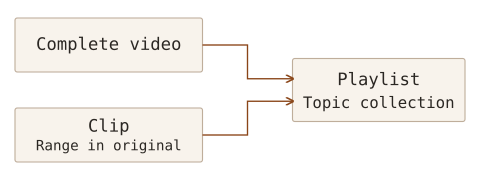

On 15 October 2026, I attended a webinar on using AVON, an academic video database covering a broad range of subjects. Having mainly searched for papers and books, I found it useful to consider video as research material that can also be searched, cited and revisited.

The [Korean AVON guide](https://proquest.libguides.com/avonkr) brings together the recording, teaching material and explanations of menus and functions. It is a useful reference when checking a feature again. Here I want to retain the sequence of narrowing a search, locating relevant passages in a transcript, and organising clips and citation details.

## What AVON contains

**Academic Video Online (AVON)** is an academic video collection available through the Alexander Street platform. It covers history, anthropology, business and economics, psychology and counselling, education, health, science, music and performing arts. Formats include documentaries, news, interviews, lectures, demonstrations, training videos and recorded performances.

The 2026 session described a growing collection of more than 85,000 videos. Material comes from producers including the BBC and PBS, so each video's production date, format and purpose need attention. **Recently added** and **recently produced** are different: an older video can appear among recent additions when it enters the collection.

I also need to distinguish the nature of the material. Interviews record particular experiences or perspectives, while news and documentaries combine events with choices made by their producers. Before using a passage in my own explanation, I need to establish who made it, when and why, and what the statement or scene actually supports.

## Institutional access and a personal account

The starting point is the AVON link under electronic resources, databases, multimedia or similar sections of the university library website. Menu names and off-campus access arrangements vary by institution, so check the library's instructions.

The session covered library login through a proxy and access through RISS. If the appropriate route is unclear, ask the institutional library. Access to the collection and signing into a personal AVON account serve different purposes.

| Access or account     | Purpose                                                              |
| --------------------- | -------------------------------------------------------------------- |
| Institutional access  | Accessing video material under the institution's entitlement         |
| Personal AVON account | Saving and managing clips, Watchlist, Playlist and Interactions work |

After gaining institutional access, basic searching and viewing do not require a personal account. Creating clips or saving material to lists requires a separate personal account. Creating that account should not be understood as automatically granting institutional access to the collection.

## Narrowing a search with terms and filters

The search box can be used alongside subject browsing through **Browse**. The interface can be displayed using automatic Korean translation, but the demonstration used English search terms. Interface language and the terms used to find material need to be considered separately.

When results are numerous, combine filters for subject, content type, duration and production or release year. The demonstration selected psychology, narrowed it to educational material, and then added duration and date conditions. Before applying a date limit, it is worth considering whether older material is relevant to the subject.

**Grid view** helps when scanning thumbnails; **List view** supports comparison of titles, production information, duration and descriptions. Open **More details** or **Details** to examine a candidate's producer, year, length and summary. A matching search term is only the start: the material still needs to address the question being investigated.

## Finding a passage in the transcript, then checking the video

The **Transcript** presents speech as searchable text. It follows the current playback position, and selecting a passage can move the video to that point. This provides more specific clues than searching titles or descriptions alone.

Entering a term in transcript search locates the passages where it occurs. In the demonstration, searching for `foods` produced several matches, and selecting one moved playback to the corresponding point. This helps locate relevant speech without searching through a long recording again from the beginning.

Before using the passage, check the surrounding speech and scenes. A single matching sentence may not establish the speaker's intention or the scope of the explanation. I intend to retain the timestamp alongside the title so that I can return to the scene later.

The transcript and on-screen captions also serve different purposes. The transcript supports searching and navigation, while captions help follow speech during viewing. The demonstration also covered automatically translated Korean captions, playback speed and quality settings. If a translated sentence becomes important evidence, check the original speech and context again.

## How Watchlist, Playlist and Clip differ

Not every video found during a search needs to be kept in the same way. The choice depends on whether it is a candidate for later review, part of a topic collection or a particular passage to revisit.

| Feature   | What it retains or organises                    | When it is useful                                                 |
| --------- | ----------------------------------------------- | ----------------------------------------------------------------- |
| Watchlist | Videos of potential interest                    | Collecting candidates during a search for later review            |
| Playlist  | Videos and clips grouped by topic               | Organising and sharing material for a presentation or study topic |
| Clip      | A start and end range within the original video | Replaying a particular scene or sharing a link to it              |

Selected Watchlist candidates can later be added to a Playlist. A Playlist can contain both complete videos and clips representing selected passages.

This distinction preserves the context of the complete video while making passages for presentations or discussions easier to find. Saved material can be revisited through the clips, Playlist and Watchlist sections of the personal profile.

## Retaining a useful passage as a clip

To create a clip, open **Create Clip** under **Clips**, then specify a title, description, start and end times, and visibility. Although the demonstration used English for searching, personal clip titles and notes can be written in Korean. A short explanation of why the passage matters will be more useful later than a title alone.

The demonstration selected a range in the original video, created a clip, and showed how to copy its link or add it to a Playlist. Saving a clip manages a playback range and link within the original. It is distinct from downloading a video file and editing it separately.

Visibility options include private, institutional and public access to the clip. Choose the appropriate scope and check it again before sharing. A public clip or shared link does not itself grant access to someone without the necessary entitlement to the original video. Also distinguish a link to the complete video from a link to a particular clip.

## Recording a source and timestamp for video

The **Citation** function offers formats such as APA, Chicago and MLA and allows the reference to be copied. Check generated details against the original title, producer and year. The demonstration included APA 6th edition and MLA 8th edition, so the required style and edition still need to be checked for the actual manuscript.

References can also be downloaded as `RIS` files for import into a reference manager. This connects video material with the process I described in _Connecting Literature Management and Citation with EndNote Fusion_. The download here contains bibliographic information, rather than the video file itself.

When using a particular scene or statement as evidence, I need to record its timestamp alongside the reference for the complete video. A clip link alone may make the original source difficult to identify, so I intend to retain its title, production details and relevant range together. Access to material and permission to reuse it also require separate checks.

## Adding questions with Interactions

**Interactions** supports questions, discussions and surveys alongside video viewing. A personal account is used to create the activity, with templates supporting multiple-choice and open-response questions, fill-in-the-blank tasks, surveys and discussions.

To create a question, select the required type from a template, write the question and its options, then save it. The webinar used a multiple-choice example to work through this process.

For a presentation or study group, I could establish a question before viewing a scene and compare interpretations afterwards. Questions could ask participants to explain the evidence they found, as well as check whether they remember the content.

## Connecting this with my own research

The webinar helped me consider video as material with searchable speech, production details and citation information. In future searches, I intend to narrow candidates with terms and filters, then check passages found in the transcript against the video's context. For material I may use again, I will retain the original source, timestamp and reason for keeping it, so that viewing can feed into later reading and writing.
