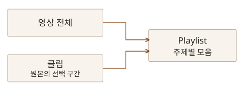

2026년 10월 15일 「전 주제분야 학술 동영상 자료 DB, AVON 이용교육」 웨비나를 들었습니다. 그동안 논문과 책을 중심으로 자료를 찾아왔는데, 이번에는 영상도 검색하고 출처를 남기며 다시 활용할 수 있는 연구 자료로 살펴봤습니다.

[AVON 한국어 이용 안내](https://proquest.libguides.com/avonkr)에는 교육 녹화 영상과 교재, 메뉴와 기능별 설명이 모여 있습니다. 필요한 기능을 다시 확인할 때 참조하면 좋은 페이지입니다. 이번에는 검색으로 자료를 좁히고, 대본에서 필요한 부분을 찾은 뒤, 클립과 인용 정보로 정리하는 흐름을 남겨두려 합니다.

## AVON에서 찾을 수 있는 자료

**Academic Video Online(AVON)**은 Alexander Street 플랫폼에서 제공하는 학술 동영상 컬렉션입니다. 역사와 인류학, 경영·경제, 심리·상담, 교육, 보건, 과학, 음악과 공연예술 등 여러 주제를 다룹니다. 다큐멘터리뿐 아니라 뉴스, 인터뷰, 강의, 시연과 훈련 영상, 공연 실황도 포함합니다.

2026년 교육에서는 8만 5천 편 이상의 자료를 제공하며 계속 추가된다고 설명했습니다. BBC, PBS 등 여러 제작사의 영상을 모아 제공하므로, 자료마다 제작 시점과 형식, 목적을 살펴야 합니다. 특히 **최근 추가된 자료**와 **최근에 제작된 자료**는 구분해야 합니다. 오래된 영상도 컬렉션에 새로 들어오면 최근 추가 목록에 나타날 수 있습니다.

자료의 성격도 구분해서 읽어야겠습니다. 인터뷰는 특정 인물의 경험이나 관점을, 뉴스와 다큐멘터리는 사건의 맥락과 제작자의 구성을 함께 담습니다. 내 설명에 활용하려면 누가 언제 어떤 목적으로 만든 영상인지, 그 안의 발언이나 장면이 무엇을 뒷받침하는지 확인해야 합니다.

## 기관 접속과 개인 계정 구분하기

접속은 소속 대학 도서관의 **전자자료**, **Web DB**, **데이터베이스**, **멀티미디어** 등에 있는 AVON 링크에서 시작할 수 있습니다. 메뉴 이름과 교외 접속 방식은 기관마다 다르므로 도서관의 안내를 확인해야 합니다.

교외에서는 도서관 로그인과 프록시를 거치는 방법, RISS를 통한 이용 경로를 함께 살펴봤습니다. 어느 경로를 써야 하는지 불분명하면 소속 도서관에 확인하는 편이 좋습니다. 도서관을 통한 자료 이용과 AVON 안의 개인 계정 로그인은 역할이 다릅니다.

| 구분             | 역할                                                                 |
| ---------------- | -------------------------------------------------------------------- |
| 기관을 통한 접속 | 소속 기관의 이용 권한으로 영상 자료에 접근                           |
| AVON 개인 계정   | 클립, Watchlist, Playlist, Interactions 등 개인 작업을 저장하고 관리 |

기관을 통해 접속한 뒤 단순 검색과 시청만 한다면 개인 계정을 만들지 않고 이용할 수 있습니다. 클립을 만들거나 자료를 목록에 보관하려면 별도의 개인 계정이 필요합니다. 개인 계정을 만들었다고 기관의 자료 이용 권한까지 자동으로 생기는 것으로 이해해서는 안 됩니다.

## 검색어와 필터로 필요한 영상 좁히기

검색창에 단어를 넣는 방법과 주제별로 둘러보는 **Browse**를 함께 사용할 수 있습니다. 인터페이스는 한국어 자동 번역으로 볼 수 있지만, 이번 교육에서는 영어 검색어로 자료를 찾았습니다. 화면의 언어와 검색에 사용할 표현은 나눠 생각해야 합니다.

검색 결과가 많으면 주제, 자료 유형, 영상 길이, 제작·출시 연도 등의 필터를 조합해 범위를 줄일 수 있습니다. 시연에서는 심리학 분야에서 교육용 자료를 고르고, 길이와 연도 조건을 추가해 후보를 좁혔습니다. 날짜부터 제한하기보다 오래된 자료도 필요한 주제인지 먼저 판단하는 순서가 유용하겠습니다.

**Grid view**는 썸네일로 여러 영상을 훑어볼 때, **List view**는 제목과 제작 정보, 길이와 설명을 함께 비교할 때 활용할 수 있습니다. 후보 영상의 **More details**나 **Details**에서는 제작자와 제작연도, 길이, 내용 소개 등을 확인합니다. 검색어가 들어 있다는 이유만으로 선택하지 않고, 내 질문에 필요한 내용을 실제로 담고 있는지 살펴야 합니다.

## 대본에서 찾고 영상으로 확인하기

**Transcript**는 영상의 발화를 텍스트로 보여주는 대본입니다. 재생 중인 부분과 대본이 연동되고, 대본에서 특정 부분을 선택하면 해당 시점으로 이동할 수 있습니다. 영상 안에서 필요한 내용을 찾을 때 제목이나 소개글 검색보다 구체적인 단서를 얻을 수 있습니다.

대본 검색창에 단어를 넣으면 그 표현이 나오는 부분을 찾아 이동할 수 있습니다. 시연에서는 `foods`를 검색해 여러 일치 구간을 살펴보고, 선택한 구간으로 영상을 옮겼습니다. 긴 영상을 처음부터 끝까지 다시 탐색하지 않아도 필요한 발언이 있는 위치를 찾는 데 도움이 됩니다.

찾은 문장을 사용할 때는 앞뒤 장면과 발언도 함께 확인해야 합니다. 검색된 한 문장만으로 말한 사람의 의도나 설명의 범위를 판단하기는 어렵습니다. 내 기록에는 영상 제목과 함께 시점을 남겨, 나중에 해당 장면으로 돌아갈 수 있도록 하려 합니다.

대본과 화면 위 자막은 역할도 다릅니다. 대본은 내용을 검색하고 이동하는 데, 자막은 시청하면서 발화를 따라가는 데 활용합니다. 시연에서는 한국어 자동 번역 자막과 재생 속도·화질 설정도 살펴봤습니다. 번역된 문장이 중요한 근거가 된다면 원래 발화와 문맥을 다시 확인해야 합니다.

## Watchlist, Playlist, Clip은 무엇이 다른가

검색하다 발견한 영상을 모두 같은 방식으로 보관할 필요는 없습니다. 우선 후보를 담아둘지, 주제별로 정리할지, 특정 구간을 다시 볼지에 따라 기능을 나눠 사용할 수 있습니다.

| 기능      | 보관·정리하는 대상                  | 활용할 때                                  |
| --------- | ----------------------------------- | ------------------------------------------ |
| Watchlist | 관심 있는 영상 후보                 | 검색 중 일단 담아두고 나중에 검토          |
| Playlist  | 주제별로 묶은 영상과 클립           | 발표·학습 주제에 맞게 자료를 정리하고 공유 |
| Clip      | 원본 영상에서 지정한 시작·종료 구간 | 필요한 장면을 다시 재생하거나 링크로 전달  |

Watchlist에 모은 후보는 나중에 필요한 것만 Playlist로 옮길 수 있습니다. Playlist에는 영상 전체뿐 아니라 선택 구간으로 만든 클립도 넣을 수 있습니다.

이 구분을 해두면 영상 전체의 맥락을 보관하면서도 발표나 토론에서 다시 볼 장면을 따로 찾기 쉬워집니다. 저장한 자료는 개인 프로필의 클립, Playlist, Watchlist 메뉴에서 다시 확인할 수 있습니다.

## 필요한 구간을 클립으로 남기기

클립을 만들 때는 **Clips**에서 **Create Clip**을 열고 제목과 설명, 시작·종료 시점, 공개 범위를 지정합니다. 검색에는 영어 표현을 사용했지만, 내 클립의 제목과 메모는 한국어로 작성할 수 있습니다. 제목만 붙이기보다 그 구간을 왜 남겼는지 짧게 적어두는 편이 나중에 다시 찾는 데 도움이 됩니다.

시연에서는 원본의 일부 구간을 지정해 클립을 만들고, 링크를 복사하거나 Playlist에 넣는 과정을 살펴봤습니다. 여기서 클립 저장은 원본 영상의 재생 구간과 링크를 관리하는 기능입니다. 영상 파일을 내려받아 따로 편집하는 작업과는 구분해야 합니다.

공개 범위는 나만 보기, 기관 내 보기, 공개 등으로 나뉩니다. 자료를 정리하는 목적에 맞게 선택하고 공유 전에 다시 확인해야 합니다. 공개 클립이나 공유 링크를 만들었다고 원본 영상의 이용 권한이 없는 사람에게까지 시청 권한이 생기는 것은 아닙니다. 전체 영상 링크와 특정 구간의 클립 링크도 구분해 전달해야 합니다.

## 영상에도 출처와 시점을 남기기

영상의 **Citation**에서는 APA, Chicago, MLA 등의 양식을 선택하고 인용 정보를 복사할 수 있습니다. 자동으로 만든 서지정보도 원본의 제목과 제작자, 연도에 맞는지 확인해야 합니다. 시연 화면에는 APA 6판과 MLA 8판 등이 보였으므로, 실제 원고에서는 제출처가 요구하는 양식과 판까지 확인해야 합니다.

인용 정보는 `RIS` 파일로 내려받아 문헌관리도구로 가져갈 수도 있습니다. 앞선 「EndNote Fusion으로 문헌 관리와 인용 연결하기」에서 정리한 흐름을 영상 자료에도 연결할 수 있는 부분입니다. 이때 내려받는 것은 서지정보이며 영상 파일 자체가 아닙니다.

특정 장면이나 발언을 근거로 삼을 때는 영상 전체의 서지정보와 해당 시점을 함께 기록해야겠습니다. 클립 링크만 남기면 원본이 무엇인지 설명하기 어려워질 수 있으므로 원본 제목과 제작 정보, 필요한 구간을 같이 정리하려 합니다. 접근할 수 있는 자료인지와 재이용할 수 있는 범위도 별도로 확인해야 합니다.

## Interactions로 영상에 질문 붙이기

**Interactions**는 영상을 보면서 질문에 답하거나 토론과 설문에 참여하도록 구성하는 기능입니다. 개인 계정으로 작업을 만들고, 템플릿을 바탕으로 객관식·서술형 질문, 빈칸 채우기, 설문이나 토론 등을 구성할 수 있습니다.

질문을 만들 때는 템플릿에서 필요한 유형을 고르고 질문과 선택지를 작성한 뒤 저장합니다. 웨비나에서는 객관식 질문을 예로 이 과정을 살펴봤습니다.

내가 발표나 스터디에 활용한다면, 시청 전에 살펴볼 질문을 정하고 해당 장면을 본 뒤 해석을 비교하는 방식으로 사용할 수 있겠습니다. 단순히 내용을 기억했는지 확인하는 질문뿐 아니라, 영상에서 어떤 근거를 확인했는지 설명하도록 구성하는 것도 생각해볼 수 있습니다.

## 내 자료 탐색에 연결하기

이번 웨비나를 통해 영상도 검색 가능한 대본과 제작 정보, 인용 정보를 가진 자료로 다룰 수 있다는 점을 정리했습니다. 앞으로 관련 자료를 찾을 때는 검색과 필터로 후보를 좁히고, 대본에서 찾은 부분을 실제 영상의 문맥 안에서 확인하려 합니다. 다시 쓸 자료에는 원본 정보와 시점, 보관한 이유를 함께 남겨, 시청한 경험이 이후의 읽기와 글쓰기로 이어지도록 하겠습니다.
