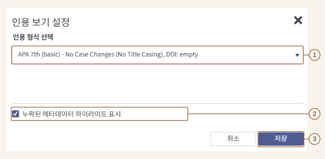
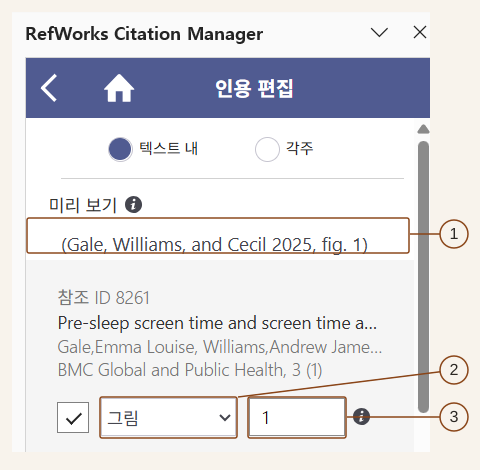
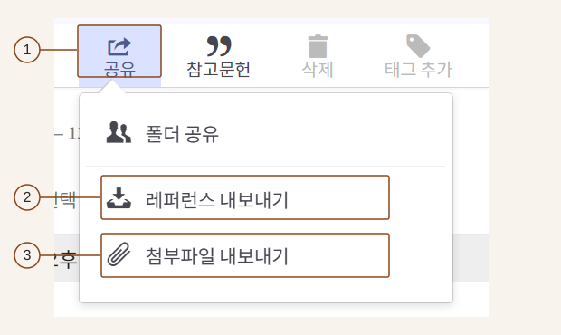

**RefWorks** was rebranded as **EndNote Fusion** on 6 October 2026. The [Korean EndNote Fusion guide](https://proquest.libguides.com/newrwkorea) brings together tutorials on individual features, training materials covering the topics in this Note, and recordings of previous webinars. It is a useful reference when I need to revisit a particular feature.

In my earlier library workshop and DBpia webinar Notes, I described finding prior research and reading a paper's structure and evidence. Here, I connect that work to preserving the literature, checking its bibliographic details and citing it in a manuscript.

## Record sources so readers can find them again

Citation lets readers trace the material supporting a statement. The text points to a source through an in-text citation, a note or another prescribed form, while the reference list supplies the details needed to locate it. Those connections allow readers to check the evidence again.

A citation style determines which details to include, such as author, title, year, volume, issue and pages, and how to order and format them. APA, MLA, Chicago and Vancouver are among the available styles, but the requirements of the thesis or publication come first. The necessary fields and their presentation depend on both the source type and the selected style.

A reference manager helps collect sources and format citations. I still need to check whether the imported details match the original and whether the source supports the statement I want to make. I need to check the evidence and bibliographic information before relying on automatic formatting.

## Bring search results into the library

EndNote Fusion is a web-based reference manager. An account is created by registering with an institutional email address and confirming the activation email. The library's instructions need to be checked for access routes and institutional authentication.

The import route depends on where a source was found and which files are available.

| Source or available file                      | Import route                                      | What to check                                             |
| --------------------------------------------- | ------------------------------------------------- | --------------------------------------------------------- |
| RISS, ProQuest or a library discovery service | Send references through **Cite** or **Export**    | Whether the imported records match the selected sources   |
| Google Scholar                                | Use the citation menu or a reference-manager link | Imported titles, authors, years and other details         |
| A site without a dedicated export button      | Download and import a `RIS` file                  | File format and character encoding                        |
| A general webpage                             | Use **Save references from the web**              | Which details were extracted from the page                |
| An existing paper PDF                         | Upload it to extract bibliographic information    | Accuracy of the extracted title, authors and other fields |

A library discovery service may allow one reference to be sent directly or several to be collected in a temporary folder for export together. Google Scholar also provides a citation menu for individual results and a setting to display links for importing into a reference manager.

Even without a dedicated export button, bibliographic details can be imported through a `RIS` file. When importing a `RIS` file, select `RIS format UTF-8`. Files such as `NBIB` and `BIB` can also be imported, using the format appropriate to the file.

To save a webpage, install **Save references from the web** through the tools menu, then open the extension on the page to import its details. After importing either a file or a page, I need to open the resulting record and check the information it contains.

## Keep bibliographic details alongside the PDF

Using **Cite** or **Export** in a database initially brings across the bibliographic record describing a source. To preserve the full-text PDF as well, open the saved record and attach the file. A PDF can be added to an existing record and opened through **Read** in its details panel.

If the PDF is already available, uploading it can extract bibliographic information. Scanned older papers and manuscripts with unusual structures may yield incomplete records. The extracted title and authors need to be compared with the opening page of the original and corrected where necessary.

Another import route extracts references from an existing Word or PDF manuscript. This could help reorganise a reference list from an older document. The extracted records still need checking, and any required full-text files need to be attached separately.

To read the source again, I need to find both its bibliographic details and its full text. After saving a reference, I intend to check whether the original file is attached.

## Check the information needed for citation

As the collection grows, different list views can support different checks. A compact list or table helps scan the records, while the **Citation view** applies the intended citation style.

Enabling the missing-metadata display in that view highlights information needed by the selected style. Blue marks required fields and grey marks recommended fields. Open the marked record, enter the details checked against the original source and save the changes.

_Figure 1. Settings for highlighting missing bibliographic details. Source: Clarivate EndNote Fusion training material. The following screenshots are also extracts from that material, with numbered callouts added for explanation. The original Korean interface is retained._

1. Select the style required for the manuscript under **인용 형식** (citation format).
2. Enable **누락된 메타데이터 하이라이트 표시** (highlight missing metadata).
3. Select **저장** (Save), then check the list for missing information.

If a formatted reference lacks page information, for example, I need to check the original and its publication details. Even after the missing-field indicator disappears, the author names or year may still need correction. **Bulk edit** can help when the same field needs to be organised across several records.

An output-style editor also allows styles to be modified. It can be used to adjust a style to submission requirements. First, I need to check that the basic style is selected correctly and the bibliographic information is accurate.

## Organise folders, projects and sharing

When bringing references into the library, I can create a new folder or choose an existing one. Folders can also be added after the references have been saved. **Manage folders** provides a way to organise a growing folder list. Projects can be created and renamed, with options for sharing and selecting the current project.

Grouping material by research topic or manuscript would make sources easier to find again. Rather than starting with a large classification scheme, I would organise folders and projects around the ways I actually retrieve material.

Sharing requires decisions about both the audience and its permissions. The folder-sharing screen includes access through a URL and invitations to individual people. Invitations can distinguish reading, annotation and modification permissions. Passing on a link and granting editing access require attention to their respective scope. Account and institutional access conditions also need checking for the intended recipients.

## Insert citations and edit their locations

**EndNote Fusion Writing Tool** connects stored references to a manuscript. In Word, place the cursor at the citation position and select a reference to insert the citation and its reference-list entry.

The bibliographic record and the location cited in a particular passage are separate details. Several citations to the same paper may point to different pages. The citation-editing panel allows a page locator to be entered and the citation updated. To identify a figure or table, select the appropriate locator type and enter its number.

_Figure 2. Setting a figure locator. RefWorks Citation Manager is the existing name displayed in the panel._

1. Check the citation under **미리 보기** (Preview).
2. Choose the locator type: **페이지** for pages, or **그림** for a figure as shown here.
3. Enter the page or figure number. The screenshot specifies figure `1`, producing `fig. 1` in the preview. Update the citation after making changes.

To add a source to an existing citation group, or remove one, the references are added or deselected in the panel before updating the citation. When the supporting sources change during revision, the citations and reference list need to be updated together.

When only a reference list is needed, selected records can be formatted through **Create bibliography**. The list should use one consistent style. If the manuscript uses another source's content, the relevant passage also needs an appropriate citation under the manuscript's requirements.

Google Docs uses a separate add-on, while Hangul requires attention to the RCM Hangul launch procedure. Start RCM Hangul first, then open the existing document in the Hangul window launched with it. Hangul integration uses email-and-password login rather than SSO, so supported versions and authentication arrangements need checking at installation.

## Connect AI assistance to checking the original

Related features include submission checks through **Paperpal Preflight**, matching-text and AI-content checks through **Copyleaks**, and a PDF **Research Assistant**. They support manuscript formatting and language checks, finding overlapping text, and summarising, asking questions about and translating a paper respectively.

Their outputs need different kinds of review. Matching text requires examining the actual passages and their citations; an AI-content indicator cannot be treated as a definitive judgement. Summaries and translations need to lead back to the meaning and conditions in the original passage I want to cite. Availability and credit allowances need checking at the time of use.

An AI-suggested source needs to be checked by searching its title and comparing the bibliographic information with an actual record. Once located, the paper needs to be read to establish whether it contains the evidence required. In my own research, I intend to check the source's existence, the accuracy of its bibliographic details and the match between the citation and its content in turn.

## Preserve reference data and attachments separately

Moving to another tool requires checking what the export contains. A `RIS` file exported from EndNote Fusion can be imported into desktop **EndNote**. For bibliographic information containing multiple languages, the `UTF-8` encoding setting also needs to be checked.

Attachments are downloaded separately through **Export attachments**. I need to check the reference data and the full-text files individually, rather than assume a bibliographic export preserves both.

_Figure 3. Separate menu options for exporting reference data and attachments._

1. Select the references to export and open **공유** (Share).
2. Use **레퍼런스 내보내기** (Export references) to save the bibliographic data.
3. To preserve the full-text files as well, run **첨부파일 내보내기** (Export attachments) separately.

## Applying this to my research

Applied to my research, this workflow would begin by checking the bibliographic details and full text after import, then recording the precise locations cited in the manuscript. I also intend to preserve the reference data and original files so that I can retrieve them again. Since the same literature passes through several stages between search and writing, it helps to define the state in which each stage hands it to the next.
