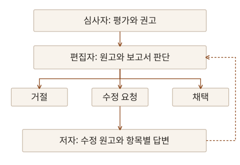

논문을 어디에 투고할지 결정하려면 연구 주제와 독자뿐 아니라 출판 방식과 비용, 심사 절차도 함께 살펴야 합니다. 2026년 10월 14일 **Wiley**의 「오픈 액세스 출판 성공 가이드: 연구자를 위한 실무 안내」 웨비나는 이 과정을 저자의 입장에서 짚어볼 수 있는 내용이었습니다. 발표는 Wiley-VCH의 편집자 Dr. Axel Straube가 맡았습니다.

앞선 Elsevier 저자 워크숍 노트에서는 원고 구성과 투고 준비를 정리했습니다. 이번에는 오픈액세스 출판의 조건과 저널 선택, 심사 결과를 받아들이고 대응하는 과정에 초점을 맞췄습니다. 특히 질의응답에서 다룬 비용 지원, 거절 후 이의제기, 심사의 편향 문제를 함께 기록해 두려 합니다.

## 오픈액세스에서 먼저 확인할 것

오픈액세스(Open Access, OA)는 독자가 구독이나 개별 결제 없이 논문을 읽을 수 있도록 하는 출판 방식입니다. 재이용할 수 있는 범위는 적용된 라이선스에 따라 달라집니다. 무료로 읽을 수 있다는 사실과 아무 조건 없이 재사용할 수 있다는 것은 구분해야 합니다.

OA를 선택할 이유에는 독자의 접근성뿐 아니라 연구비 지원기관의 공개 의무도 있습니다. 투고 전에 저널의 출판 방식, 라이선스, 지원기관의 요구를 함께 확인해야 합니다. Wiley의 [오픈액세스 안내](https://authors.wiley.com/author-resources/Journal-Authors/open-access/the-open-access-advantage.html)도 참고할 수 있습니다.

| 선택지           | 확인할 내용                                                             |
| ---------------- | ----------------------------------------------------------------------- |
| Gold OA 저널     | 논문 공개 방식과 논문 처리 비용(APC), 할인·면제 조건                    |
| 하이브리드 저널  | 구독형 저널에서 OA를 선택할 수 있는지, 선택 시 비용과 지원 조건         |
| 구독형 출판 경로 | 독자의 접근 조건, 별도 게재 비용의 유무, 지원기관의 공개 의무 충족 여부 |

Gold OA라는 이름만으로 모든 저널의 비용 구조가 같다고 볼 수는 없습니다. 하이브리드 저널에서도 OA 선택에 따른 비용과 구독형 경로의 조건을 나눠 확인해야 합니다.

### 비용과 지원에 관한 질문

질의응답에서는 OA 출판 비용이 얼마인지, 구독형 출판보다 저렴한지에 대한 질문이 나왔습니다. 답은 저널마다 다르다는 것이었습니다. APC 금액부터 확인하고, 할인이나 면제를 받을 수 있는지 따로 살펴야 합니다. 구독형 경로라고 해서 모든 종류의 비용이 항상 없는 것도 아닙니다.

기관과 출판사 사이의 협약으로 비용을 지원받을 수 있는지도 중요한 확인 사항입니다. 지원 대상 저널, 교신저자의 소속, 적용 시점과 자격 조건에 따라 결과가 달라질 수 있으므로 소속 도서관에 문의하는 편이 좋습니다. 국가별 지원 제도인 **Research4Life**도 언급됐지만, 특정 국가나 기관에 속한다는 이유만으로 지원을 받을 수 있다고 단정할 수는 없습니다.

현재 내게 어떤 지원이 적용되는지는 별도로 확인해야 합니다. 원고를 완성한 뒤 비용을 알아보기보다 저널 후보를 추리는 단계에서 출판 조건과 예산을 함께 살펴두는 것이 필요합니다.

## 연구와 독자에 맞는 저널 고르기

저널 선택의 출발점은 내 연구가 그 저널의 범위와 독자에게 맞는지입니다. 최근 게재 논문을 읽으면서 어떤 질문과 방법, 기여 수준을 다루는지 비교해야 합니다. 비슷한 연구가 어디에 실렸는지도 후보를 좁히는 단서가 됩니다.

질의응답에서는 높은 영향력지수(IF)를 가진 저널에 채택되려면 어떻게 해야 하는지도 다뤘습니다. IF는 저널 단위의 지표이므로 개별 논문의 질을 그대로 나타내지 않습니다. 연구의 새로움과 기여를 현실적으로 판단하고, 그 내용을 필요로 하는 독자가 있는 저널을 찾는 일이 먼저입니다. 전문 분야의 독자에게 도달하는 저널이 연구에 더 적합할 수도 있습니다.

후보를 정한 뒤에는 원저논문과 리뷰논문 등 허용하는 논문 유형, 출판 방식, 심사·출판 소요 시간, 연구비 지원 조건을 확인해야 합니다. **Wiley Journal Finder**는 초록 등을 바탕으로 후보 저널을 찾는 데 활용할 수 있습니다. 다만 [검색 결과](https://authors.wiley.com/author-resources/Journal-Authors/find-a-journal/index.html)는 실제 저널의 범위와 최근 논문을 직접 읽는 과정을 대신하지 않습니다. 같은 원고를 여러 저널에 동시에 투고해서도 안 됩니다.

### 믿을 만한 출판처인지 확인하기

빠른 채택을 약속하는 메일이나 익숙한 저널과 비슷한 이름만으로 판단하지 말고, 편집진과 실제 게재 논문, 심사 절차와 비용 공개 여부를 확인해야 합니다. 편집위원 이름이 당사자의 동의 없이 쓰이는 경우도 경계해야 합니다.

OA 저널은 [DOAJ](https://doaj.org/) 등에서 정보를 확인할 수 있고, 판단이 어려울 때는 도서관이나 해당 분야 연구자의 도움을 받을 수 있습니다. 한 가지 목록의 등재 여부만으로 결론을 내리기보다 저널이 실제로 어떻게 운영되는지 여러 근거를 함께 살펴야 합니다.

## 편집자의 첫 판단과 심사자의 평가

원고를 제출하면 편집자는 저널의 범위와 논문 유형, 기본적인 가독성과 연구윤리 등을 먼저 확인합니다. 저널에 따라 새로움과 중요성, 독자의 관심도도 주요 판단 기준입니다. 이 단계에서 외부 심사로 보내지 않고 거절할 수도 있습니다.

유사도 검사 역시 문맥을 읽어야 합니다. 일치한 문장이 방법 설명인지, 적절히 표시한 인용인지, 출처 없이 가져온 내용인지 살펴야 하므로 수치 하나만으로 표절 여부를 판단할 수는 없습니다.

외부 심사자는 연구 방법과 재현 가능성, 결과가 결론을 뒷받침하는지 등을 평가합니다. 심사 보고서는 편집자가 판단할 근거이며, 최종 결정은 편집자가 내립니다. 찬성과 반대의 수를 세는 단순한 투표로 이해하면 안 됩니다.

이 도식은 외부 심사 이후의 판단과 수정 흐름을 간추린 것입니다. 실제 절차에서는 수정 원고를 다시 외부 심사로 보내는 등 저널과 원고에 따라 검토 방식이 달라질 수 있습니다.

동료심사는 원고의 문제를 찾아 개선하는 과정입니다. 모든 데이터 조작이나 중복 출판을 찾아내고 논문의 질과 장래 영향력을 보증하는 장치는 아닙니다. 연구의 정확성과 정직성에 대한 저자의 책임은 그대로 남습니다.

## 거절을 받았을 때 확인할 것

거절 뒤에는 편집자의 결정문과 심사 의견을 나눠 읽어야 합니다. 연구 범위가 저널과 맞지 않은 것인지, 기여가 충분히 설명되지 않은 것인지, 방법이나 근거에 문제가 있는지에 따라 다음 행동이 달라집니다.

질의응답에서는 같은 저널의 거절에 어떻게 대응할 수 있는지 묻는 과정에서 이의제기(appeal)를 설명했습니다. 편집자나 심사자가 핵심 내용을 오해했거나 중요한 근거를 놓쳤다고 판단한다면, 그 이유를 구체적이고 정중하게 설명해 재고를 요청할 수 있습니다. 수정하지 않은 원고를 얼마 뒤 그대로 다시 내는 방식과는 다릅니다. 실제 이의제기는 해당 저널의 절차에 따라야 합니다.

채택률이나 거절률에 관한 질문에 대해 발표자는 이를 심사 결과가 모인 통계로 설명했습니다. 일정한 비율을 맞추기 위해 개별 원고를 거절하는 내부 할당량으로 이해할 필요는 없다는 답변이었습니다.

### 심사 편향에 관한 질문

저자 이름과 소속이 보이는 심사에서 편향이 생길 수 있느냐는 질문에는 그 가능성을 인정했습니다. 다만 개별 거절을 곧바로 편향 때문이라고 판단하기보다 의견의 내용을 객관적으로 검토해야 한다는 답변이 이어졌습니다.

단일 익명 심사는 저자가 심사자의 신원을 모르는 방식이고, 이중 익명 심사는 심사자에게도 저자의 신원을 가리는 방식입니다. 이중 익명이라도 연구 주제나 인용, 사전 공개 자료 등으로 저자를 짐작할 수 있으므로 모든 편향이 사라진다고 볼 수는 없습니다. 실제 익명 처리와 공개 범위는 저널의 심사 정책을 확인해야 합니다.

## 수정 답변을 실제 원고에 반영하기

수정 요청을 받으면 심사 의견을 항목별로 검토하고, 무엇을 바꿨는지 답변서에 설명해야 합니다. 동의하기 어려운 요청에는 수용하지 않는 이유와 근거를 제시하고, 필요하다면 대안을 설명할 수 있습니다. 근거가 주장을 충분히 지지하지 못한다면 분석을 보완하거나 표현의 강도를 낮추는 판단도 필요합니다.

특히 남겨두고 싶은 내용은 답변서에서 설명한 사항을 실제 원고에도 반영해야 한다는 점입니다. 답변서에서만 방법이나 한계를 풀어 쓰고 원고를 그대로 두면, 출판된 논문을 읽는 독자는 그 설명을 볼 수 없습니다. 수정한 위치와 내용을 표시하는 일도 편집자와 심사자가 변경 사항을 확인하는 데 도움이 됩니다.

답변의 목적은 심사 의견마다 반박하는 데 있지 않습니다. 의견을 계기로 설명과 근거를 점검하고, 최종 독자가 읽을 원고를 더 명확하게 만드는 데 있습니다.

## 정확하고 간결하며 명확하게 쓰기

글쓰기 원칙은 Accurate, Brief, Clear로 정리할 수 있습니다. 정확하게 쓰려면 막연한 평가 대신 수치와 조건, 비교 기준을 제시해야 합니다. 간결하게 쓸 때도 의미와 재현에 필요한 세부 정보는 남겨야 합니다. 명확한 글은 불필요하게 복잡한 명사구를 줄이고, 무엇을 했는지 동사로 드러냅니다.

원고는 연구를 수행한 시간순으로 모두 나열하기보다 연구 질문과 결과를 이해할 수 있는 순서로 구성해야 합니다. 방법에는 필요한 절차와 조건을, 결과와 논의에는 근거와 해석, 한계를 구분해 담아야 합니다. 중요한 그림과 결과의 흐름을 먼저 잡고 본문을 쓴 뒤 제목과 초록을 다듬는 방식도 활용할 수 있습니다.

| 원고의 부분 | 다시 확인할 질문                                                          |
| ----------- | ------------------------------------------------------------------------- |
| 제목        | 핵심 메시지가 드러나며, 불필요한 약어나 과장이 없는가?                    |
| 초록        | 본문을 읽지 않아도 연구 질문과 방법, 주요 결과와 의미를 이해할 수 있는가? |
| 키워드      | 해당 연구를 찾는 독자가 실제로 검색할 표현인가?                           |
| 참고문헌    | 최신 연구와 상반된 결과를 균형 있게 다루고 있는가?                        |
| 그림과 본문 | 용어·약어·단위·표현이 일관되며 서로 맞물리는가?                           |
| 커버레터    | 초록을 반복하는 대신 연구의 기여와 해당 저널에 맞는 이유를 설명하는가?    |

초록의 길이나 키워드 개수는 투고할 저널의 규정을 따라야 합니다. 커버레터에는 이해상충이나 관련된 다른 원고 등 편집자가 알아야 할 맥락도 정확히 적어야 합니다. 저널과 편집자의 이름을 다른 투고처의 것으로 남겨두지 않았는지도 마지막에 확인할 부분입니다.

## AI를 사용해도 내용의 책임은 저자에게

AI를 활용했다면 사용 내용을 투명하게 밝히고, 원고의 정확성에 사람이 책임져야 합니다. ChatGPT 같은 AI 도구는 저자로 올릴 수 없습니다. 문장이 매끄러워져도 사실과 인용, 해석이 맞는지는 직접 검토해야 합니다.

단순 맞춤법·문법 교정과 원고의 내용을 생성하거나 실질적으로 수정하는 활용은 구분해야 합니다. 제품 이름만 보고 공개 의무를 판단해서는 안 됩니다. 실제로 무엇을 어떻게 사용했는지에 따라 투고 시점의 [Wiley 연구윤리 지침 중 AI 항목](https://authors.wiley.com/ethics-guidelines/index.html#artificial-intelligence)과 개별 저널 규정을 확인해야 합니다. 그림에 AI를 사용하는 경우에도 허용 범위와 공개 요건을 따로 살펴야 합니다.

## 필요할 때 찾아볼 저자 지원 도구

투고 준비부터 출판 이후까지 필요한 도구의 역할도 구분해 두면 좋습니다.

| 도구·자료                                          | 활용할 수 있는 일                                        |
| -------------------------------------------------- | -------------------------------------------------------- |
| Wiley Journal Finder                               | 초록과 검색 조건으로 후보 저널 찾기                      |
| Manuscript Language Checker·Wiley Editing Services | 언어 상태 점검, 교정·번역·원고 형식 등 편집 지원         |
| Wiley Author Services·Author Dashboard             | 투고·출판 진행 상태와 OA 관련 절차 확인                  |
| Authorea                                           | 공동 집필과 문헌·연구 자료를 연결하는 작업               |
| GetFTR·ORCID                                       | 이용 가능한 원문 접근 경로 확인, 연구자 식별과 기여 연결 |
| Wiley Researcher Academy·저자 웨비나               | 출판 과정과 원고 작성에 관한 추가 학습                   |

언어 점검 결과가 연구의 타당성을 판정하거나 채택을 보장하는 것은 아닙니다. 각 도구는 필요한 단계에서 보조적으로 활용하면 됩니다. [Wiley Author Services](https://authorservices.wiley.com/home.html)와 [저자 웨비나·행사 안내](https://authors.wiley.com/author-resources/Journal-Authors/webinars-and-events.html)는 관련 자료를 다시 찾을 때 참조할 수 있습니다.

## 내 원고를 준비할 때 남겨둘 기준

저널 후보를 고를 때는 연구 질문과 독자, 출판 조건과 비용 지원을 함께 확인하려 합니다. 심사 결과를 받으면 결정의 이유를 읽고, 답변서에서 설명한 개선이 최종 원고에도 남도록 점검해야 합니다. 투고 준비를 원고 파일을 완성하는 일로만 보지 않고, 연구가 어떤 경로로 독자에게 전달되는지까지 생각하는 과정으로 이어가려 합니다.
