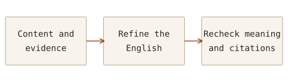

On 20 October 2026, I attended Wiley's webinar _Writing Open Access Research Papers in English: Practical Tips for Global Researchers_. Fabio Di Bello, Customer Education Manager at **Wiley**, presented the session, focusing on communicating research to an international audience when English is not the author's first language.

In my earlier Note, _Open Access Publishing Success: A Guide for Authors_, I covered journal choice, costs, peer review and revision. Here I describe how to organise the reasoning before polishing English sentences, and what to check and record when using AI assistance.

## Establishing the message before writing sentences

A paper is usually read from its title and abstract through the introduction, methods, results, discussion and conclusions to the references. This does not require completing the title first and drafting every sentence in that order. Important ideas can first be recorded without a fixed sequence, then grouped into the research context, results and discussion, and conclusions.

Within each group, deciding which evidence to present first and which figures help explain it makes the role of each paragraph clearer. The sequence should help readers understand the research question and answer, rather than reproduce every activity in the order it happened.

I sketched a simple workflow to apply when preparing a manuscript. After organising the content and refining the English, I still need to check that the intended meaning and evidence remain intact.

Language editing supports this process. I first need to decide what the research claims and how far the explanation can go.

## Writing accurately, briefly and clearly

Good research writing in English does not depend on difficult vocabulary or long sentences. The central principles are Accurate, Brief and Clear. Readers need to understand what was done and what was established without being misled.

| Principle | What to check in the manuscript                                                                                          |
| --------- | ------------------------------------------------------------------------------------------------------------------------ |
| Accuracy  | Replace vague evaluations with quantities, conditions and comparison criteria; check for overstatement or understatement |
| Brevity   | Remove repetition and unnecessary wording while retaining meaning and scientific detail                                  |
| Clarity   | Use familiar expressions, reduce unnecessary jargon and complex noun phrases, and keep tenses consistent                 |

For example, a phrase such as “carried out an analysis” can become “analysed”: a verb makes the action more direct. Shortening a sentence should still preserve experimental conditions and limitations.

After improving the wording, check the strength of the claim. If the observation was limited to particular conditions, those conditions need to remain. A statement of possibility must not become a definite conclusion. Improving expression and changing the research content require different judgements.

## The question each section should answer

It helps to understand the structure as a sequence of answers for the reader, rather than a list of sections to fill.

| Part of the paper          | What the reader should understand                                                               |
| -------------------------- | ----------------------------------------------------------------------------------------------- |
| Introduction               | What is known, and why is this research question needed?                                        |
| Materials and methods      | What conditions and procedures were used, and what problems or omissions affect interpretation? |
| Results                    | What was actually observed, including important and unexpected findings?                        |
| Discussion and conclusions | What do the findings mean, how far do they support a claim, and what limitations remain?        |

The introduction should supply relevant background and locate the study within current knowledge. Methods need sufficient detail, including missing data or problems encountered where these matter to interpretation. Previously published methods need references to their original sources.

Results and discussion need to distinguish observations from their meaning. Acknowledge earlier contributions and explain how the work connects to existing ideas. Excessively fragmenting one study's findings into multiple papers is also something to avoid.

## Titles and abstracts need to stand on their own

An abstract gives a researcher who has not read the paper a short account of its question, approach, main findings and significance. The presenter suggested imagining explaining the work in about 20 seconds to someone unfamiliar with it. I took this as a way to decide what to retain and what to remove, rather than a formal timing requirement.

The abstract should communicate the central content without trying to include every detail. Avoid unnecessary citations and unfamiliar abbreviations, and include the important results. Follow the target journal's requirements for its length and structure.

The title should select the most important message rather than contain every finding. Check whether it is understandable on first reading and conveys the study's scope. Choose keywords that readers would actually search for, connect them naturally with the title and abstract, and follow the journal's requirements for their number and entry.

## Treating references and the cover letter as part of the manuscript

References should not consist only of papers favourable to a claim. Cover the main foundations, current knowledge and alternative interpretations or conflicting results in balance. A longer reference list does not by itself establish stronger support, and unnecessary self-citation should be avoided.

The cover letter should explain the contribution, significance and fit with the journal. Give the editor context for an initial assessment rather than simply reproduce the abstract. Accurately disclose relevant information, including conflicts of interest or related manuscripts.

Language and content checks belong together here too. Beyond grammatical correctness, check that the body actually delivers the research promised by the title and abstract.

## Recording the purpose and review of AI assistance

The important question is what was delegated and what I judged directly. Refining language, generating or translating manuscript content, searching literature and analysing data affect the research in different ways.

The presenter recommended broad disclosure. That advice needs to be distinguished from a publisher's requirements. [Wiley's official publishing ethics guidance](https://authors.wiley.com/ethics-guidelines/index.html) requires disclosure of substantial manuscript development, editing or translation using AI, while excluding tools used solely for spelling, grammar and general editing from those requirements. Check the individual journal's rules at submission too.

Where AI is used in research methods or data analysis, describe what is needed to understand the method. The presenter emphasised disclosure in the methods section, but the location and format for declaring writing assistance should follow the target publication's guidance. Recording the tool and version, purpose, parts affected and how the results were reviewed will make that explanation easier later.

AI cannot be listed as an author; people remain responsible for the content, citations and analysis. When accepting editing suggestions, check that technical meanings, quantities, claims and limitations remain intact.

## Questions and answers

### What percentage of AI use is acceptable?

The presenter did not give a universal permitted percentage. His answer focused on whether researchers understand, review and take responsibility for the content, rather than allowing AI to write a fixed proportion of the paper.

I cannot reduce my own criteria to volume alone either. I need to explain the task delegated, how the output was checked and its influence on research judgements and conclusions.

### What if my own writing is flagged as AI-generated?

A participant described independently written text being flagged, and the presenter acknowledged the possibility of false positives. Such a result should not be treated as a definitive score for a manuscript's authenticity or scientific validity.

AI detection and similarity to existing text are also different measures. [Turnitin's official explanation](https://guides.turnitin.com/hc/en-us/articles/22774058814093-Using-the-AI-Writing-Report) states that they are independent and that misidentification is possible. Examine the actual wording, sources and writing process alongside the report rather than drawing a conclusion from detection alone.

Keeping the manuscript, revision history and records of tools used seems more useful than adopting a particular percentage as a safe boundary. A low score does not remove the need to check evidence and citations.

### Which AI tool is best?

No single tool was selected as best for every task. Language editing, literature search and data analysis need different capabilities and review criteria, so selection should follow the purpose.

For literature searches, a connection to actual sources matters. Even when a tool supplies a paper, open the original and check whether its population or subject, conditions and findings address the question. A large set of retrieved papers and adequate assessment of the necessary evidence are different achievements.

### How should an AI-use statement be written?

The statement needs to describe the actual work: the tool, its purpose and how the output was reviewed should agree with the working record. Even if AI helps draft the statement, its description of the use still needs a direct check.

Use official examples and the target publication's format as references, while ensuring the statement matches my own work. It must not claim functions I did not use or reviews I did not perform.

## Resources for checks before submission

The session also covered **Wiley Journal Finder** for candidate journals, **Manuscript Language Checker** for language assessment, and **Wiley Editing Services** for support such as editing and translation. They serve different purposes; a language assessment does not establish scientific validity or guarantee acceptance.

Further training is listed on the [Wiley webinars and events page](https://www.wiley.com/en-ie/solutions-partnerships/customer-success-hub/webinars-and-events/).

## What I will carry into my own manuscript

Before refining the English, I intend to establish the research question and sequence of evidence, then recheck meaning and claim boundaries after editing. For AI-assisted work, I will retain its purpose, scope and review alongside the task. Preparing wording that readers can understand accurately, together with the evidence supporting it, is the writing criterion I took from this webinar.
