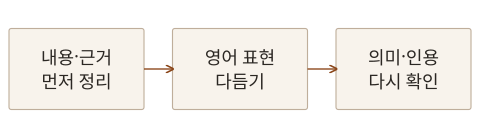

2026년 10월 20일 **Wiley**의 「글로벌 연구자를 위한 영어 오픈 액세스 논문 작성 실무 팁」 웨비나를 들었습니다. 발표는 Customer Education Manager인 Fabio Di Bello가 맡았으며, 영어가 모국어가 아닌 연구자가 국제 독자에게 연구 내용을 전달하는 데 초점을 맞췄습니다.

저널 선택과 비용, 심사와 수정 대응은 「오픈 액세스 출판 성공 가이드: 연구자를 위한 실무 안내」 노트에 정리해 두었습니다. 이번 글에서는 영어 문장을 다듬기 전에 연구의 논리를 어떻게 구성할지, AI의 도움을 받을 때 무엇을 직접 확인하고 기록해야 할지를 정리했습니다.

## 문장을 쓰기 전에 전달할 내용부터 정리하기

논문은 보통 제목과 초록, 서론, 방법, 결과, 논의와 결론, 참고문헌 순서로 읽습니다. 그렇다고 처음부터 제목을 완성하고 첫 문장부터 차례대로 써야 하는 것은 아닙니다. 먼저 연구에서 중요한 아이디어를 순서에 얽매이지 않고 적은 뒤, 연구의 맥락과 결과·논의, 결론으로 묶어볼 수 있습니다.

각 묶음 안에서 어떤 근거를 먼저 보여줄지, 어떤 그림이 설명을 도울지 정리하면 문단의 역할도 분명해집니다. 연구를 수행한 시간순으로 모든 일을 나열하기보다 독자가 연구 질문과 답을 이해할 수 있는 순서로 배치해야 합니다.

원고를 준비할 때 적용할 흐름을 간단히 그려봤습니다. 내용을 정리하고 영어 표현을 다듬은 뒤에도, 처음 전달하려던 의미와 근거가 유지되는지 다시 확인하는 과정이 필요합니다.

이 흐름에서 영어 교정은 연구 내용을 대신 만드는 단계가 아닙니다. 무엇을 주장하고 어디까지 설명할 수 있는지는 내가 먼저 판단해야 합니다.

## 정확하고, 간결하고, 명확하게 쓰기

영어 논문을 잘 쓴다는 것을 어려운 단어나 긴 문장을 많이 쓰는 일로 생각하지 않아야겠습니다. 핵심은 Accurate, Brief, Clear입니다. 독자가 무엇을 했고 무엇을 확인했는지 오해 없이 읽을 수 있어야 합니다.

| 기준   | 원고에서 확인할 내용                                                                    |
| ------ | --------------------------------------------------------------------------------------- |
| 정확성 | 막연한 평가 대신 수치·조건·비교 기준을 쓰고, 근거보다 강하거나 약한 표현은 없는지 확인  |
| 간결함 | 반복과 불필요한 말을 줄이면서도 의미와 과학적 세부 정보는 유지                          |
| 명확함 | 익숙한 표현을 사용하고, 불필요한 전문용어와 복잡한 명사구를 줄이며 시제를 일관되게 사용 |

예를 들어 한국어에서도 ‘분석을 수행했다’를 ‘분석했다’로 줄일 수 있듯, 영어에서도 명사구보다 동사로 행동을 드러내면 문장이 분명해집니다. 다만 짧게 만드는 과정에서 실험 조건이나 한계까지 지워서는 안 됩니다.

문장을 매끄럽게 고친 다음에는 주장의 강도도 살펴야 합니다. 관찰한 범위가 제한적이었다면 그 조건을 유지하고, 가능성을 말한 문장이 확정적인 결론으로 바뀌지 않았는지 확인해야 합니다. 표현의 개선과 연구 내용의 변경을 구분하는 기준이 필요합니다.

## 각 절이 답해야 할 질문

원고의 구성은 형식을 채우는 목록보다 독자의 질문에 답하는 순서로 이해하는 편이 좋겠습니다.

| 원고의 부분 | 독자가 이해해야 할 내용                                               |
| ----------- | --------------------------------------------------------------------- |
| 서론        | 무엇이 알려져 있으며, 이 연구 질문이 왜 필요한가?                     |
| 재료와 방법 | 어떤 조건과 절차로 연구했고, 해석에 영향을 줄 문제나 누락은 무엇인가? |
| 결과        | 실제로 무엇을 관찰했으며, 중요한 결과와 예상 밖의 결과는 무엇인가?    |
| 논의와 결론 | 결과가 무엇을 뜻하고, 어디까지 말할 수 있으며, 어떤 한계가 남는가?    |

서론에서는 연구와 직접 관련된 배경을 제시하고 현재의 지식 속에 연구를 놓아야 합니다. 방법에서는 필요한 정보를 충분히 적고, 누락된 데이터나 진행 중 겪은 문제도 해석에 필요한 범위에서 투명하게 설명해야 합니다. 이미 발표된 방법을 사용할 때는 원래 출처를 연결해야 합니다.

결과와 논의에서는 관찰한 사실과 그 의미를 구분해야 합니다. 관련 연구의 기여를 인정하고, 내 연구를 기존 아이디어와 어떻게 연결하는지 설명해야 합니다. 하나의 연구 결과를 지나치게 잘게 나눠 여러 논문으로 만드는 것도 경계할 부분입니다.

## 제목과 초록은 독립적으로 읽혀야 한다

초록은 본문을 읽지 않은 연구자에게 연구의 질문과 방법, 주요 결과와 의미를 전달하는 짧은 설명입니다. 발표에서는 연구를 모르는 사람에게 약 20초 안에 설명한다고 생각해보라는 기준을 제시했습니다. 실제 발표 시간을 측정하는 규칙보다는 무엇을 남기고 무엇을 줄일지 판단하는 방법으로 받아들였습니다.

세부 정보를 모두 넣으려 하기보다 초록만 읽어도 핵심을 이해할 수 있도록 구성해야 합니다. 불필요한 인용과 낯선 약어를 피하고 중요한 결과를 담아야 합니다. 초록의 분량이나 형식은 투고할 저널의 규정을 확인해야 합니다.

제목도 모든 메시지를 한꺼번에 담기보다 가장 중요한 내용을 선택해야 합니다. 첫 독해에서 뜻이 통하고 연구의 범위가 드러나는지 살펴야 합니다. 키워드는 독자가 실제로 검색할 표현을 생각해 고르고, 제목과 초록에 자연스럽게 연결하되 저널이 정한 개수와 입력 기준을 따라야 합니다.

## 참고문헌과 커버레터도 원고의 일부로 보기

참고문헌은 내 주장에 유리한 논문만 모으는 목록이 아닙니다. 연구가 기반으로 삼은 주요 문헌과 현재의 지식, 다른 해석이나 상반된 결과도 균형 있게 다뤄야 합니다. 인용 수가 많다는 이유만으로 근거가 충분해지는 것은 아니며, 불필요한 자기 인용도 피해야 합니다.

커버레터에서는 연구의 중요성과 기여, 그 저널에 적합한 이유를 편집자에게 설명해야 합니다. 초록을 그대로 옮기기보다 편집자가 첫 판단을 하는 데 필요한 맥락을 담는 편이 좋습니다. 이해상충이나 관련된 다른 원고 등 필요한 정보도 정확히 밝혀야 합니다.

이 단계에서도 언어 점검과 내용 점검을 함께 해야 합니다. 문법이 맞는 문장인지뿐 아니라, 제목과 초록에서 약속한 연구가 본문에 실제로 제시돼 있는지 확인해야 합니다.

## AI 활용은 사용 목적과 검토 내용을 남기기

AI를 활용할 수 있느냐보다 중요한 질문은 무엇을 맡겼고 무엇을 직접 판단했느냐입니다. 표현을 다듬는 일, 원고 내용을 생성하거나 번역하는 일, 문헌을 검색하거나 데이터를 분석하는 일은 연구에 미치는 영향이 다릅니다.

발표자는 사용 내용을 폭넓게 밝힐 것을 권했습니다. 다만 그 권고와 출판사의 의무 요건은 구분해야 합니다. [Wiley의 공식 연구윤리 지침](https://authors.wiley.com/ethics-guidelines/index.html)은 원고의 실질적인 작성·수정·번역에 AI를 사용한 경우 공개하도록 하며, 맞춤법·문법·일반 교정만을 위한 사용은 그 공개 요건에서 제외합니다. 실제 제출 시에는 개별 저널의 기준도 확인해야 합니다.

연구 방법이나 데이터 분석에 AI를 사용했다면 방법을 이해하는 데 필요한 설명을 남겨야 합니다. 발표에서는 방법 절의 공개를 강조했지만, 원고 작성 보조의 공개 위치와 양식은 투고처의 지침을 따라야 합니다. 사용한 도구와 버전, 목적, 적용한 부분, 결과를 검토한 방법을 작업 중에 기록해 두면 나중에 설명하기도 쉽겠습니다.

AI를 저자로 올릴 수는 없으며, 원고의 내용과 인용, 분석에 대한 책임은 사람에게 남습니다. 교정 결과를 받아들일 때도 전문용어의 뜻과 수치, 주장과 한계가 유지됐는지 직접 확인해야 합니다.

## 질의응답 내용

### AI를 몇 퍼센트까지 사용해도 되는가?

발표자는 일률적인 사용 비율을 제시하지 않았습니다. 원고의 일정 비율까지 AI가 작성하면 괜찮다는 식으로 판단하기보다, 연구자가 내용을 이해하고 검토하며 책임질 수 있는지가 중요하다는 답변이었습니다.

내가 적용할 기준도 사용량 하나로 정하기는 어렵겠습니다. 어떤 작업을 맡겼는지, 결과를 어떻게 확인했는지, 연구의 판단과 결론에 어떤 영향을 줬는지를 설명할 수 있어야 합니다.

### 직접 쓴 문장도 AI로 표시된다면?

참가자가 직접 작성한 글도 AI 사용으로 표시됐다는 경험을 나눴고, 발표자도 판별 도구의 오탐 가능성을 인정했습니다. 이런 결과를 원고의 진실성이나 연구의 타당성을 확정하는 점수로 받아들여서는 안 됩니다.

AI 판별 점수와 다른 문헌과의 텍스트 유사도 점수도 구분해야 합니다. [Turnitin의 공식 설명](https://guides.turnitin.com/hc/en-us/articles/22774058814093-Using-the-AI-Writing-Report) 역시 두 지표가 독립적이며 오탐이 가능하다고 명시합니다. 판별 결과만으로 결론을 내리기보다 실제 문장과 출처, 작성 과정을 함께 검토해야 합니다.

특정 비율을 안전선으로 정하기보다는 원고와 수정 이력, 사용 도구의 기록을 남겨두는 편이 실질적이겠습니다. 점수가 낮다고 인용과 근거 확인이 필요 없어지는 것도 아닙니다.

### 어떤 AI 도구가 가장 좋은가?

하나의 도구를 모든 작업에 가장 좋다고 고르지는 않았습니다. 문장 교정과 문헌 검색, 데이터 분석은 필요한 기능과 검토 기준이 다르므로 목적에 맞게 선택해야 한다는 방향이었습니다.

문헌 검색에서는 실제 출처와 연결되는 결과가 중요합니다. 도구가 논문을 제시하더라도 원문을 열어 연구 대상과 조건, 결과가 내 질문에 맞는지 확인해야 합니다. 검색된 자료가 많다는 사실과 필요한 근거를 충분히 검토했다는 것은 별개의 문제입니다.

### AI 사용 공개 문구는 어떻게 작성하는가?

공개 문구에는 실제 수행한 작업이 드러나야 합니다. 어떤 도구를 무슨 목적으로 사용했고 결과를 어떻게 검토했는지, 작업 기록과 일치하게 적어야 합니다. 문장을 만드는 데 다시 AI의 도움을 받더라도 실제 사용 범위와 맞는지는 직접 확인해야 합니다.

공식 지침의 예시와 투고처의 양식을 참고하되, 내 작업과 다른 내용을 그대로 가져오지 않아야겠습니다. 내가 사용하지 않은 기능이나 수행하지 않은 검토를 적어서는 안 됩니다.

## 제출 전 점검에 활용할 자료

저널 후보를 찾는 **Wiley Journal Finder**, 언어 상태를 점검하는 **Manuscript Language Checker**, 교정·번역 등을 지원하는 **Wiley Editing Services**도 살펴봤습니다. 도구마다 맡길 수 있는 일이 다르며, 언어 평가 결과가 연구의 타당성이나 게재 가능성을 보증하는 것은 아닙니다.

추가 교육은 [Wiley 웨비나·행사 안내](https://www.wiley.com/en-ie/solutions-partnerships/customer-success-hub/webinars-and-events/)에서 찾아볼 수 있습니다.

## 내 원고에서 이어갈 일

영어 표현을 다듬기 전에 연구 질문과 근거의 순서를 먼저 정리하고, 교정 뒤에는 의미와 주장의 범위를 다시 확인하려 합니다. AI를 활용한 작업은 목적과 적용 범위, 검토 내용을 함께 기록하겠습니다. 독자가 내 연구를 정확하게 이해할 수 있는 문장과, 그 문장을 뒷받침하는 근거를 함께 준비하는 것이 이번 웨비나에서 정리한 원고 작성의 기준입니다.
