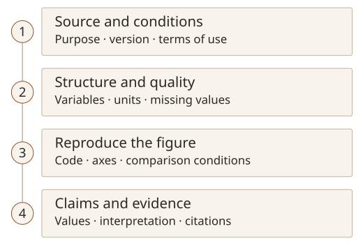

On 23 October 2026, I attended the library workshop “Using AI for Research Paper Writing and Visualisation”. The earlier session, “Starting a Prior-Research Search with AI and Academic Databases”, addressed research questions and finding literature. This session focused on understanding the data obtained, presenting them in figures, and connecting them with a paper's claims and evidence.

AI has a different role at each stage: inspecting data structure and quality, helping specify the relationships and calculations for figures, and refining outlines and wording. Here I describe the inputs and outputs for each task, together with the material against which the output needs to be checked.

## Find data that fit the research question

Research data may come from experiments, measurements or surveys conducted for the study, from other researchers' shared materials, or from public data sources. The collection purpose, population, period and variable definitions determine which questions a file can answer. Availability alone does not establish suitability for the research question.

The starting point depends on the material needed.

| Material needed                                             | Where to look                                                                                                             | What to check first                                           |
| ----------------------------------------------------------- | ------------------------------------------------------------------------------------------------------------------------- | ------------------------------------------------------------- |
| Official Korean statistics                                  | [KOSIS](https://kosis.kr/)                                                                                                | Statistical definitions, population, period and units         |
| Public data on administration, transport or the environment | [Korea's Public Data Portal](https://www.data.go.kr/)                                                                     | Provider, file or API format, update date and terms of use    |
| Data and code linked to papers                              | [Zenodo](https://zenodo.org/), [Figshare](https://figshare.com/)                                                          | Original paper, data version, identifier and reuse conditions |
| Machine learning training and evaluation data               | [UCI Machine Learning Repository](https://archive.ics.uci.edu/), [Hugging Face Datasets](https://huggingface.co/datasets) | Variable and label definitions, data splits and licence       |

When using a paper's data, its preprocessing and evaluation conditions also need to be checked. The same dataset name does not make results directly comparable if the version or analysed population differs. Documentation such as [Hugging Face dataset cards](https://huggingface.co/docs/hub/datasets-cards) provides context and considerations for use.

Even publicly available materials require checks of any Korea Open Government Licence indication, individual licence and recommended citation. Both the data source and the reuse conditions need to be checked before use in a manuscript.

### Establish the conditions before obtaining data

First distinguish reproduction, comparison with another method, and reanalysis for a new question. Reproduction depends on the version and preprocessing used in the original paper. A comparison needs compatible training and evaluation data and metrics. Reanalysis requires checking whether the original collection purpose makes the data suitable for the new question.

For example, comparing regional statistics requires compatible regional boundaries, survey years and units of aggregation. A total count cannot be compared directly with a population-adjusted rate. For machine learning data, first establish the meanings of the input variables and target labels, and how the training, validation and test sets were divided.

A source record should include the dataset title, version or reference date, download date, and DOI or original address, alongside the provider or repository. These details distinguish the material analysed if the file is later updated. For Korean public materials, the attached [Korea Open Government Licence type](https://www.kogl.or.kr/info/license.do) determines conditions such as attribution, commercial use and modification; the terms attached to the particular material need to be read.

## Use AI to inspect structure and quality first

Before asking for a graph, establish what the file contains. Start with row and column counts, variable names, data types and units, then examine missing values, duplicates and potential outliers before exploring distributions and relationships.

A request is easier to check when it includes a description of the data, the checks required, the output format and constraints. A request can be structured as follows.

> This CSV contains data about [research population and collection purpose]. Tabulate the row and column counts, variable types and documented units. Report the counts and locations of missing values, duplicate rows and potential outliers. Suggest three plots for exploring the main numerical variables and explain the choices. Do not change the original values or infer undocumented variable meanings. Include the code used for the calculations.

Before analysis, check whether the material may be sent to an external service.

The calculation rules and actual values matter more than the summary alone. Counts may differ depending on how missing values are recognised or whether duplication is assessed across entire rows or selected identifiers. A potential outlier should be assessed against measurement conditions and the research purpose before being removed as an error.

### Read the inspection results in order

| Check                   | What to examine                                                                                | Decision that follows                                           |
| ----------------------- | ---------------------------------------------------------------------------------------------- | --------------------------------------------------------------- |
| Rows, columns and types | Whether a row represents a person, experiment or time point; whether numbers were read as text | Establish the unit of analysis and each variable's role         |
| Units and ranges        | Units for time, temperature or proportions; codes versus measurements                          | Decide which values can be compared or used in calculations     |
| Missing values          | Affected columns and groups, and how blanks or special codes were stored                       | Decide whether to exclude, replace or retain them, with reasons |
| Duplicates              | Identical rows versus repeated measurements of the same subject                                | Distinguish errors from necessary observations                  |
| Potential outliers      | The detection rule and explanations in the source or measurement conditions                    | Assess whether correction or exclusion is warranted             |

Whether `0` represents missing data depends on the variable. A zero count may be valid, while another source may use zero to indicate that no value was entered. Applying an AI-selected rule can alter the meaning of the data, so the variable definitions and collection rules need to be checked first.

Initial inspection and modification should also be separate. First request candidate problems and their locations without changing the original. Then decide which items need treatment and by which rules. Record which rows or columns were changed and why, and retain analytical code that can repeat the processing.

## Choose a plot for the relationship it needs to show

Visualisation starts with what the reader needs to understand. Showing a distribution, comparing variables and describing change over time call for different figures.

| What to explain                              | Plot to consider                      | What to check                                                                     |
| -------------------------------------------- | ------------------------------------- | --------------------------------------------------------------------------------- |
| Correct and incorrect model classifications  | Confusion matrix                      | Actual versus predicted axes, class order, counts versus normalised proportions   |
| Group distributions and differences          | Box plot with individual observations | Sample size, spread and hidden observations                                       |
| Relationship between two numerical variables | Scatter plot                          | Axes, units, overlapping points and limits of interpretation                      |
| Change over time or training steps           | Line plot or learning curve           | Meaning of the horizontal axis, comparison conditions, training versus validation |
| Patterns across variables or conditions      | Correlation matrix or heatmap         | Colour range, value definitions, correlation versus causation                     |
| Research steps and their connections         | Flow diagram                          | Inputs, outputs, branches and work actually performed                             |

AI suggestions need to be assessed against that purpose. A polished figure can communicate something different if its units or aggregation rules are wrong. The grouping and exclusion rules, and whether the compared groups share the same conditions, need to accompany the figure.

### Read confusion matrices and learning curves

A confusion matrix cross-tabulates actual classes and model predictions. With the same class order on both axes, diagonal entries represent correct classifications and off-diagonal entries represent misclassifications. First identify whether actual values occupy rows or columns before interpreting the errors.

For example, in anomaly detection, predicting normal for an actual anomaly is a false negative; predicting an anomaly for an actual normal case is a false positive. With many more normal cases, overall accuracy alone can look high, so the distribution of errors also matters. Check whether cells contain counts or proportions and, for proportions, whether normalisation is by actual or predicted class.

A learning curve shows how loss or a performance metric changes during learning. Its interpretation depends on whether the horizontal axis represents epochs or training-set size, and whether the vertical axis shows loss or accuracy. Improving training performance alongside worsening validation performance can indicate possible overfitting. The curve alone does not establish the cause; data splits and evaluation conditions also need checking.

### Specify more than the plot type

A request should identify the relationship to show, variables, aggregation rules and presentation conditions. A scatter-plot request could take this form.

> Plot the relationship between [variable A] and [variable B] as a scatter plot. Each point represents one [unit of observation]; use colour to distinguish [group variable]. Label axes and units. Report the conditions and counts for any excluded rows. Do not add a causal interpretation of group differences. Include the data columns used and the code for calculations and plotting.

Check whether the number of points and group sample sizes agree with the data, and whether axis ranges or colours exaggerate differences. A correlation matrix needs an interpretable colour scale and range; a box plot needs readable information about the median, spread and individual observations; a heatmap needs clear cell values and colour definitions. These interpretive requirements remain even when the plot type changes.

The checks from data to manuscript can be organised as follows.

## Separate analysis from presentation when choosing tools

The workshop covered **Julius AI**, **Orange Data Mining**, **Tableau**, **Google Colab**, **Plotly** and **Mermaid Live**. They serve different roles: requesting analysis in natural language, connecting widgets into an analytical workflow, or using code to reproduce calculations and figures.

Julius AI was introduced as a tool for requesting data exploration and chart creation through natural language. Orange Data Mining supports visual analysis through connected widgets, while Tableau can be used to explore multiple measures visually. Upload policies and available features need checking at the time of use.

AI-generated Python can be reviewed and run in Colab to produce figures with libraries such as Matplotlib, Seaborn or Plotly. [Colab is a hosted Jupyter Notebook service](https://research.google.com/colaboratory/faq.html); the code and libraries perform the calculations and rendering. Generating code and establishing that its calculations are correct are separate steps.

A Plotly figure used interactively for exploration also needs a suitable static export for a paper. The [official export guide](https://plotly.com/python/static-image-export/) distinguishes formats such as PNG, SVG and PDF from interactive HTML. For a manuscript, axes, legends, text size and submission requirements need checking. The data and code needed to recreate the figure should be retained.

[Mermaid](https://mermaid.js.org/intro/) renders relationships defined in text as diagrams. It can explain research procedures or system flows. Its role differs from that of tools for numerical analysis and plotting. Diagram connections also need to match the actual method.

The differences become clearer when expressed as working sequences.

| Tool                                        | Working sequence                                                   | What to retain                                                        |
| ------------------------------------------- | ------------------------------------------------------------------ | --------------------------------------------------------------------- |
| Julius AI                                   | Supply a data file and questions, then review analysis and charts  | Variables, calculation and aggregation rules, results and corrections |
| Orange Data Mining                          | Load a file and connect analysis and visualisation widgets         | Connected workflow and widget settings                                |
| Tableau                                     | Select fields, aggregate measures and explore different views      | Filters, aggregation and the data range shown                         |
| Google Colab with Plotly or other libraries | Review and run AI-generated Python, then revise and export figures | Data, notebook or code, and required library information              |
| Mermaid Live                                | Define a procedure in text and check the rendered connections      | Diagram source and final image                                        |

[Orange's official documentation](https://orangedatamining.com/docs/) separates visual programming through connected widgets, data loading and example workflows. A widget performs a task such as reading a file or displaying a scatter plot. This differs from asking a question in a generative AI chat interface.

With Colab, distinguish asking AI to generate code, executing it in the notebook, and comparing results with the source data. If execution fails, examine the error message alongside the relevant code and input structure. Resolving the error still leaves variable selection, aggregation and the figure's fit to the original question to be checked.

An exploratory figure also needs preparation for a manuscript. Values visible only on hover disappear from a static image, so axes, legends and captions must convey the necessary information. Check text at the final printed size and follow the intended publication's format and resolution requirements. Retain code or diagram source that can regenerate the figure alongside the image.

### Inputs and outputs in three examples

The workshop's visualisation examples concerned equipment temperature, relationships between temperature, pressure and efficiency, and an AI research procedure. Each starts with different material and requires different checks.

The equipment-temperature example supplies Julius AI with a CSV containing time and temperature, requests a line plot over time, and highlights periods at or above 70°C. Check that the reference line is at 70°C, highlighted periods match the actual temperatures, and time intervals are represented correctly. The 70°C threshold is the highlighting criterion specified for this example.

The temperature–pressure–efficiency example generates Python code for a Plotly 3D scatter plot from a CSV containing those variables, runs it in Colab, and saves HTML or an image. Check the assignment of variables to axes, units, and the colour legend for efficiency. If overlapping points obscure the relationship in three dimensions, pairwise scatter plots can also be considered.

The research-procedure example represents “sensor data collection → preprocessing → feature extraction → AI model training → performance evaluation and analysis” in Mermaid code. Paste the code into Mermaid Live, check the connections, and export PNG or SVG. The output represents procedural structure rather than numerical analysis, so check for missing steps or incorrect arrows.

## Design the argument before polishing sentences

An outline needs to establish the claim and the evidence supporting it. The workshop used the IMRaD structure to examine the role of each part of a paper.

Here, IMRaD stands for Introduction, Methods, Results and Discussion: a way of organising the main text of a research paper into four sections. Its logical sequence is: why was the research needed, how was it conducted, what was found, and what do the findings mean?

The introduction establishes the context of existing research, the problem and the study's purpose. The methods describe the data and experimental or analytical procedures, while the results present what was observed or measured. The discussion interprets those findings, relates them to earlier research, and addresses their significance and limitations. In particular, presenting observations in the results should be distinguished from interpreting their meaning in the discussion. The exact section structure and names need to fit the field and the intended publication.

Before requesting a full draft, specify the topic, population, structure, required evidence and exclusions, then review the outline. Does the problem lead to the method? Do the results answer the question? Does the discussion stay within what was established?

Refining the introduction, body sections, and conclusions and implications in stages helps identify necessary evidence and missing information. Gaps must not be filled with results that have not been obtained or references that have not been read.

### Request and review an outline

An outline prompt can specify a role, topic, structure and constraints. The role sets the review perspective; the topic narrows the population and question; the structure determines the form of the output. Constraints establish the evidence, length, inclusions and exclusions. Assigning an expert role does not guarantee accuracy, so the evidence still needs independent checking.

> Review an engineering paper outline from an editor's perspective. The research question is [question], the population and conditions are [scope], and the available evidence is [literature, data and observations]. Use IMRaD to set out each section's purpose and contents, identifying the evidence required beside each claim. Mark anything unsupported by the supplied material as “evidence needed”. Do not describe experiments not yet conducted or results not yet obtained.

Assess more than whether the headings sound plausible: check whether the final question in the introduction corresponds to the items in the results section. The methods need the data and procedures required to obtain those results, and the discussion needs to connect interpretations with actual findings. Breaks in that connection identify material to check or parts of the outline to revise.

Next, refine the introduction's problem statement, review the detailed methods and results headings, then examine the discussion and conclusion. Reviewing each stage helps prevent scope expanding later or the same explanation recurring across sections. The useful outputs are a reviewable outline, reasons for revisions and the locations of supporting evidence.

## Recheck claims and values after editing

When editing, compare the original content with AI's proposed expression. Replacing conversational wording with academic prose must preserve the population, conditions and uncertainty. The revision must not introduce a comparison or causal relationship absent from the original account.

For example, if AI changes an observed difference into a “significant improvement”, the analysis needs to support that description. More technical wording is not necessarily more accurate. Asking for both the revision and the reason for each change would make review easier.

Figures also need to be read with the text. Each needs a number and caption explaining what it shows and under which conditions, followed by an interpretation in the manuscript. External material needs a source that allows readers to return to it.

An editing request can specify what to preserve and how far to revise.

> Revise the following paragraph into academic Korean. Preserve the study population, numerical values, comparison conditions, degree of uncertainty and citation markers. Do not add claims or references. Present the original, revision and reasons side by side, and separately identify wording that needs factual verification.

Changing “values were lower under some conditions” to “performance was superior overall” changes the scope and judgement as well as the style. Replacing “was associated with” with “affected” can turn association into a causal claim. Editing needs to check these changes of meaning alongside fluency.

A caption needs more than a short title. Readers should be able to identify the comparison, axes and units, and the conditions represented by colours or symbols. The text should refer to the figure before explaining observations relevant to the research question. For external figures or data, retain identifying information such as the creator, title, year and location in the source; a search-results address is insufficient.

## Connect citation management with records of AI use

I covered reference management in “Connecting Literature Management and Citation with EndNote Fusion”. Here too, an AI-suggested reference must be checked for existence, its bibliographic details matched to the original, and its support for the cited content verified. Saving an item to a library does not establish citation accuracy.

AI can help group papers by topic and suggest tags. Before choosing a statement to cite from a summary or classification, however, the original needs to be read. Using another person's explanation or idea in a manuscript requires a connection to its evidence and source even when the wording has been rewritten.

### Distinctions that matter in citation and organisation

A citation acknowledges another study's contribution and gives readers a route to the evidence. Reproducing original wording requires marking the quoted passage and identifying its source. Summarising or paraphrasing still requires attribution for the ideas and evidence used. Changing a few words cannot replace a citation.

Check for unattributed use of distinctive ideas or analytical methods, and reuse of earlier writing as if it were new. Reusing one's own material also requires checking its relationship to the earlier publication and the institution's or journal's rules on citation and duplicate publication. Reference-management software can format citations but cannot decide everything that needs citing or where the citation belongs.

Define classification criteria before asking AI to organise literature. For example, request tag candidates based on the populations, methods and evaluation metrics described in abstracts, with the supporting sentence for each tag. Experimental conditions or limitations absent from an abstract should remain items to check in the full text. References added by AI need their existence and bibliographic details checked in the original academic database or publisher's record before being managed as references.

Records of AI use should include the tool, purpose, affected material, and the checks and corrections performed by the researcher. The workshop covered a disclosure example identifying the original source used for verification. The statement should reflect actual use and review, following institutional and publication requirements. As discussed in the earlier Wiley Note, language correction, content drafting and data analysis should not be treated as a single undifferentiated use.

For assistance with data interpretation, record which table or section was affected, what was requested, which original material was used to check returned values, and what was corrected. Scope and review actions need to be more specific than “AI was used” to make the work explainable later. Distinguish the working record from the disclosure required for submission; the latter must describe work actually performed.

## Keep the evidence connected from data to text

The workshop connected data exploration, visualisation, writing and citation management. Obtaining data calls for checking sources and variables; making figures calls for checking calculations and presentation; editing text calls for checking that the original claims and evidence remain intact.

The final figures and manuscript are only part of the record. Data versions and processing rules, calculation code or diagram source, cited literature, and the scope of AI assistance and personal corrections also make the results reviewable. Using AI to accelerate individual tasks while maintaining the evidence from data to figures and from figures to claims was the central thread of this workshop.
