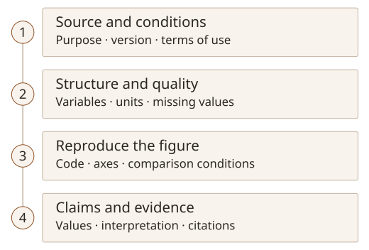

Following “Starting a Prior-Research Search with AI and Academic Databases”, this Note covers the graduate training session “Using AI for Research Paper Writing and Visualisation”. It connects finding and checking research data with producing figures, structuring and editing a paper, and managing citations.

## Find data that fit the research question

Research data may come from experiments, measurements or surveys conducted for the study, from other researchers' shared materials, or from public data sources. The collection purpose, population, period and variable definitions determine which questions a file can answer. Availability alone does not establish suitability for the research question.

The starting point depends on the material needed.

| Material needed                                             | Where to look                                                                                                             | What to check first                                           |
| ----------------------------------------------------------- | ------------------------------------------------------------------------------------------------------------------------- | ------------------------------------------------------------- |
| Official Korean statistics                                  | [KOSIS](https://kosis.kr/)                                                                                                | Statistical definitions, population, period and units         |
| Public data on administration, transport or the environment | [Korea's Public Data Portal](https://www.data.go.kr/)                                                                     | Provider, file or API format, update date and terms of use    |
| Data and code linked to papers                              | [Zenodo](https://zenodo.org/), [Figshare](https://figshare.com/)                                                          | Original paper, data version, identifier and reuse conditions |
| Machine learning training and evaluation data               | [UCI Machine Learning Repository](https://archive.ics.uci.edu/), [Hugging Face Datasets](https://huggingface.co/datasets) | Variable and label definitions, data splits and licence       |

When using a paper's data, its preprocessing and evaluation conditions also need to be checked. The same dataset name does not make results directly comparable if the version or analysed population differs. Documentation such as [Hugging Face dataset cards](https://huggingface.co/docs/hub/datasets-cards) provides context and considerations for use.

Even publicly available materials require checks of any Korea Open Government Licence indication, individual licence and recommended citation. Both the data source and the reuse conditions need to be checked before use in a manuscript.

## Use AI to inspect structure and quality first

Before asking for a graph, establish what the file contains. Start with row and column counts, variable names, data types and units, then examine missing values, duplicates and potential outliers before exploring distributions and relationships.

A request is easier to check when it includes a description of the data, the checks required, the output format and constraints. A request can be structured as follows.

> This CSV contains data about [research population and collection purpose]. Tabulate the row and column counts, variable types and documented units. Report the counts and locations of missing values, duplicate rows and potential outliers. Suggest three plots for exploring the main numerical variables and explain the choices. Do not change the original values or infer undocumented variable meanings. Include the code used for the calculations.

Before analysis, check whether the material may be sent to an external service.

The calculation rules and actual values matter more than the summary alone. Counts may differ depending on how missing values are recognised or whether duplication is assessed across entire rows or selected identifiers. A potential outlier should be assessed against measurement conditions and the research purpose before being removed as an error.

## Choose a plot for the relationship it needs to show

Visualisation starts with what the reader needs to understand. Showing a distribution, comparing variables and describing change over time call for different figures.

| What to explain                              | Plot to consider                      | What to check                                                                     |
| -------------------------------------------- | ------------------------------------- | --------------------------------------------------------------------------------- |
| Group distributions and differences          | Box plot with individual observations | Sample size, spread and hidden observations                                       |
| Relationship between two numerical variables | Scatter plot                          | Axes, units, overlapping points and limits of interpretation                      |
| Change over time or training steps           | Line plot or learning curve           | Meaning of the horizontal axis, comparison conditions, training versus validation |
| Patterns across variables or conditions      | Correlation matrix or heatmap         | Colour range, value definitions, correlation versus causation                     |
| Research steps and their connections         | Flow diagram                          | Inputs, outputs, branches and work actually performed                             |

AI suggestions need to be assessed against that purpose. A polished figure can communicate something different if its units or aggregation rules are wrong. The grouping and exclusion rules, and whether the compared groups share the same conditions, need to accompany the figure.

The checks from data to manuscript can be organised as follows.

## Separate analysis from presentation when choosing tools

The training covered **Julius AI**, **Orange Data Mining**, **Tableau**, **Google Colab**, **Plotly** and **Mermaid Live**. They serve different roles: requesting analysis in natural language, connecting widgets into an analytical workflow, or using code to reproduce calculations and figures.

Julius AI was introduced as a tool for requesting data exploration and chart creation through natural language. Orange Data Mining supports visual analysis through connected widgets, while Tableau can be used to explore multiple measures visually. Upload policies and available features need checking at the time of use.

AI-generated Python can be reviewed and run in Colab to produce figures with libraries such as Matplotlib, Seaborn or Plotly. [Colab is a hosted Jupyter Notebook service](https://research.google.com/colaboratory/faq.html); the code and libraries perform the calculations and rendering. Generating code and establishing that its calculations are correct are separate steps.

A Plotly figure used interactively for exploration also needs a suitable static export for a paper. The [official export guide](https://plotly.com/python/static-image-export/) distinguishes formats such as PNG, SVG and PDF from interactive HTML. For a manuscript, axes, legends, text size and submission requirements need checking. The data and code needed to recreate the figure should be retained.

[Mermaid](https://mermaid.js.org/intro/) renders relationships defined in text as diagrams. It can explain research procedures or system flows. Its role differs from that of tools for numerical analysis and plotting. Diagram connections also need to match the actual method.

## Design the argument before polishing sentences

An outline needs to establish the claim and the evidence supporting it. The training used the IMRaD structure to examine the role of each part of a paper.

Here, IMRaD stands for Introduction, Methods, Results and Discussion: a way of organising the main text of a research paper into four sections. Its logical sequence is: why was the research needed, how was it conducted, what was found, and what do the findings mean?

The introduction establishes the context of existing research, the problem and the study's purpose. The methods describe the data and experimental or analytical procedures, while the results present what was observed or measured. The discussion interprets those findings, relates them to earlier research, and addresses their significance and limitations. In particular, presenting observations in the results should be distinguished from interpreting their meaning in the discussion. The exact section structure and names need to fit the field and the intended publication.

Before requesting a full draft, specify the topic, population, structure, required evidence and exclusions, then review the outline. Does the problem lead to the method? Do the results answer the question? Does the discussion stay within what was established?

Refining the introduction, body sections, and conclusions and implications in stages helps identify necessary evidence and missing information. Gaps must not be filled with results that have not been obtained or references that have not been read.

## Recheck claims and values after editing

When editing, compare the original content with AI's proposed expression. Replacing conversational wording with academic prose must preserve the population, conditions and uncertainty. The revision must not introduce a comparison or causal relationship absent from the original account.

For example, if AI changes an observed difference into a “significant improvement”, the analysis needs to support that description. More technical wording is not necessarily more accurate. Asking for both the revision and the reason for each change would make review easier.

Figures also need to be read with the text. Each needs a number and caption explaining what it shows and under which conditions, followed by an interpretation in the manuscript. External material needs a source that allows readers to return to it.

## Connect citation management with records of AI use

I covered reference management in “Connecting Literature Management and Citation with EndNote Fusion”. Here too, an AI-suggested reference must be checked for existence, its bibliographic details matched to the original, and its support for the cited content verified. Saving an item to a library does not establish citation accuracy.

AI can help group papers by topic and suggest tags. Before choosing a statement to cite from a summary or classification, however, the original needs to be read. Using another person's explanation or idea in a manuscript requires a connection to its evidence and source even when the wording has been rewritten.

Records of AI use should include the tool, purpose, affected material, and the checks and corrections performed by the researcher. The training covered a disclosure example identifying the original source used for verification. The statement should reflect actual use and review, following institutional and publication requirements. As discussed in the earlier Wiley Note, language correction, content drafting and data analysis should not be treated as a single undifferentiated use.
