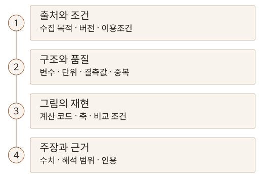

2026년 10월 23일 도서관에서 「AI를 활용한 논문작성과 시각화」 특강을 들었습니다. 앞선 「AI와 학술 DB로 시작하는 선행연구 탐색」에서 연구 질문과 문헌을 찾는 흐름을 살펴봤다면, 이번에는 확보한 데이터를 이해하고 그림으로 표현한 뒤 논문의 주장과 근거로 연결하는 과정이 중심이었습니다.

AI에 맡기는 작업도 단계마다 달라집니다. 데이터에서는 구조와 품질을 점검하고, 시각화에서는 전달할 관계와 계산 방법을 정하며, 글쓰기에서는 개요와 표현을 다듬습니다. 각 단계에서 어떤 자료를 주고 어떤 결과를 받아야 하는지, 그 결과를 무엇과 대조해야 하는지를 함께 정리했습니다.

## 연구 질문에 맞는 데이터부터 찾기

연구데이터는 직접 수행한 실험·측정·설문에서 얻을 수도 있고, 다른 연구자가 공개한 자료나 공공데이터를 활용할 수도 있습니다. 같은 파일을 분석하더라도 수집 목적과 대상, 기간, 변수의 의미에 따라 답할 수 있는 질문이 달라집니다. 내려받을 수 있다는 이유만으로 연구 질문에 적합한 데이터가 되는 것은 아닙니다.

찾는 자료에 따라 출발점을 나눠 볼 수 있습니다.

| 필요한 자료                    | 찾아볼 경로                                                                                                               | 먼저 확인할 내용                               |
| ------------------------------ | ------------------------------------------------------------------------------------------------------------------------- | ---------------------------------------------- |
| 국내 공식 통계                 | [KOSIS 국가통계포털](https://kosis.kr/)                                                                                   | 통계의 정의, 조사 대상과 기간, 단위            |
| 행정·교통·환경 등의 공공데이터 | [공공데이터포털](https://www.data.go.kr/)                                                                                 | 제공 기관, 파일·API 형식, 갱신 시점과 이용조건 |
| 논문과 연결된 데이터·코드      | [Zenodo](https://zenodo.org/), [Figshare](https://figshare.com/)                                                          | 원 논문, 데이터 버전, 식별자와 재사용 조건     |
| 머신러닝 학습·평가용 데이터    | [UCI Machine Learning Repository](https://archive.ics.uci.edu/), [Hugging Face Datasets](https://huggingface.co/datasets) | 변수·레이블 정의, 데이터 분할, 라이선스        |

관심 논문의 데이터를 찾았다면 원 논문에서 어떤 전처리와 평가 조건을 사용했는지도 함께 읽어야 합니다. 같은 데이터셋 이름을 썼더라도 버전이나 분석 대상이 다르면 결과를 그대로 비교하기 어렵습니다. Hugging Face의 [데이터셋 카드 안내](https://huggingface.co/docs/hub/datasets-cards)처럼 데이터의 맥락과 사용상 고려사항을 설명하는 문서도 확인할 필요가 있습니다.

공개된 자료도 공공누리 표시나 개별 라이선스, 권장 인용문을 확인해야 합니다. 원고에 사용할 데이터의 출처와 재사용 조건을 함께 확인해야 합니다.

### 데이터를 받기 전에 확인할 조건

데이터를 찾는 목적이 재현인지, 다른 방법과의 비교인지, 새로운 질문에 대한 재분석인지부터 구분해야 합니다. 재현이라면 원 논문이 사용한 버전과 전처리 조건이 중요하고, 방법을 비교한다면 같은 학습·평가 데이터와 지표를 적용할 수 있어야 합니다. 재분석에서는 원래의 수집 목적이 새 질문에 답할 만큼 적합한지 살펴야 합니다.

예를 들어 지역별 통계로 차이를 비교하려면 지역 구분과 조사 연도, 집계 단위가 맞아야 합니다. 한쪽은 전체 건수이고 다른 쪽은 인구당 비율이라면 수치를 나란히 놓는 것만으로는 비교가 되지 않습니다. 머신러닝 데이터도 입력 변수와 정답 레이블의 뜻, 학습용·검증용·시험용 데이터가 어떻게 나뉘었는지부터 확인해야 합니다.

출처 기록에는 제공 기관이나 저장소 이름뿐 아니라 데이터셋 제목, 버전 또는 기준일, 내려받은 날짜, DOI나 원문 주소를 함께 남기는 편이 좋습니다. 나중에 파일이 갱신되더라도 분석에 사용한 자료를 구분할 수 있기 때문입니다. [공공누리 유형 안내](https://www.kogl.or.kr/info/license.do)처럼 자료에 표시된 유형에 따라 출처 표시, 상업적 이용, 변경 등의 조건이 달라지므로 해당 자료의 이용조건을 읽어야 합니다.

## AI로 구조와 품질을 먼저 살피기

파일을 확보한 뒤에는 바로 그래프를 요청하기보다 무엇이 들어 있는지 확인하는 순서가 필요합니다. 행과 열의 수, 변수명과 자료형, 단위를 살핀 다음 결측값·중복값·이상치 후보를 점검하고, 분포와 변수 사이의 관계를 탐색할 수 있습니다.

AI에 요청할 때도 데이터의 설명, 확인할 항목, 출력 형식, 지켜야 할 조건을 함께 적으면 결과를 대조하기 쉽습니다. 요청은 다음과 같이 구성할 수 있습니다.

> 이 CSV는 [연구 대상과 수집 목적]에 관한 데이터다. 행·열 수, 변수별 자료형과 확인 가능한 단위를 표로 정리하고, 결측값과 중복 행, 이상치 후보의 개수와 위치를 알려 줘. 주요 수치형 변수의 분포와 관계를 살필 그래프를 세 가지 제안하고 선택 이유를 설명해 줘. 원본값은 바꾸지 말고, 설명이 없는 변수의 의미는 추측하지 마. 계산에 사용한 코드도 함께 제시해 줘.

분석 전에는 외부 서비스에 보낼 수 있는 자료인지도 먼저 확인해야 합니다.

답변에서는 요약 문장보다 계산 기준과 실제 값을 확인해야 합니다. 결측값을 어떤 값으로 인식했는지, 중복을 행 전체로 판단했는지 특정 식별자로 판단했는지에 따라 개수가 달라질 수 있습니다. 이상치 후보도 오류라고 단정해 지우기보다 측정 조건과 연구 목적을 보고 판단해야 합니다.

### 점검 결과를 읽는 순서

| 점검 항목      | 구체적으로 볼 내용                                                           | 다음 판단                                      |
| -------------- | ---------------------------------------------------------------------------- | ---------------------------------------------- |
| 행·열과 자료형 | 한 행이 사람·실험·시점 중 무엇을 뜻하는지, 숫자가 문자열로 읽히지는 않았는지 | 분석 단위와 변수의 역할을 정하기               |
| 단위와 범위    | 시간·온도·비율 등의 단위, 코드값과 실제 측정값의 구분                        | 서로 비교하거나 계산할 수 있는 값인지 판단하기 |
| 결측값         | 어느 열과 집단에 값이 없는지, 빈칸·별도 코드 등이 어떻게 저장됐는지          | 제외·대체·유지 여부와 그 이유 정하기           |
| 중복           | 완전히 같은 행인지, 같은 대상의 반복 측정인지                                | 삭제할 오류인지 필요한 관측인지 구분하기       |
| 이상치 후보    | 어떤 기준으로 후보가 됐는지, 원자료와 측정 조건에 설명이 있는지              | 수정·제외가 필요한지 검토하기                  |

특히 `0`을 결측값으로 간주해도 되는지는 변수의 의미에 달려 있습니다. 횟수가 0인 관측은 유효할 수 있고, 다른 자료에서는 0이 미입력을 뜻할 수도 있습니다. AI가 정한 처리 규칙을 그대로 적용하면 원자료의 의미가 달라질 수 있으므로, 변수 설명과 수집 규칙을 먼저 대조해야 합니다.

초기 점검과 데이터 수정도 나누는 편이 좋습니다. 먼저 원본을 바꾸지 않고 문제 후보와 위치를 보고받은 뒤, 처리할 항목과 기준을 정합니다. 수정본에는 어떤 행·열을 어떤 이유로 바꿨는지 기록하고, 분석 코드가 그 처리 과정을 다시 수행할 수 있도록 남겨야 합니다.

## 보여줄 관계에 따라 그래프 선택하기

시각화에서는 먼저 독자가 무엇을 읽어야 하는지 정해야 합니다. 분포를 보여줄지, 변수 사이의 관계를 비교할지, 시간에 따른 변화를 설명할지에 따라 적절한 그림이 달라집니다.

| 설명할 내용                | 검토할 그림            | 읽을 때 확인할 점                                           |
| -------------------------- | ---------------------- | ----------------------------------------------------------- |
| 분류 모델의 정답과 오분류  | 혼동행렬               | 실제·예측 축의 방향, 클래스 순서, 건수와 정규화 비율의 구분 |
| 집단별 분포와 차이         | 상자그림과 개별 관측점 | 표본 수, 퍼짐, 일부 값이 가려지는지                         |
| 두 수치형 변수의 관계      | 산점도                 | 축과 단위, 점의 겹침, 해석 가능한 관계의 범위               |
| 시간·학습 단계에 따른 변화 | 선그래프·학습곡선      | 가로축의 의미, 비교 조건, 학습·검증 결과의 구분             |
| 여러 변수·조건의 패턴      | 상관행렬·히트맵        | 색상 범위, 값의 정의, 상관관계와 인과관계의 구분            |
| 연구 절차와 단계별 연결    | 흐름도                 | 입력과 출력, 분기 조건, 실제 수행한 범위                    |

AI가 제안한 그래프는 이 질문에 맞춰 검토해야 합니다. 보기 좋게 완성된 그림이어도 단위나 집계 기준이 다르면 다른 내용을 전달할 수 있습니다. 특히 원자료를 어떤 기준으로 묶고 제외했는지, 비교한 집단의 조건이 같은지를 그림과 함께 설명해야 합니다.

### 혼동행렬과 학습곡선에서 읽어야 할 것

혼동행렬은 실제 클래스와 모델이 예측한 클래스를 교차해 분류 결과를 보여주는 표입니다. 두 축에 같은 클래스 순서를 놓으면 대각선은 맞게 분류한 사례, 대각선 밖은 다른 클래스로 잘못 분류한 사례를 나타냅니다. 실제값이 행인지 열인지 먼저 읽어야 어떤 종류의 오류인지 해석할 수 있습니다.

예를 들어 이상 탐지에서 실제 이상을 정상으로 예측한 경우는 미탐이고, 실제 정상을 이상으로 예측한 경우는 오탐입니다. 정상 사례가 훨씬 많은 데이터에서는 전체 정확도만 높게 나올 수 있으므로, 어떤 오류가 어디에 모이는지 함께 봐야 합니다. 셀의 값이 건수인지 비율인지, 비율이라면 실제 클래스별인지 예측 클래스별인지도 구분해야 합니다.

학습곡선은 학습이 진행되는 동안 손실이나 성능 지표가 어떻게 변하는지 보여줍니다. 가로축이 epoch인지 학습 데이터 수인지, 세로축이 손실인지 정확도인지에 따라 읽는 방식이 달라집니다. 학습 결과만 좋아지고 검증 결과가 나빠지는 구간은 과적합 가능성을 살펴볼 단서가 됩니다. 다만 곡선만 보고 원인을 확정하지 말고 데이터 분할과 평가 조건도 확인해야 합니다.

### 그래프를 요청할 때 함께 지정할 것

AI에는 그래프 이름만 주기보다 보여줄 관계, 사용할 변수, 집계 기준과 표현 조건을 함께 전달해야 합니다. 다음은 산점도 작성을 요청하는 예입니다.

> [변수 A]와 [변수 B]의 관계를 산점도로 표현해 줘. 각 점은 [관측 단위] 하나이며, [집단 변수]에 따라 색을 구분해 줘. 축 이름과 단위를 표시하고, 제외한 행이 있으면 조건과 개수를 알려 줘. 집단 간 차이에 대한 인과적 해석은 추가하지 마. 사용한 데이터 열과 계산·그림 생성 코드를 함께 제시해 줘.

그림을 받은 뒤에는 점의 수와 집단별 표본 수가 맞는지, 축의 범위나 색상 때문에 차이가 과장되지는 않았는지 확인해야 합니다. 상관행렬에서는 색의 의미와 범례 범위가, 상자그림에서는 중앙값·퍼짐과 개별 관측점이, 히트맵에서는 각 셀의 값과 색상 기준이 읽혀야 합니다. 그림 종류를 바꾸더라도 이런 해석의 기준은 남아 있어야 합니다.

데이터에서 원고로 이어지는 과정에서 확인할 항목은 다음과 같습니다.

## 도구는 분석과 표현의 역할을 나눠 사용하기

특강에서는 **Julius AI**, **Orange Data Mining**, **Tableau**, **Google Colab**, **Plotly**, **Mermaid Live**를 시각화 도구로 다뤘습니다. 모두 같은 일을 대신하는 도구는 아닙니다. 자연어로 분석을 요청하거나, 위젯을 연결해 분석 절차를 구성하거나, 코드로 수치와 그림을 재현하는 등 작업 방식이 다릅니다.

Julius AI는 자연어로 데이터 탐색과 차트 작성을 요청하는 도구로 소개됐습니다. Orange Data Mining은 위젯을 연결하는 시각적 분석에, Tableau는 여러 지표를 탐색하는 시각화에 활용할 수 있습니다. 각 서비스의 업로드 정책과 이용 범위는 사용할 때 확인해야 합니다.

AI가 작성한 Python 코드를 Colab에서 검토·실행하고, Matplotlib·Seaborn·Plotly 등으로 그림을 만들 수 있습니다. [Colab은 호스팅된 Jupyter Notebook 서비스](https://research.google.com/colaboratory/faq.html)이고, 그림의 계산과 표현은 실행하는 코드와 라이브러리가 맡습니다. 코드가 만들어졌다는 사실과 그 계산이 맞다는 판단은 구분해야 합니다.

Plotly로 탐색한 대화형 그림을 논문에 넣으려면 정적 이미지 출력도 별도로 확인해야 합니다. [공식 내보내기 안내](https://plotly.com/python/static-image-export/)는 PNG·SVG·PDF 등의 출력과 대화형 HTML 출력을 구분합니다. 최종 원고에서는 축·범례·글자 크기와 제출 형식을 확인하고, 그림을 다시 만들 수 있도록 데이터와 코드를 함께 보관해야 합니다.

[Mermaid](https://mermaid.js.org/intro/)는 텍스트로 정의한 관계를 도식으로 표현하는 도구입니다. 연구 절차나 시스템 흐름을 설명할 때 활용할 수 있습니다. 수치 데이터를 분석하고 그래프를 만드는 도구와는 역할이 다릅니다. 흐름도의 연결도 실제 방법과 일치하는지 직접 확인해야 합니다.

실제 작업 순서로 보면 도구의 차이가 더 분명합니다.

| 도구                     | 작업 흐름                                                   | 남겨야 할 결과                                     |
| ------------------------ | ----------------------------------------------------------- | -------------------------------------------------- |
| Julius AI                | 데이터 파일과 질문을 전달하고 분석·차트 결과를 검토         | 사용한 변수, 계산·집계 기준, 결과와 수정 내용      |
| Orange Data Mining       | 파일을 읽고 분석·시각화 위젯을 연결                         | 연결한 작업 흐름과 각 위젯의 설정                  |
| Tableau                  | 데이터의 필드를 선택해 지표를 집계하고 여러 관점에서 탐색   | 필터, 집계 방식과 그림에 사용한 범위               |
| Google Colab과 Plotly 등 | AI가 만든 Python 코드를 검토하고 실행한 뒤 그림을 수정·출력 | 데이터, 노트북·코드, 실행에 필요한 라이브러리 정보 |
| Mermaid Live             | 절차를 텍스트로 정의하고 렌더링한 연결을 검토               | 도식 원문과 최종 이미지                            |

[Orange의 공식 문서](https://orangedatamining.com/docs/)는 위젯을 연결하는 시각적 프로그래밍과 데이터 불러오기, 예제 작업 흐름을 나눠 제공합니다. 여기서 위젯은 파일 읽기나 산점도 표시처럼 한 작업을 맡는 구성요소입니다. 생성형 AI 채팅창에 질문하는 방식과는 다릅니다.

Colab을 쓰는 흐름에서는 AI에 코드 생성을 요청하는 단계, 노트북에서 코드를 실행하는 단계, 결과를 원자료와 대조하는 단계를 구분해야 합니다. 실행 오류가 나면 오류 메시지와 관련 코드, 입력 데이터의 구조를 함께 보고 수정합니다. 오류가 없어져도 변수 선택과 집계 기준, 그래프가 원래 질문에 맞는지는 별도로 확인해야 합니다.

탐색용 그림을 원고용으로 바꾸는 일도 필요합니다. 대화형 그림에서 마우스를 올려야 보이던 값은 정적 이미지에서 사라질 수 있으므로 축·범례·캡션으로 필요한 정보가 전달돼야 합니다. 글자 크기는 최종 지면에서 읽히는지 확인하고, 제출 형식과 해상도는 투고처의 지침에 맞춰야 합니다. 이미지만 보관하기보다 다시 출력할 수 있는 코드나 도식 원문을 함께 남겨야 합니다.

### 세 가지 예제로 보는 입력과 결과

특강에서 다룬 시각화 예제는 설비 온도, 온도·압력·효율의 관계, AI 연구 절차의 세 가지였습니다. 같은 ‘그림 만들기’라도 출발점과 확인할 결과가 다릅니다.

설비 온도 예제는 시간과 온도가 들어 있는 CSV를 Julius AI에 전달하고, 시간에 따른 변화를 선그래프로 그리면서 70°C 이상인 구간을 강조하는 구성입니다. 이때 확인할 것은 기준선이 70°C에 놓였는지, 강조된 구간이 실제 온도값과 일치하는지, 가로축의 시간 간격이 맞는지입니다. 70°C는 이 예제에서 지정한 강조 기준입니다.

온도·압력·효율 예제는 세 변수가 들어 있는 CSV를 바탕으로 Plotly의 3차원 산점도를 만드는 Python 코드를 생성하고, Colab에서 실행해 HTML이나 이미지로 저장하는 흐름입니다. 온도·압력·효율이 각각 어느 축에 배치됐는지, 단위와 효율을 표현한 색상 범례가 맞는지 확인해야 합니다. 3차원 그림에서 점이 겹쳐 관계가 잘 읽히지 않으면 두 변수씩 나눈 산점도도 검토할 수 있습니다.

연구 절차 예제는 ‘센서 데이터 수집 → 데이터 전처리 → 특징 추출 → AI 모델 학습 → 성능 평가와 결과 분석’을 Mermaid 코드로 표현하는 방식입니다. 코드를 Mermaid Live에 붙여 넣어 연결을 확인하고 PNG나 SVG로 저장합니다. 여기서 결과는 수치 분석이 아니라 절차의 구조이므로, 빠진 단계나 잘못 이어진 화살표가 없는지 읽어야 합니다.

## 문장보다 논리의 순서를 먼저 설계하기

논문 개요를 만들 때는 무엇을 주장하고 어떤 근거로 뒷받침할지 먼저 정해야 합니다. 특강에서는 IMRaD 구조를 기준으로 논문의 각 부분이 맡는 역할을 살펴봤습니다.

여기서 IMRaD는 Introduction(서론), Methods(방법), Results(결과), and Discussion(논의)을 줄인 말로, 연구 논문의 본문을 네 부분으로 구성하는 방식입니다. ‘왜 연구했는가 → 어떻게 수행했는가 → 무엇을 발견했는가 → 그 결과는 무엇을 의미하는가’라는 논리적 흐름으로 이해할 수 있습니다.

서론에서는 기존 연구의 맥락과 해결할 문제, 연구 목적을 제시합니다. 방법에서는 사용한 데이터와 실험·분석 절차를 설명하고, 결과에서는 그 과정을 통해 관찰하거나 측정한 내용을 보여줍니다. 논의에서는 결과를 해석하고 기존 연구와의 관계, 연구의 의미와 한계를 다룹니다. 특히 관찰한 사실을 제시하는 결과와 그 사실의 의미를 해석하는 논의를 구분해야 합니다. 실제 절의 구성과 명칭은 연구 분야와 투고처에 맞춰 조정해야 합니다.

AI에 논문 전체를 한 번에 써 달라고 하기보다, 연구 주제와 대상, 사용할 구조, 반드시 포함할 근거와 제외할 내용을 정해 개요부터 검토해야 합니다. 서론의 문제 제기가 방법으로 이어지는지, 결과가 질문에 답하는지, 논의가 확인한 범위를 넘어가지 않는지 차례로 살펴볼 수 있습니다.

서론 구성, 본문 세부 항목, 결론과 시사점을 단계별로 다듬으면서 필요한 근거와 빠진 정보를 확인해야 합니다. 아직 얻지 않은 결과나 읽지 않은 문헌을 채워 넣도록 요청해서는 안 됩니다.

### 개요를 요청하고 검토하는 방법

개요를 위한 프롬프트에는 역할, 연구 주제, 구조, 제약 조건을 함께 줄 수 있습니다. 역할은 검토 관점을 정하고, 주제는 대상과 질문을 좁히며, 구조는 결과를 어떤 틀로 받을지 정합니다. 제약 조건에는 사용할 근거와 분량, 포함할 내용과 제외할 내용을 적습니다. 역할을 전문가로 지정해도 답변의 정확성이 보장되지는 않으므로 근거는 별도로 확인해야 합니다.

> 공학 분야 논문 개요를 검토하는 편집자 관점에서 답해 줘. 연구 질문은 [질문], 대상과 조건은 [범위], 확보한 근거는 [문헌·데이터·관찰 결과]다. IMRaD에 맞춰 절별 목적과 포함할 항목을 정리하고, 각 주장 옆에 필요한 근거를 표시해 줘. 제공한 자료로 뒷받침할 수 없는 부분은 ‘근거 필요’로 남겨 줘. 아직 수행하지 않은 실험이나 얻지 않은 결과는 작성하지 마.

첫 답변에서 목차가 그럴듯한지만 볼 것이 아니라, 서론의 마지막 질문과 결과 절의 항목이 서로 대응하는지 확인해야 합니다. 방법 절에는 결과를 얻는 데 필요한 데이터와 절차가 있어야 하고, 논의에서는 실제 결과와 해석을 연결해야 합니다. 이 연결이 끊긴 곳이 다음에 확인할 자료나 개요를 고칠 지점입니다.

이후에는 서론의 문제 제기만 먼저 다듬고, 그다음 방법과 결과의 세부 항목을 검토한 뒤 논의와 결론을 점검할 수 있습니다. 단계마다 수정안을 확인하면 앞에서 정한 범위가 뒤에서 넓어지거나 같은 설명이 여러 절에 반복되는 것을 줄일 수 있습니다. 이때 필요한 것은 검토할 수 있는 개요와 수정 이유, 근거의 위치입니다.

## 표현을 다듬은 뒤에는 주장과 수치를 다시 확인하기

문장 교정에서는 연구자가 쓴 내용과 AI가 제안한 표현을 대조해야 합니다. 구어적인 표현을 학술적인 문장으로 고치더라도 대상과 조건, 불확실성은 유지돼야 합니다. 문장을 자연스럽게 바꾸는 과정에서 원래 없던 비교나 인과관계가 추가되지 않았는지도 확인해야 합니다.

예를 들어 측정값에서 차이가 보였다는 문장을 AI가 ‘유의미한 향상’으로 바꿨다면, 그 표현을 뒷받침할 분석이 있는지 먼저 살펴야 합니다. 더 전문적으로 들리는 문장이 더 정확한 문장인 것은 아닙니다. 이때는 수정한 문장과 바꾼 이유를 함께 제시하도록 요청하면 검토하기 쉽습니다.

그림도 본문과 연결해 읽어야 합니다. 그림·표 번호와 캡션을 붙이고, 무엇을 어떤 조건에서 나타낸 것인지 설명한 뒤 본문에서 해당 결과를 해석해야 합니다. 외부 자료를 썼다면 독자가 원자료로 돌아갈 수 있는 출처도 남겨야 합니다.

문장을 다듬을 때는 다음과 같이 보존할 내용과 수정 범위를 지정할 수 있습니다.

> 다음 문단을 학술적인 한국어로 다듬어 줘. 연구 대상, 수치, 비교 조건, 불확실성의 정도와 인용 표시는 유지해 줘. 새로운 주장이나 인용은 추가하지 마. 원문과 수정문, 바꾼 이유를 나란히 제시하고, 사실 확인이 필요한 표현은 별도로 표시해 줘.

예를 들어 ‘일부 조건에서 값이 낮았다’를 ‘전반적으로 성능이 우수했다’로 바꾸면 문체뿐 아니라 비교 범위와 판단까지 달라집니다. ‘관련이 있었다’를 ‘영향을 미쳤다’로 고치는 경우도 상관관계를 인과관계로 바꿀 수 있습니다. 교정에서는 문장의 매끄러움과 함께 이런 의미의 변화를 살펴야 합니다.

캡션은 그림의 짧은 제목에 그치지 않아야 합니다. 무엇을 비교했는지, 축과 단위가 무엇인지, 색이나 기호가 어떤 조건을 뜻하는지 알아볼 수 있어야 합니다. 본문에서는 그림을 먼저 지칭하고 연구 질문과 연결되는 관찰을 설명합니다. 외부 그림이나 데이터를 사용했다면 원저자·자료명·연도·해당 위치 등 원자료를 식별할 정보를 남겨야 하며, 검색 결과 페이지 주소만으로 대신하지 않아야 합니다.

## 인용 관리와 AI 사용 기록까지 연결하기

문헌관리도구의 역할은 앞선 「EndNote Fusion으로 문헌 관리와 인용 연결하기」에서 정리했습니다. 이번 흐름에서도 AI가 제안한 문헌의 실재 여부를 확인하고, 제목·저자·연도 등 서지정보를 원문과 맞춘 다음, 인용한 내용이 해당 자료에 실제로 있는지 살피는 순서가 필요합니다. 라이브러리에 저장됐다는 사실만으로 인용의 정확성이 확인되지는 않습니다.

AI는 여러 문헌의 주제를 묶고 태그 후보를 제안하는 데 활용할 수 있습니다. 다만 요약과 분류를 근거로 인용할 문장을 정하기 전에 원문을 읽어야 합니다. 다른 사람의 설명이나 아이디어를 원고에 사용했다면 문장을 바꿔 쓴 경우에도 그 근거와 출처를 연결해야 합니다.

### 인용과 문헌 정리에서 놓치기 쉬운 구분

인용은 다른 연구의 설명을 빌려 왔다는 표시이면서, 독자가 주장의 근거를 확인하는 경로입니다. 원문의 표현을 그대로 가져왔다면 인용 범위를 표시하고 출처를 밝혀야 합니다. 자기 말로 요약하거나 바꿔 써도 가져온 아이디어와 근거의 출처는 남아 있어야 합니다. 단어 몇 개만 바꾸는 일로 출처 표시를 대신할 수는 없습니다.

다른 사람의 고유한 아이디어나 분석 방법을 출처 없이 사용하는 경우, 이전에 쓴 자신의 글을 새 글처럼 재사용하는 경우도 점검해야 합니다. 자신의 자료를 다시 쓸 때도 이전 발표와의 관계, 인용과 중복 게재에 관한 해당 기관·투고처의 기준을 확인해야 합니다. 서지관리도구가 인용 형식을 맞춰 주더라도 무엇을 어디에 인용해야 하는지까지 판단해 주지는 않습니다.

AI로 문헌을 묶을 때도 분류 기준을 먼저 정하는 편이 좋습니다. 예를 들어 초록에 나타난 연구 대상·방법·평가 지표별로 태그 후보를 만들고, 각 태그의 근거가 된 문장을 함께 받으면 분류를 검토하기 쉽습니다. 초록만으로 확인할 수 없는 실험 조건이나 한계는 원문에서 확인할 항목으로 남겨야 합니다. AI가 추가한 문헌은 원 학술 DB나 발행기관에서 실재 여부와 서지정보를 대조한 뒤 관리해야 합니다.

AI 사용 기록에는 도구와 사용 목적, 적용한 부분, 직접 확인하고 수정한 내용을 남겨야 합니다. 특강에서는 AI 사용 내용을 밝힐 때 어떤 원자료와 대조했는지까지 구체적으로 적는 예시를 다뤘습니다. 공개 문구는 실제 사용 범위와 검토 내용에 맞춰 작성하고, 소속 기관과 투고처의 기준을 확인해야 합니다. 앞선 Wiley 노트에서 정리한 것처럼 문장 교정, 내용 작성, 데이터 분석은 같은 사용 범위로 묶을 수 없습니다.

예를 들어 데이터 해석에 도움을 받았다면 어느 표나 절에 사용했는지, 무엇을 요청했는지, 반환된 수치를 어떤 원자료와 비교했고 무엇을 고쳤는지 기록해야 합니다. ‘AI를 활용했다’는 한 문장보다 적용 범위와 검토 행위가 구체적이어야 나중에 설명할 수 있습니다. 이런 작업 기록과 투고 시 공개해야 할 문구는 구분하되, 공개 문구에는 실제로 수행한 내용만 담아야 합니다.

## 데이터와 문장 사이의 근거를 이어 두기

이번 특강은 데이터 탐색과 시각화, 글쓰기, 인용 관리를 하나의 흐름으로 연결했습니다. 데이터를 얻으면 출처와 변수를 확인하고, 그림을 만들면 계산과 표현을 확인하며, 문장을 다듬으면 원래 주장과 근거가 유지됐는지 확인해야 합니다.

그 과정에서 남겨야 할 것은 완성된 그림과 원고만이 아닙니다. 사용한 데이터의 버전과 처리 기준, 계산 코드나 도식 원문, 인용한 문헌, AI가 관여한 범위와 직접 수정한 내용이 함께 있어야 결과를 다시 검토할 수 있습니다. AI로 각 작업의 속도를 높이면서도 데이터에서 그림으로, 그림에서 주장으로 이어지는 근거를 유지하는 것이 이번 특강의 핵심입니다.
