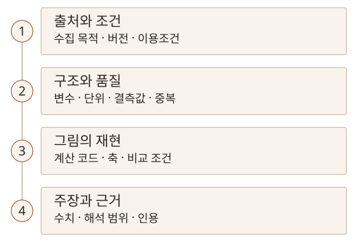

앞선 「AI와 학술 DB로 시작하는 선행연구 탐색」 교육에 이어, 이번에는 대학원생을 위한 「AI를 활용한 논문 작성과 시각화」 교육 내용을 정리했습니다. 연구데이터를 확보하고 점검하는 단계부터 그림 제작, 논문 구성과 문장 교정, 인용 관리까지 연결되는 과정입니다.

## 연구 질문에 맞는 데이터부터 찾기

연구데이터는 직접 수행한 실험·측정·설문에서 얻을 수도 있고, 다른 연구자가 공개한 자료나 공공데이터를 활용할 수도 있습니다. 같은 파일을 분석하더라도 수집 목적과 대상, 기간, 변수의 의미에 따라 답할 수 있는 질문이 달라집니다. 내려받을 수 있다는 이유만으로 연구 질문에 적합한 데이터가 되는 것은 아닙니다.

찾는 자료에 따라 출발점을 나눠 볼 수 있습니다.

| 필요한 자료                    | 찾아볼 경로                                                                                                               | 먼저 확인할 내용                               |
| ------------------------------ | ------------------------------------------------------------------------------------------------------------------------- | ---------------------------------------------- |
| 국내 공식 통계                 | [KOSIS 국가통계포털](https://kosis.kr/)                                                                                   | 통계의 정의, 조사 대상과 기간, 단위            |
| 행정·교통·환경 등의 공공데이터 | [공공데이터포털](https://www.data.go.kr/)                                                                                 | 제공 기관, 파일·API 형식, 갱신 시점과 이용조건 |
| 논문과 연결된 데이터·코드      | [Zenodo](https://zenodo.org/), [Figshare](https://figshare.com/)                                                          | 원 논문, 데이터 버전, 식별자와 재사용 조건     |
| 머신러닝 학습·평가용 데이터    | [UCI Machine Learning Repository](https://archive.ics.uci.edu/), [Hugging Face Datasets](https://huggingface.co/datasets) | 변수·레이블 정의, 데이터 분할, 라이선스        |

관심 논문의 데이터를 찾았다면 원 논문에서 어떤 전처리와 평가 조건을 사용했는지도 함께 읽어야 합니다. 같은 데이터셋 이름을 썼더라도 버전이나 분석 대상이 다르면 결과를 그대로 비교하기 어렵습니다. Hugging Face의 [데이터셋 카드 안내](https://huggingface.co/docs/hub/datasets-cards)처럼 데이터의 맥락과 사용상 고려사항을 설명하는 문서도 확인할 필요가 있습니다.

공개된 자료도 공공누리 표시나 개별 라이선스, 권장 인용문을 확인해야 합니다. 원고에 사용할 데이터의 출처와 재사용 조건을 함께 확인해야 합니다.

## AI로 구조와 품질을 먼저 살피기

파일을 확보한 뒤에는 바로 그래프를 요청하기보다 무엇이 들어 있는지 확인하는 순서가 필요합니다. 행과 열의 수, 변수명과 자료형, 단위를 살핀 다음 결측값·중복값·이상치 후보를 점검하고, 분포와 변수 사이의 관계를 탐색할 수 있습니다.

AI에 요청할 때도 데이터의 설명, 확인할 항목, 출력 형식, 지켜야 할 조건을 함께 적으면 결과를 대조하기 쉽습니다. 요청은 다음과 같이 구성할 수 있습니다.

> 이 CSV는 [연구 대상과 수집 목적]에 관한 데이터다. 행·열 수, 변수별 자료형과 확인 가능한 단위를 표로 정리하고, 결측값과 중복 행, 이상치 후보의 개수와 위치를 알려 줘. 주요 수치형 변수의 분포와 관계를 살필 그래프를 세 가지 제안하고 선택 이유를 설명해 줘. 원본값은 바꾸지 말고, 설명이 없는 변수의 의미는 추측하지 마. 계산에 사용한 코드도 함께 제시해 줘.

분석 전에는 외부 서비스에 보낼 수 있는 자료인지도 먼저 확인해야 합니다.

답변에서는 요약 문장보다 계산 기준과 실제 값을 확인해야 합니다. 결측값을 어떤 값으로 인식했는지, 중복을 행 전체로 판단했는지 특정 식별자로 판단했는지에 따라 개수가 달라질 수 있습니다. 이상치 후보도 오류라고 단정해 지우기보다 측정 조건과 연구 목적을 보고 판단해야 합니다.

## 보여줄 관계에 따라 그래프 선택하기

시각화에서는 먼저 독자가 무엇을 읽어야 하는지 정해야 합니다. 분포를 보여줄지, 변수 사이의 관계를 비교할지, 시간에 따른 변화를 설명할지에 따라 적절한 그림이 달라집니다.

| 설명할 내용                | 검토할 그림            | 읽을 때 확인할 점                                |
| -------------------------- | ---------------------- | ------------------------------------------------ |
| 집단별 분포와 차이         | 상자그림과 개별 관측점 | 표본 수, 퍼짐, 일부 값이 가려지는지              |
| 두 수치형 변수의 관계      | 산점도                 | 축과 단위, 점의 겹침, 해석 가능한 관계의 범위    |
| 시간·학습 단계에 따른 변화 | 선그래프·학습곡선      | 가로축의 의미, 비교 조건, 학습·검증 결과의 구분  |
| 여러 변수·조건의 패턴      | 상관행렬·히트맵        | 색상 범위, 값의 정의, 상관관계와 인과관계의 구분 |
| 연구 절차와 단계별 연결    | 흐름도                 | 입력과 출력, 분기 조건, 실제 수행한 범위         |

AI가 제안한 그래프는 이 질문에 맞춰 검토해야 합니다. 보기 좋게 완성된 그림이어도 단위나 집계 기준이 다르면 다른 내용을 전달할 수 있습니다. 특히 원자료를 어떤 기준으로 묶고 제외했는지, 비교한 집단의 조건이 같은지를 그림과 함께 설명해야 합니다.

데이터에서 원고로 이어지는 과정에서 확인할 항목은 다음과 같습니다.

## 도구는 분석과 표현의 역할을 나눠 사용하기

교육에서는 **Julius AI**, **Orange Data Mining**, **Tableau**, **Google Colab**, **Plotly**, **Mermaid Live**를 시각화 도구로 다뤘습니다. 모두 같은 일을 대신하는 도구는 아닙니다. 자연어로 분석을 요청하거나, 위젯을 연결해 분석 절차를 구성하거나, 코드로 수치와 그림을 재현하는 등 작업 방식이 다릅니다.

Julius AI는 자연어로 데이터 탐색과 차트 작성을 요청하는 도구로 소개됐습니다. Orange Data Mining은 위젯을 연결하는 시각적 분석에, Tableau는 여러 지표를 탐색하는 시각화에 활용할 수 있습니다. 각 서비스의 업로드 정책과 이용 범위는 사용할 때 확인해야 합니다.

AI가 작성한 Python 코드를 Colab에서 검토·실행하고, Matplotlib·Seaborn·Plotly 등으로 그림을 만들 수 있습니다. [Colab은 호스팅된 Jupyter Notebook 서비스](https://research.google.com/colaboratory/faq.html)이고, 그림의 계산과 표현은 실행하는 코드와 라이브러리가 맡습니다. 코드가 만들어졌다는 사실과 그 계산이 맞다는 판단은 구분해야 합니다.

Plotly로 탐색한 대화형 그림을 논문에 넣으려면 정적 이미지 출력도 별도로 확인해야 합니다. [공식 내보내기 안내](https://plotly.com/python/static-image-export/)는 PNG·SVG·PDF 등의 출력과 대화형 HTML 출력을 구분합니다. 최종 원고에서는 축·범례·글자 크기와 제출 형식을 확인하고, 그림을 다시 만들 수 있도록 데이터와 코드를 함께 보관해야 합니다.

[Mermaid](https://mermaid.js.org/intro/)는 텍스트로 정의한 관계를 도식으로 표현하는 도구입니다. 연구 절차나 시스템 흐름을 설명할 때 활용할 수 있습니다. 수치 데이터를 분석하고 그래프를 만드는 도구와는 역할이 다릅니다. 흐름도의 연결도 실제 방법과 일치하는지 직접 확인해야 합니다.

## 문장보다 논리의 순서를 먼저 설계하기

논문 개요를 만들 때는 무엇을 주장하고 어떤 근거로 뒷받침할지 먼저 정해야 합니다. 교육에서는 IMRaD 구조를 기준으로 논문의 각 부분이 맡는 역할을 살펴봤습니다.

여기서 IMRaD는 Introduction(서론), Methods(방법), Results(결과), and Discussion(논의)을 줄인 말로, 연구 논문의 본문을 네 부분으로 구성하는 방식입니다. ‘왜 연구했는가 → 어떻게 수행했는가 → 무엇을 발견했는가 → 그 결과는 무엇을 의미하는가’라는 논리적 흐름으로 이해할 수 있습니다.

서론에서는 기존 연구의 맥락과 해결할 문제, 연구 목적을 제시합니다. 방법에서는 사용한 데이터와 실험·분석 절차를 설명하고, 결과에서는 그 과정을 통해 관찰하거나 측정한 내용을 보여줍니다. 논의에서는 결과를 해석하고 기존 연구와의 관계, 연구의 의미와 한계를 다룹니다. 특히 관찰한 사실을 제시하는 결과와 그 사실의 의미를 해석하는 논의를 구분해야 합니다. 실제 절의 구성과 명칭은 연구 분야와 투고처에 맞춰 조정해야 합니다.

AI에 논문 전체를 한 번에 써 달라고 하기보다, 연구 주제와 대상, 사용할 구조, 반드시 포함할 근거와 제외할 내용을 정해 개요부터 검토해야 합니다. 서론의 문제 제기가 방법으로 이어지는지, 결과가 질문에 답하는지, 논의가 확인한 범위를 넘어가지 않는지 차례로 살펴볼 수 있습니다.

서론 구성, 본문 세부 항목, 결론과 시사점을 단계별로 다듬으면서 필요한 근거와 빠진 정보를 확인해야 합니다. 아직 얻지 않은 결과나 읽지 않은 문헌을 채워 넣도록 요청해서는 안 됩니다.

## 표현을 다듬은 뒤에는 주장과 수치를 다시 확인하기

문장 교정에서는 연구자가 쓴 내용과 AI가 제안한 표현을 대조해야 합니다. 구어적인 표현을 학술적인 문장으로 고치더라도 대상과 조건, 불확실성은 유지돼야 합니다. 문장을 자연스럽게 바꾸는 과정에서 원래 없던 비교나 인과관계가 추가되지 않았는지도 확인해야 합니다.

예를 들어 측정값에서 차이가 보였다는 문장을 AI가 ‘유의미한 향상’으로 바꿨다면, 그 표현을 뒷받침할 분석이 있는지 먼저 살펴야 합니다. 더 전문적으로 들리는 문장이 더 정확한 문장인 것은 아닙니다. 이때는 수정한 문장과 바꾼 이유를 함께 제시하도록 요청하면 검토하기 쉽습니다.

그림도 본문과 연결해 읽어야 합니다. 그림·표 번호와 캡션을 붙이고, 무엇을 어떤 조건에서 나타낸 것인지 설명한 뒤 본문에서 해당 결과를 해석해야 합니다. 외부 자료를 썼다면 독자가 원자료로 돌아갈 수 있는 출처도 남겨야 합니다.

## 인용 관리와 AI 사용 기록까지 연결하기

문헌관리도구의 역할은 앞선 「EndNote Fusion으로 문헌 관리와 인용 연결하기」에서 정리했습니다. 이번 흐름에서도 AI가 제안한 문헌의 실재 여부를 확인하고, 제목·저자·연도 등 서지정보를 원문과 맞춘 다음, 인용한 내용이 해당 자료에 실제로 있는지 살피는 순서가 필요합니다. 라이브러리에 저장됐다는 사실만으로 인용의 정확성이 확인되지는 않습니다.

AI는 여러 문헌의 주제를 묶고 태그 후보를 제안하는 데 활용할 수 있습니다. 다만 요약과 분류를 근거로 인용할 문장을 정하기 전에 원문을 읽어야 합니다. 다른 사람의 설명이나 아이디어를 원고에 사용했다면 문장을 바꿔 쓴 경우에도 그 근거와 출처를 연결해야 합니다.

AI 사용 기록에는 도구와 사용 목적, 적용한 부분, 직접 확인하고 수정한 내용을 남겨야 합니다. 교육에서는 AI 사용 내용을 밝힐 때 어떤 원자료와 대조했는지까지 구체적으로 적는 예시를 다뤘습니다. 공개 문구는 실제 사용 범위와 검토 내용에 맞춰 작성하고, 소속 기관과 투고처의 기준을 확인해야 합니다. 앞선 Wiley 노트에서 정리한 것처럼 문장 교정, 내용 작성, 데이터 분석은 같은 사용 범위로 묶을 수 없습니다.
