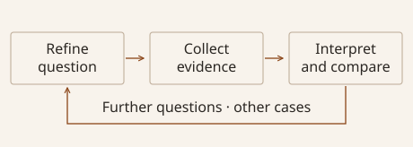

On 30 October 2026, I attended DBpia's webinar “Qualitative Research Methods for Beginning Researchers”. Following the previous day's quantitative session, it examined how to understand experiences and actions in context and support interpretations with evidence.

In “Quantitative Research Methods: Design and Measurement”, I described comparison conditions, measurement and analysis planning. This Note starts with the researcher's position and participants' perspectives, connects the main approaches with interviewing and analysis, and includes the later questions and answers.

## What should be asked to understand an experience?

Asking how much scores changed after a new educational programme requires different evidence from asking under which circumstances teachers accepted or resisted it. The latter needs an account of what happened, who was involved and what mattered to those taking part.

Similar outward actions can carry different meanings. Closing and reopening one eye might signal something to another person or result from discomfort. Counting the movements reveals little about relationships or intentions. Examine the situation, the meanings understood within that culture and the person's account.

Qualitative questions focus on experience, meaning, relationships and processes. For example, move beyond whether teachers are reluctant to teach remotely to ask what they find difficult when preparing and delivering lessons, and under which conditions they choose differently.

Numbers alone do not define quantitative research, just as interviews alone do not define qualitative research. Interview responses can be counted within predetermined categories, and qualitative studies can report participant or event numbers. The question needs to fit the way evidence is interpreted.

## The researcher's perspective is part of the inquiry

Who the researcher is, and their relationship with participants, can affect questions and interpretations. A long-serving teacher, a former pupil and a first-time visitor studying the same school may notice different things and take different practices for granted.

Explaining positionality means more than providing a long autobiography. Describe how prior understanding, experience, roles and relationships influenced collection and interpretation. Reflexive records can examine what familiarity obscured, which answers were expected and what changed a judgement.

Qualitative inquiry encompasses different philosophical approaches. Postpositivist approaches examine explanations while acknowledging imperfect knowledge; interpretive and constructivist approaches attend to meanings formed through experience and interaction. Critical approaches examine power and inequality, while postmodern approaches question singular accounts that obscure other interpretations. Posthumanism and new materialism extend attention to relationships and activity involving technologies, objects and environments as well as people.

Rather than assigning one view of truth to all qualitative research, explain how the chosen perspective connects with the question and method. [APA's JARS–Qual](https://apastyle.apa.org/jars/qual-table-1.pdf) recognises diverse approaches and asks researchers to describe how their backgrounds and prior understandings affected the inquiry.

## Remote teaching: from individual attitudes to surrounding conditions

One study asked whether perceived shortcomings in remote teaching could be explained simply as teachers' laziness. It involved 11 primary-school teachers interviewed three to five times over two months, alongside collection of materials such as official communications and policy documents.

The accounts revealed conditions that digital competence alone could not explain: relationships with colleagues, concern about parental judgement and complaints, management understanding, workload, household support and access, and policy and platform issues. Understanding a teaching choice required examining its surrounding relationships and institutions.

Responses were not uniform. The analysis distinguished teachers who conscientiously followed an agreed approach, “strong change-makers” who challenged arrangements and sought systemic change, and “quiet change-makers” whose own practices influenced colleagues. It showed different ways of participating in change within the same organisational setting.

These categories should not be treated as fixed personalities or population proportions applying to all teachers. Examine what responses and relationships were identified among those participants at that time. The case demonstrates how a question initially framed around individual attitudes can expand into school culture and the process of change.

## Parent interviews: when the same word means different things

Another study examined how parents of autistic children entered or left activities described as “pseudotherapy”. Its purpose was to understand how people recognised such activities and made choices in particular circumstances, rather than to test a treatment's effectiveness.

Parents, doctors and therapists used the same expression with different criteria. They placed different emphasis on abuse or harm, lack of evidence and deliberate deception. Researchers need to understand participants' terms while defining the scope of their own inquiry.

An explanation based solely on lack of information can overlook how family and social pressures, difficulties seeking help, access to services, anxiety and expectations interact. These relationships were interpretations developed in that study; they do not establish that every parent has the same experience or follows the same sequence.

Participants do not arrive with their experiences organised into a finished theory. Comparing accounts, emotions and different explanations, and constructing relationships between them, is analytical work. Check those interpretations against the source material and examine how unexpected cases might change the explanation.

## Different approaches can examine the same setting

Consider studying residents of a village with temporary homes and shared facilities. A study could examine one resident's route into the community, observe rules of communal life or develop an explanation of how people leave. The setting is the same, but the focus changes with what needs to be understood.

| Approach          | Main interest                                                             | Applied to the housing setting                                                            |
| ----------------- | ------------------------------------------------------------------------- | ----------------------------------------------------------------------------------------- |
| Case study        | Understanding a bounded case deeply in context                            | Events, relationships and operating conditions in a particular village or resident's case |
| Phenomenology     | Meaning and character of lived experience                                 | How residents experience and understand living there                                      |
| Grounded theory   | Developing explanations of processes and relationships through comparison | Conditions shaping how people settle or leave                                             |
| Ethnography       | Shared practices, rules, language and meanings                            | Understanding communal routines and conflicts through participant observation             |
| Narrative inquiry | How experiences are organised into stories and given meaning              | How residents recount their lives and turning points                                      |
| Autoethnography   | Relationships between the researcher's experience and culture or society  | Analysing and reflecting on communal life experienced as an insider                       |
| Life history      | Connections between a life and historical or social conditions            | A life from housing loss to resettlement within its historical context                    |

The table compares starting points for choosing an approach. Each includes different traditions and analytical procedures; borrowing a question from the table does not justify attaching the method's name to a study.

### Case studies need boundaries

A case might be a person, school, organisation, programme or event. Even a study of one resident needs decisions about whether evidence will extend to family, neighbours or the operating organisation. Define periods, places and activities to clarify what belongs within the case.

Unusual cases can yield important insights, but case studies need not concern exceptional people. [Crowe and colleagues' methodological paper](https://link.springer.com/article/10.1186/1471-2288-11-100) also describes choosing typical cases according to the research purpose. The selection rationale and depth of accessible evidence matter.

### Grounded theory explains relationships between categories

Grounded theory goes beyond summarising interview topics to develop an explanation of conditions, actions and processes grounded in data. Collection and analysis proceed together, comparing incidents and cases and seeking further evidence where categories or relationships need development. Theoretical sampling directs further collection towards these analytical needs.

For example, an emerging difference between residents who leave and those who remain may call for examining further experiences and conditions. Reaching an initially planned headcount does not establish an adequate explanation. Equally, an explanation developed in one study need not be a universal law applying without exception to every person.

### Phenomenology, narrative inquiry and life history ask different questions

Phenomenology examines the meaning of lived experience, including how bodily sensations, relationships, time and space are experienced in an anxious moment. Its focus extends beyond listing events to understanding what an experience was like for the person.

Narrative inquiry attends to what is told first, what becomes a turning point, and to whom and under which circumstances a story is told. Dialogue between researcher and participant can help shape the account. Life history particularly emphasises connecting personal choices with institutions, culture and historical conditions.

### Ethnography and autoethnography examine insider and outsider positions

Ethnography involves participating in everyday life to understand what people do and the rules they share. Hearing that residents help one another provides different evidence from observing when help is requested, from whom, and who is left out.

Autoethnography connects analysis of the researcher's own experience with cultural and social contexts. A lengthy account of familiar experiences is insufficient on its own. Examine both insider knowledge and what familiarity makes easy to overlook. Neither outsider distance nor insider closeness guarantees a more accurate understanding in every case.

## Participant selection needs a rationale before a headcount

Purposive sampling can identify participants whose experiences are informative for the question. This does not simply mean recruiting articulate people. Consider relevant differences and perspectives, including voices missed by relying only on those easiest to reach.

Snowball sampling can connect researchers with less accessible groups through introductions. Similar social networks may produce similar accounts, so explain recruitment routes and their limits. Introductions should not involve passing on another person's contact details or sensitive experiences without permission.

Justify participant numbers through scope, approach, depth and diversity of evidence, and analytical needs. [JARS–Qual](https://apastyle.apa.org/jars/qual-table-1.pdf) states that there is no agreed minimum for qualitative studies and calls for a rationale. Numbers suggested in the materials should inform planning rather than operate as universal requirements.

## Ask the central question without prescribing the answer

Researchers should not fill gaps with assumptions about an unspoken state of mind. Address the central question without steering participants towards agreement with a predetermined cause. Establish a relationship, invite recollection of the situation, then ask about specific choices and meanings.

The following examples illustrate ways to make interview questions more specific.

| Purpose                        | Illustrative question                                                | What to watch for                                      |
| ------------------------------ | -------------------------------------------------------------------- | ------------------------------------------------------ |
| Establish the scene            | What happened on the day you made that decision?                     | Hear events and sequence before conclusions            |
| Seek detail                    | You mentioned difficulty preparing. Which parts were difficult?      | Avoid immediately imposing the researcher's categories |
| Explore reasons and conditions | Did you consider other options? What influenced the choice?          | Avoid embedding a presumed cause in the question       |
| Explore meaning                | What did that experience mean to you?                                | Do not assign meaning on the person's behalf           |
| Check understanding            | Have I understood this correctly? Please explain anything different. | Make disagreement and correction possible              |
| Close the interview            | Is there anything important that I have not asked about?             | Leave room for experience beyond the interview guide   |

Semistructured interviews can use common questions with follow-ups adapted to responses. A participant may need another interview to clarify something. Record changes and collection procedures, keeping them within the research question and consented scope.

## Revisit interpretations while collecting evidence

Qualitative evidence extends beyond interviews. Field notes, official and policy documents, photographs, diaries, online posts and spatial arrangements can be relevant. More material is not automatically better: establish what each source shows and the conditions under which it was produced.

Read transcripts with questions and surrounding context rather than extracting expressions alone. Distinguish observed scenes, participants' accounts, suppositions and analytical memos so that the grounds for interpretation remain traceable. Explore emerging explanations through further questions or other sources.

A conceptual view of refining questions through collection and interpretation. It shows neither measured results from a particular study nor a fixed procedure for every qualitative approach.

### From codes to categories and themes

Thematic analysis involves repeated reading, coding meaningful passages and examining relationships between codes to develop categories and themes. A code is a short label interpreting a passage or scene; a theme explains meaning across material.

| Work                              | What to examine                                                                       |
| --------------------------------- | ------------------------------------------------------------------------------------- |
| Become familiar with the material | Read transcripts and source records; note context and initial thoughts                |
| Generate initial codes            | Mark meanings relevant to the question and revisit earlier material                   |
| Develop categories and themes     | Examine relationships and differences between codes to build provisional explanations |
| Review                            | Check the whole dataset as well as selected quotations                                |
| Define names and scope            | Specify what each theme explains and includes                                         |
| Write findings                    | Connect interpretations with evidence, including exceptions and limitations           |

For example, concern about complaints and difficulty doing something differently from another class might appear to concern the same issue. Yet one could relate to parental judgement and the other to colleagues. Check their situations before combining them as resistance to change. This illustrates coding and interpretation rather than reproducing actual interview quotations.

A theme is not simply a frequently occurring word. One person's account can open an important question, but explain its evidential basis and connections with other material. Nor should this analytical sequence replace the procedures of grounded theory, phenomenology or every other approach.

## Show interpretive depth and its evidence together

Lists of difficulties and requests for support can leave relationships between experiences unexplained. Examine when difficulties arose, which relationships mattered, and how institutions and resources shaped choices. Explore individual, community and social levels without forcing a structural explanation unsupported by the material.

Acknowledging subjectivity does not license arbitrary interpretation. Record the connections between source material, codes, categories, themes and the final account, and examine cases that do not fit. Compelling quotations provide evidence for analysis; they cannot replace it.

Possible checks include member feedback on understanding, triangulation across sources or perspectives, peer discussion and reflexive memos. The same checks are not mandatory in every approach. If a participant changes their account or disagrees with an interpretation, document and examine the difference.

Discussing application elsewhere requires enough context for readers to assess similarities in participants, environments, relationships and conditions. Neither dismiss a contribution solely because the sample is small nor extend conclusions to everyone solely because a case has been examined deeply.

## Questions and answers

### Film criticism and content analysis

One question asked whether interpreting a film could form a research paper and how this differs from criticism. Beyond an interesting reading, establish the research problem and what the analysis contributes to existing discussion.

Explain the selection of works and scenes, the concepts or perspective used, and the evidence supporting the interpretation. Mentioning a theory does not itself establish research. Show how it shaped the analysis and how the findings contribute something new.

### Multiple case studies and narrative inquiry

Interviewing several people does not automatically create a multiple case study. Define each case, gather relevant evidence and analyse both individual cases and similarities or differences between them. An event-based case may need documents and site evidence as well as interviews.

Narrative inquiry centres on how experiences are organised into stories. Sequence, turning points, the conversational situation and the researcher's involvement can all become analytical concerns. The same interviews can serve different purposes, so choose according to the analytical focus and how findings will be presented.

### What grounded theory requires

Finding several categories does not justify the label. Explain the processes and relationships being investigated and how collection and constant comparison developed that explanation.

When a case challenges the initial explanation, reconsider conditions and categories rather than setting it aside as an exception. If the purpose is description or thematic summary, another approach may be clearer. A method's name does not establish analytical depth.

### Recruiting particular participants

One question concerned oral history requiring someone with particular knowledge, while the IRB requested public recruitment. Explain recruitment according to the purpose, population and access conditions. A plan needs the rationale for purposive or snowball sampling and the actual contact procedure.

Do not infer a universal ban on public recruitment or compensation in qualitative research. Check the study's review conditions and examine voluntariness, privacy and compensation. Needing a particular participant does not remove consent requirements or institutional approval.

### Online interviews and ethnography

A question concerned developing depth when difficult-to-reach participants had only been interviewed online. Online interviews can explore experiences and meanings, but the interview medium does not determine the research approach.

For ethnography concerned with everyday community life, ask what can be observed beyond verbal accounts. Acknowledge the material and context missed without physical access. For an online community, a design might examine interactions and material in that space, but interviews alone should not be reported as completed participant observation.

### Choosing methods for institutional reform

One question sought to identify problems in a country's institutions and propose reform. Writing recommendations does not establish a qualitative design. Analysing policy reasoning and institutions, interviewing service users and examining policy language require different methods.

For example, examining a policy's declared goals alongside the language in its documents requires a defined document selection and analytical perspective. If interviews or statistics are added, specify which questions they address and how findings connect. Clarify the purpose before selecting policy analysis, qualitative, quantitative or mixed approaches.

### Choosing methods with limited prior research

A shortage of related papers does not itself require changing a case study into quantitative research. Identify what remains unknown and what evidence could answer it. Interviews and observation can establish a foundation when types of experience and context still need exploration.

Using qualitative and quantitative methods together requires a purpose for each and a plan for their connection. Adding a method because the material seems insufficient may only expand the workload. As discussed in the previous Note, collecting two forms of evidence differs from integrating findings to answer the question.

### Power when interviewing students

An assessment or supervisory relationship can discourage accounts of uncomfortable experiences through fear of disadvantage. Familiarity does not remove the power difference. Participation, refusal and withdrawal need to be separated from assessment and supervision.

Separate recruiters or interviewers may help. Also examine who will know participation decisions or see raw material, whether anonymity is realistic and what evidence reaches the researcher. A different interviewer alone does not resolve every concern.

### Interview numbers and stopping decisions

The webinar returned to a table of suggested numbers, but no single number fits every topic. Case boundaries, differences in experience, depth and repetition of interviews, and the intended analysis change what evidence is needed.

If using saturation, explain what ceased to add something new and which comparisons and analyses support that judgement. Similar-sounding answers alone are insufficient. Saturation is important in grounded theory, but is neither a term exclusive to it nor a stopping rule that can be imposed on every qualitative approach.

### Time and cost in qualitative research

Even with few participants, recruitment, relationship-building, repeated interviews, transcription and analysis can be demanding. Ethnographic field engagement and further grounded-theory collection particularly depend on schedules and access. Compensation alone cannot determine total cost.

A thesis needs a feasible scope as well as a contribution. Examine access to sites and participants, time to read and analyse the material, and available supervision and collaboration. Reducing scale should preserve the connection between question and analysis.

### Learning from completed studies

Reading completed studies shows how material becomes interpretation beyond a method's definition. _Unequal Childhoods_ was introduced as ethnography examining class and child-rearing through everyday family and school life. _My Freshman Year_ followed a professor entering university life as a first-year student to examine students' time, relationships and academic experience.

_Awareness of Dying_ examined how patients, families and clinical staff know and communicate about impending death. It distinguished closed awareness, suspicion, mutual pretence and open awareness. These are awareness contexts, not stages that everyone necessarily passes through in order.

Read for questions, access, participant accounts, observation, analysis and interpretive scope as well as memorable conclusions. Check that AI-recommended papers exist and inspect their actual contents.

### Transcribing and checking recordings

The closing discussion addressed turning interview recordings into text. Automatic tools such as **Clova Note** can help, but an initial transcript should not be accepted without review. Check similar-sounding technical terms, speaker attribution, negatives and omissions against the recording.

Pauses, laughter, intonation and overlapping speech may matter to the question. Record consistently what is included and how it is marked. Before uploading recordings to an external service, check consent, personal and sensitive material, and institutional storage and processing conditions.

## Leave a traceable account of understanding

The webinar moved beyond classifying actions from outside to examining experienced meanings and the conditions surrounding choices. Researchers shape questions, select material and contribute interpretations, so their position and judgements also require examination.

Between hearing a rich account and writing persuasive research lie collection, comparison, reflection and analysis. Explain participants' experiences sufficiently and show the evidence connecting them to an interpretation. Just as comparison and measurement conditions mattered in quantitative research, the connection between experience, context and interpretation sustains the meaning of qualitative findings.
