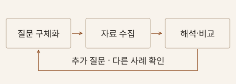

2026년 10월 30일 DBpia의 「초보연구자를 위한 질적연구방법론」 웨비나를 들었습니다. 전날의 양적 연구에 이어, 사람들의 경험과 행동을 맥락 속에서 이해하고 그 해석을 자료로 뒷받침하는 방법을 다뤘습니다.

앞 글 「양적 연구 방법론: 설계와 측정」에서는 비교 조건과 측정, 분석 계획을 정리했습니다. 이번 글은 연구자의 위치와 참여자의 관점에서 출발해, 주요 연구 접근과 인터뷰·분석 과정을 연결하고 후반 질의응답까지 다룹니다.

## 경험을 이해하려면 무엇을 물어야 하는가

새 교육 프로그램을 적용한 뒤 점수가 얼마나 달라졌는지 알아보는 질문과, 교사가 그 프로그램을 어떤 상황에서 받아들이거나 거부했는지 알아보는 질문은 필요한 자료가 다릅니다. 후자의 경우에는 어떤 일이 있었고, 누가 관여했으며, 당사자가 무엇을 중요하게 여겼는지 들어야 합니다.

겉으로 같은 행동에도 다른 의미가 담길 수 있습니다. 한쪽 눈을 감았다 뜨는 움직임은 상대에게 보내는 신호일 수도 있고 눈이 불편해서 나온 반응일 수도 있습니다. 움직임을 세는 것만으로는 관계와 의도를 알기 어렵습니다. 행동이 일어난 상황, 그 문화에서 통하는 의미, 당사자의 설명을 함께 살펴야 합니다.

질적 연구에서는 경험과 의미, 관계와 과정에 초점을 맞춘 질문을 세웁니다. 예를 들어 ‘교사들이 원격수업을 꺼리는가’에서 더 나아가 ‘원격수업을 준비하고 운영하는 과정에서 무엇을 어렵게 느끼며, 어떤 조건에서 다른 선택을 하는가’를 물을 수 있습니다.

숫자가 있으면 양적 연구이고 인터뷰가 있으면 질적 연구라는 구분만으로는 충분하지 않습니다. 인터뷰 응답을 미리 정한 항목에 따라 집계할 수도 있고, 질적 연구에서 참여자나 사건의 수를 제시할 수도 있습니다. 연구 질문과 자료를 해석하는 방식이 맞는지 봐야 합니다.

## 연구자의 관점도 연구의 일부다

질적 연구에서는 연구자가 누구이며 참여자와 어떤 관계에 있는지가 질문과 해석에 영향을 줍니다. 같은 학교를 연구하더라도 교사로 오래 일한 사람, 학생이었던 사람, 처음 방문한 사람은 눈에 들어오는 장면과 자연스럽게 여기는 일이 다를 수 있습니다.

이러한 위치성을 밝히는 것은 자기소개를 길게 쓰는 일이 아닙니다. 현상에 대한 사전 이해, 관련 경험과 역할, 참여자와의 관계가 자료 수집과 해석에 어떤 영향을 주었는지 설명하는 것입니다. 익숙해서 놓친 장면은 무엇인지, 어떤 답을 기대했는지, 자신의 판단이 달라진 계기는 무엇인지 성찰 기록으로 남길 수 있습니다.

질적 연구 안에도 서로 다른 철학적 접근이 있습니다. 후기실증주의는 지식의 불완전성을 인정하며 설명을 검토하고, 해석주의·구성주의는 경험과 상호작용 속에서 만들어지는 의미에 주목합니다. 비판적 접근은 권력과 불평등을, 포스트모던 접근은 단일한 설명에 가려진 다양한 해석을 살핍니다. 포스트휴머니즘과 신유물론은 인간뿐 아니라 기술·사물·환경의 관계와 작용으로 관심을 넓힙니다.

따라서 모든 질적 연구가 하나의 진리관을 공유한다고 단정하기보다, 선택한 관점이 질문과 방법에 어떻게 연결되는지 설명해야 합니다. [APA의 JARS–Qual](https://apastyle.apa.org/jars/qual-table-1.pdf)도 다양한 접근을 인정하며 연구자의 배경과 사전 이해가 연구에 미친 영향을 기술하도록 합니다.

## 원격수업 사례: 개인의 태도에서 주변 조건으로

원격수업이 부실하다는 평가를 교사의 게으름만으로 설명할 수 있는지 묻는 연구가 소개됐습니다. 초등교사 11명을 두 달 동안 3–5회 인터뷰하고, 교사의 경험뿐 아니라 공문과 정책자료 등도 함께 수집한 사례입니다.

여기서는 디지털 도구를 다루는 능력만으로 설명하기 어려운 조건들이 드러났습니다. 동료와의 관계, 학부모의 평가와 민원에 대한 부담, 관리자의 이해, 업무량, 가정의 지원과 접근 환경, 정책과 플랫폼의 문제가 얽혀 있었습니다. 한 사람이 수업 방식을 선택한 이유를 알아보려면 그 선택을 둘러싼 관계와 제도도 살펴야 했던 것입니다.

교사의 대응도 하나로 묶이지 않았습니다. 합의된 방식을 성실히 따르는 ‘순응형’, 직접 문제를 제기하고 제도 변화를 요구하는 ‘강한 체인지메이커’, 자신의 실천을 보여주며 동료에게 영향을 주는 ‘조용한 체인지메이커’로 해석했습니다. 같은 조직 안에서도 변화에 관여하는 방식이 다를 수 있음을 보여주는 분석입니다.

이 분류를 모든 교사에게 적용되는 고정 성격이나 모집단의 비율로 읽어서는 안 됩니다. 해당 참여자와 시기의 자료에서 어떤 대응과 관계를 발견했는지 살피는 것이 중요합니다. 개인의 태도로 시작한 질문이 학교 문화와 변화 과정에 관한 질문으로 넓어질 수 있다는 점이 이 사례의 핵심입니다.

## 부모 인터뷰 사례: 같은 단어가 다른 뜻일 때

자폐아동의 부모가 ‘사이비 치료’로 지칭된 활동을 선택하거나 중단하는 과정을 살핀 연구도 다뤘습니다. 여기서 관심은 특정 치료의 효과를 검증하는 데 있지 않고, 당사자들이 무엇을 그런 활동으로 인식하며 어떤 상황에서 선택하는지 이해하는 데 있었습니다.

인터뷰에서는 부모, 의사, 치료사가 같은 표현을 서로 다른 기준으로 사용하는 문제가 드러났습니다. 학대나 피해 여부, 근거의 유무, 고의적인 속임수 가운데 무엇을 중요하게 보는지가 달랐습니다. 연구자는 참여자의 표현을 듣는 동시에, 자신의 연구에서 어떤 범위를 다룰지도 분명히 해야 합니다.

선택의 과정을 이해하려면 정보 부족이라는 설명만으로 끝내기 어렵습니다. 가족과 사회의 압박, 도움을 구하는 과정의 어려움, 서비스 접근 조건, 불안과 기대가 어떻게 이어지는지 살펴야 합니다. 이는 해당 연구에서 구성한 해석이며, 모든 부모가 같은 경험을 하거나 같은 순서로 선택한다는 뜻은 아닙니다.

참여자는 자신의 경험을 처음부터 정리된 이론으로 말해 주지 않습니다. 시간순으로 뒤섞인 이야기와 감정, 서로 다른 설명을 비교하고 관계를 구성하는 일은 연구자의 분석입니다. 동시에 그 해석이 원자료와 맞는지 확인하고, 예상과 다른 사례가 설명을 어떻게 바꾸는지도 검토해야 합니다.

## 같은 현장에서도 연구 접근은 달라진다

임시 주거 공간과 공동시설을 갖춘 마을에서 주민의 삶을 연구한다고 생각해 볼 수 있습니다. 한 주민이 그곳에 정착한 과정을 깊이 살필 수도 있고, 공동생활의 규칙을 관찰하거나 마을을 떠나는 과정을 설명할 수도 있습니다. 현장이 같아도 무엇을 이해하려는지에 따라 연구의 초점이 달라집니다.

| 접근          | 관심의 초점                                    | 주거 공간을 다룬다면                                   |
| ------------- | ---------------------------------------------- | ------------------------------------------------------ |
| 사례연구      | 경계가 있는 사례를 맥락 속에서 깊이 이해       | 특정 마을이나 주민 사례의 사건·관계·운영 조건          |
| 현상학        | 살아낸 경험의 의미와 성격                      | 그곳에 산다는 경험을 주민들이 어떻게 느끼고 이해하는가 |
| 근거이론      | 자료를 비교하며 과정과 관계에 대한 설명을 구성 | 정착하거나 떠나는 과정이 어떤 조건에서 달라지는가      |
| 문화기술지    | 집단이 공유하는 규칙·언어·관행과 의미          | 공동생활의 일상과 갈등을 참여관찰로 이해               |
| 내러티브 탐구 | 경험을 이야기로 구성하고 의미를 만드는 방식    | 주민이 자신의 삶과 전환점을 어떻게 이야기하는가        |
| 자문화기술지  | 연구자 자신의 경험과 문화·사회의 관계          | 내부자로 경험한 공동생활을 성찰하고 분석               |
| 생애사 연구   | 개인의 삶과 역사·사회적 조건의 연결            | 주거를 잃고 다시 정착하기까지의 삶과 시대적 맥락       |

이 표는 접근을 고를 때의 초점을 비교한 것입니다. 각 방법 안에도 전통과 분석 절차의 차이가 있으므로, 표의 질문만 가져와 방법 이름을 붙여서는 안 됩니다.

### 사례연구는 경계를 정하는 일이 중요하다

사례는 한 사람일 수도 있지만 학교, 조직, 프로그램이나 사건일 수도 있습니다. 주민 한 명의 경험을 살피더라도 가족, 이웃, 운영기관 중 어디까지 자료를 모을지 정해야 합니다. 기간과 장소, 활동 범위를 밝혀야 무엇이 사례 안에 들어가는지 분명해집니다.

독특한 사례는 중요한 통찰을 줄 수 있지만 사례연구가 반드시 이례적인 사람만 다루는 것은 아닙니다. [Crowe 등의 사례연구 방법 논문](https://link.springer.com/article/10.1186/1471-2288-11-100)에서는 연구 목적에 따라 전형적인 사례를 선정하는 방법도 설명합니다. 선정 이유와 확보할 수 있는 자료의 깊이가 중요합니다.

### 근거이론은 범주 사이의 관계를 설명한다

근거이론은 인터뷰 내용을 항목별로 요약하는 데서 더 나아가, 어떤 조건에서 행동이 나타나고 과정이 어떻게 이어지는지 자료에 근거한 설명을 구성합니다. 수집과 분석을 병행하면서 사건과 사례를 계속 비교하고, 더 확인할 범주나 관계에 따라 다음 자료를 찾습니다. 이론적 표집은 이런 분석의 필요에 따라 자료 수집을 이어가는 방식입니다.

예를 들어 마을을 떠나는 주민과 계속 머무는 주민의 차이가 중요해졌다면, 그 차이를 설명할 경험과 조건을 더 살필 수 있습니다. 처음 정한 인원만 채웠다는 이유로 설명이 충분해지는 것은 아닙니다. 반대로 한 연구에서 만든 설명이 모든 사람에게 예외 없이 적용되는 보편 법칙이어야 하는 것도 아닙니다.

### 현상학·내러티브·생애사는 무엇을 다르게 보는가

현상학에서는 불안한 순간의 신체 감각, 타인과의 관계, 시간과 공간이 어떻게 경험되는지처럼 살아낸 경험의 의미를 깊이 살핍니다. 단순한 경험 목록보다 그 경험이 당사자에게 어떤 것이었는지가 중심입니다.

내러티브 탐구는 어떤 일을 먼저 말하고 무엇을 전환점으로 삼는지, 누구에게 어떤 상황에서 이야기하는지에도 관심을 둡니다. 연구자와 참여자의 대화가 이야기를 구성하는 과정에 관여할 수 있습니다. 생애사에서는 개인의 선택을 그 시대의 제도와 문화, 역사적 조건에 연결해 이해하는 작업이 특히 중요합니다.

### 문화기술지와 자문화기술지는 내부와 외부를 성찰한다

문화기술지에서는 사람들이 실제로 무엇을 하고 어떤 규칙을 공유하는지 일상에 참여하며 살핍니다. 인터뷰에서 ‘우리는 서로 돕는다’는 말을 듣는 것과, 언제 누구에게 도움을 요청하고 누가 빠지는지 현장에서 관찰하는 것은 다른 자료를 줍니다.

자문화기술지는 연구자 자신의 경험을 문화적·사회적 맥락과 연결해 분석합니다. 익숙한 경험을 길게 쓰는 것만으로 충분하지 않습니다. 내부자라서 알 수 있는 것과 당연하게 여겨 놓치는 것을 함께 검토해야 합니다. 외부자의 거리나 내부자의 친밀함 가운데 어느 하나가 항상 더 정확한 이해를 보장하지는 않습니다.

## 참여자는 인원보다 선정 이유가 먼저다

질적 연구에서는 질문과 관련된 경험을 풍부하게 설명할 수 있는 참여자를 찾는 목적표집을 사용할 수 있습니다. ‘말을 잘하는 사람’만 고른다는 뜻은 아닙니다. 경험의 차이와 연구에 필요한 관점을 고려하고, 접근하기 쉬운 사람에게만 의존했을 때 빠지는 목소리도 살펴야 합니다.

접근이 어려운 집단에서는 참여자의 소개를 통해 다음 참여자에게 연결되는 눈덩이 표집을 활용할 수 있습니다. 다만 비슷한 관계망의 경험만 모일 수 있으므로 모집 경로와 그 한계를 밝혀야 합니다. 소개자가 다른 사람의 연락처나 민감한 경험을 동의 없이 넘기도록 해서는 안 됩니다.

참여자 수는 연구 범위, 접근 방법, 자료의 깊이와 다양성, 분석의 필요에 따라 설명해야 합니다. [JARS–Qual](https://apastyle.apa.org/jars/qual-table-1.pdf)에도 질적 연구의 합의된 최소 인원은 없으며 선정 인원의 근거를 제시해야 한다고 명시돼 있습니다. 자료에 제시된 인원 예시는 계획을 검토할 참고 범위로 읽어야 합니다.

## 인터뷰는 핵심을 묻되 답을 정해 두지 않는다

참여자가 말하지 않은 마음을 연구자가 짐작해서 채워서는 안 됩니다. 핵심 질문을 피하지 않으면서도, 연구자가 정한 원인에 동의하도록 몰아가지 않는 방식으로 물어야 합니다. 관계를 형성하고 당시 상황을 떠올리게 한 뒤 구체적인 선택과 의미를 묻는 흐름이 도움이 됩니다.

다음은 인터뷰 질문을 구체화하는 방식의 예입니다.

| 목적        | 질문의 예                                                   | 주의할 점                             |
| ----------- | ----------------------------------------------------------- | ------------------------------------- |
| 장면 확인   | 그 결정을 내리던 날 어떤 일이 있었나요?                     | 결론보다 사건과 순서를 먼저 듣기      |
| 구체화      | 준비가 어려웠다고 하셨는데, 어떤 부분이었나요?              | 연구자의 분류에 바로 끼워 맞추지 않기 |
| 이유와 조건 | 그때 다른 방법도 생각하셨나요? 무엇이 선택에 영향을 줬나요? | 특정 원인을 질문 안에 단정하지 않기   |
| 의미 확인   | 그 경험은 본인에게 어떤 의미였나요?                         | 행동의 의미를 대신 정하지 않기        |
| 이해 확인   | 제가 이해한 내용이 맞나요? 다른 점이 있다면 설명해 주세요.  | 반박과 수정이 가능한 여지를 주기      |
| 마무리      | 아직 묻지 않았지만 중요하게 말씀하고 싶은 것이 있나요?      | 질문지 밖의 경험도 들을 기회 남기기   |

반구조화 인터뷰에서는 공통 질문을 준비하되 응답에 따라 후속 질문을 달리할 수 있습니다. 한 참여자에게 더 확인할 내용이 있어 추가 인터뷰를 할 수도 있습니다. 질문이 달라진 이유와 수집 과정을 기록하고, 연구 질문 및 동의받은 범위를 벗어나지 않도록 해야 합니다.

## 자료를 모으는 동안 해석도 되돌아본다

질적 자료는 인터뷰에만 한정되지 않습니다. 현장노트, 공문과 정책 문서, 사진, 일기, 온라인 게시물, 공간 배치 등도 질문과 관련된 자료가 될 수 있습니다. 많이 모으는 것 자체보다 각 자료가 무엇을 보여주며 어떤 조건에서 만들어졌는지 확인하는 일이 중요합니다.

전사본을 읽을 때는 표현만 추리지 말고 질문과 앞뒤 맥락을 함께 봐야 합니다. 관찰한 장면, 참여자의 설명, 연구자의 추측과 분석 메모를 구분하면 나중에 해석의 근거를 되짚기 쉽습니다. 인터뷰 중 떠오른 설명은 후속 질문이나 다른 자료를 통해 더 살펴야 합니다.

자료 수집과 해석을 오가며 질문을 구체화하는 개념도입니다. 특정 연구의 측정 결과나 모든 질적 접근의 고정 절차를 나타내지는 않습니다.

### 코드에서 범주와 주제로 이어가기

주제 중심 분석에서는 자료를 반복해서 읽고 의미 있는 부분에 코드를 붙인 뒤, 코드 사이의 관계를 검토해 범주와 주제를 구성합니다. 코드는 구절이나 장면을 해석하는 짧은 표지이고, 주제는 여러 자료를 관통하는 의미를 설명합니다.

| 작업               | 확인할 내용                                         |
| ------------------ | --------------------------------------------------- |
| 자료에 익숙해지기  | 전사본과 원기록을 읽고 맥락과 초기 생각 기록        |
| 초기 코드 만들기   | 질문과 관련된 의미를 표시하고 이전 자료도 다시 검토 |
| 범주와 주제 구성   | 코드의 관계와 차이를 살피며 잠정적 설명 만들기      |
| 검토하기           | 일부 인용문뿐 아니라 전체 자료와 맞는지 확인        |
| 이름과 범위 정하기 | 각 주제가 무엇을 설명하고 어디까지 포함하는지 정의  |
| 결과 쓰기          | 해석과 근거를 연결하고 예외·한계도 제시             |

예를 들어 ‘민원이 걱정됐다’와 ‘다른 반과 다르게 하기 어려웠다’는 표현을 같은 문제로 볼 수도 있습니다. 하지만 전자는 학부모의 평가, 후자는 동료와의 관계에서 나온 말일 수 있습니다. 곧바로 ‘변화에 대한 저항’으로 합치기보다 각각의 상황을 확인해야 합니다. 이 예시는 코드와 해석의 관계를 설명하기 위한 것이며 실제 발언을 옮긴 인용은 아닙니다.

주제는 단순히 많이 나온 단어와 같지 않습니다. 한 사람이 한 말도 중요한 질문을 열 수 있지만, 그 해석이 어떤 근거를 가지며 다른 자료와 어떻게 연결되는지 설명해야 합니다. 또한 이 분석 흐름을 근거이론이나 현상학 등 모든 방법의 절차로 그대로 대체해서는 안 됩니다.

## 해석의 깊이와 근거를 함께 보여주기

‘어려웠다’, ‘지원이 필요하다’는 응답을 항목별로 모으는 데서 멈추면 경험의 관계가 잘 드러나지 않습니다. 어떤 상황에서 어려웠는지, 누구와의 관계가 중요했는지, 제도와 자원은 선택에 어떤 조건을 만들었는지 연결해야 합니다. 개인·공동체·사회 차원을 살피되, 자료가 뒷받침하지 않는 구조적 원인을 억지로 붙여서는 안 됩니다.

연구자가 주관성을 인정한다는 것은 해석을 마음대로 해도 된다는 뜻이 아닙니다. 원자료와 코드, 범주와 주제, 최종 설명이 어떻게 이어지는지 기록하고, 설명에 맞지 않는 사례도 검토해야 합니다. 인상적인 인용문은 분석을 보여주는 근거로 사용해야 하며 분석 자체를 대신할 수는 없습니다.

참여자에게 이해한 내용을 되돌려 의견을 듣는 멤버 체크, 서로 다른 자료와 관점을 비교하는 삼각검증, 동료와의 검토, 성찰 메모 등을 활용할 수 있습니다. 다만 모든 접근에서 같은 확인 절차를 의무적으로 사용하는 것은 아닙니다. 참여자의 의견이 달라졌거나 해석에 동의하지 않는다면, 그 차이도 기록하고 검토해야 합니다.

다른 상황에 적용할 가능성을 논의하려면 연구가 이루어진 맥락을 충분히 설명해야 합니다. 독자는 대상과 환경, 관계와 조건이 자신의 상황과 얼마나 비슷한지 판단할 수 있어야 합니다. 작은 표본이라는 말만으로 기여를 부정하거나, 깊이 있는 사례라는 이유로 모든 사람에게 결론을 넓히는 것은 모두 적절하지 않습니다.

## 질의응답 내용

### 영화 비평과 내용분석의 차이

영화를 해석하는 글도 논문으로 쓸 수 있는지, 비평과 연구의 차이가 무엇인지에 관한 질문이 있었습니다. 해석이 흥미롭다는 데서 더 나아가 어떤 연구 문제를 다루며 기존 논의에 무엇을 더하는지 분명해야 합니다.

분석할 작품과 장면을 어떻게 선정했는지, 어떤 개념이나 관점으로 읽었는지, 해석을 뒷받침하는 자료가 무엇인지 설명해야 합니다. 이론을 언급했다는 사실만으로 연구가 되는 것은 아닙니다. 선택한 관점이 실제 분석에 어떻게 쓰였는지와 새로운 기여가 연결돼야 합니다.

### 다중사례연구와 내러티브 탐구

여러 사람을 인터뷰했다는 사실만으로 다중사례연구가 되지는 않습니다. 사례연구에서는 각 사례가 무엇인지 경계를 정하고, 사례마다 관련 자료를 모아 개별 사례와 사례 사이의 공통점·차이를 분석해야 합니다. 사건을 연구한다면 인터뷰 외에도 현장과 문서 등 필요한 자료를 살펴야 합니다.

내러티브 탐구에서는 경험을 어떤 이야기로 구성하는지가 관심의 중심입니다. 말하는 순서, 전환점, 대화의 상황과 연구자의 관여도 해석의 대상이 될 수 있습니다. 같은 인터뷰를 활용해도 분석의 초점과 결과를 쓰는 방식이 달라지므로, 연구 목적에 맞춰 구분해야 합니다.

### 근거이론에 필요한 분석

근거이론은 범주 몇 개를 찾았다는 이유만으로 붙이는 이름이 아닙니다. 어떤 과정과 관계를 설명하려는지, 자료 수집과 지속적인 비교를 통해 그 설명을 어떻게 발전시켰는지 보여줘야 합니다.

처음 예상한 설명에 맞지 않는 사례가 나오면 예외로 치우기보다 조건과 범주를 재검토해야 합니다. 단순한 경험 기술이나 주제별 요약이 목적이라면 그 목적에 맞는 다른 접근을 선택하는 편이 명확합니다. 연구 방법의 이름이 결과의 깊이를 대신하지는 않습니다.

### 특정 참여자가 필요한 연구의 모집

특정 집단의 역사를 잘 아는 사람이 꼭 필요하지만 IRB에서 공개모집을 요구한다는 질문이 있었습니다. 모집 방법은 연구 목적과 대상, 접근 가능성에 맞게 설명해야 합니다. 목적표집이나 눈덩이 표집이 필요한 이유와 구체적인 접촉 절차를 계획서에 밝혀야 합니다.

질적 연구는 공개모집을 할 수 없다거나 보상을 제공하면 안 된다는 일률적인 규칙으로 이해해서는 안 됩니다. 연구별 심의 조건을 확인하고, 자발성·개인정보 보호·보상 방식이 적절한지 검토해야 합니다. 필요한 참여자라는 이유로 동의 절차나 기관의 승인을 건너뛸 수는 없습니다.

### 온라인 인터뷰와 문화기술지

접근하기 어려운 참여자를 온라인으로만 인터뷰한 경우, 어떻게 질적 연구의 깊이를 확보할지에 관한 질문이 있었습니다. 온라인 인터뷰도 경험과 의미를 탐색할 수 있는 자료입니다. 다만 인터뷰 방식만으로 연구 접근이 정해지지는 않습니다.

현장 공동체의 일상과 상호작용을 이해하려는 문화기술지라면 말로 설명한 내용 외에 무엇을 관찰할 수 있는지가 중요합니다. 물리적 현장에 가지 못해 놓친 자료와 맥락을 인정해야 합니다. 온라인 공동체를 대상으로 한다면 그 공간의 상호작용과 자료에 접근하는 설계를 검토할 수 있지만, 면담만 했다는 이유로 참여관찰까지 수행한 것으로 쓰면 안 됩니다.

### 제도 개선 연구의 방법 선택

특정 국가의 제도에 문제가 있다고 보고 개선 방향을 제시하려는 질문이 있었습니다. 개선안을 결론에 쓴다는 사실만으로 질적 연구가 되는 것은 아닙니다. 정책의 논리와 법·제도를 분석하는지, 이용자의 경험을 인터뷰하는지, 정책 문서의 언어와 의미를 분석하는지에 따라 필요한 방법이 달라집니다.

예를 들어 정책이 내세우는 목표와 실제 문서에서 사용하는 표현의 관계를 살피려면 문서의 선정 범위와 분석 관점을 정해야 합니다. 인터뷰나 통계를 함께 활용한다면 각각이 어떤 질문에 답하고 결과를 어떻게 연결하는지 설명해야 합니다. 연구 목적을 구체화한 뒤 적절한 정책 분석·질적·양적 또는 혼합 접근을 선택해야 합니다.

### 선행연구가 적을 때의 방법 선택

관련 논문이 적다는 이유만으로 사례연구를 양적 연구로 바꿀 필요는 없습니다. 무엇을 아직 모르며 어떤 자료가 답을 줄 수 있는지부터 확인해야 합니다. 경험의 종류와 맥락을 탐색할 단계라면 인터뷰와 관찰이 기초를 마련하는 데 도움이 될 수 있습니다.

양적·질적 방법을 함께 사용하려면 각각의 목적과 연결 지점을 설계해야 합니다. 자료가 부족해 보인다는 이유로 다른 방법을 덧붙이면 연구 범위만 커질 수 있습니다. 앞 글에서 정리한 것처럼, 두 종류의 자료를 모으는 일과 그 결과를 통합해 질문에 답하는 일은 구분해야 합니다.

### 학생을 인터뷰할 때의 권력 관계

평가나 지도 관계에서는 참여자가 불이익을 걱정해 불편한 경험을 말하지 못할 수 있습니다. 친밀한 관계라고 해서 이런 권력 차이가 사라지는 것은 아닙니다. 연구 참여를 거절하거나 중단해도 평가와 지도에 영향이 없도록 설계해야 합니다.

모집과 인터뷰를 별도의 사람이 맡는 방법을 검토할 수 있습니다. 그래도 누가 참여 여부와 원자료를 알 수 있는지, 익명화가 실제로 가능한지, 연구자에게 어떤 자료가 전달되는지까지 살펴야 합니다. 다른 면담자를 둔다는 조치 하나로 모든 문제가 해결된다고 보아서는 안 됩니다.

### 인터뷰 인원과 종료 기준

강의에서는 방법별 인원 예시가 있는 표를 다시 짚었지만, 모든 주제에 같은 숫자를 적용할 수는 없습니다. 사례의 범위와 참여자의 경험 차이, 면담의 깊이와 반복 여부, 연구 접근이 요구하는 분석에 따라 필요한 자료가 달라집니다.

포화라는 말을 쓴다면 무엇이 더 이상 새롭게 나오지 않았는지, 어떤 비교와 분석을 근거로 판단했는지 설명해야 합니다. 단지 답이 비슷하게 들렸다는 인상만으로 충분하다고 정해서는 안 됩니다. 포화는 근거이론에서 중요한 개념이지만 그 용어를 그 방법만의 전유물로 보거나 모든 질적 연구의 종료 기준으로 강제할 수도 없습니다.

### 질적 연구의 시간과 비용

조사 인원이 적더라도 모집과 관계 형성, 반복 면담, 전사와 분석에 많은 시간이 들 수 있습니다. 문화기술지의 현장 참여나 근거이론의 추가 자료 수집은 일정과 접근 조건에 특히 영향을 받습니다. 보상 여부 하나로 전체 비용을 판단하기 어렵습니다.

학위논문에서는 기여뿐 아니라 실제로 끝낼 수 있는 범위를 검토해야 합니다. 필요한 현장과 참여자에게 접근할 수 있는지, 주어진 기간에 자료를 읽고 분석할 수 있는지, 도움을 받을 지도와 협업 조건이 있는지 확인해야 합니다. 규모를 줄일 때도 질문과 분석의 연결은 유지해야 합니다.

### 완성된 연구에서 배울 점

완성된 연구를 읽으면 방법 이름의 정의를 넘어 실제 자료와 해석의 연결을 볼 수 있습니다. 『불평등한 어린 시절』은 가정과 학교의 일상을 관찰해 계층과 양육의 관계를 다루는 문화기술지 사례로 소개됐습니다. 『My Freshman Year』에서는 교수가 신입생으로 생활하며 학생의 시간과 관계, 학업 경험을 살폈습니다.

『Awareness of Dying』은 환자와 가족, 의료진이 임박한 죽음을 어떻게 알고 이야기하는지 분석한 연구입니다. 모르는 상태, 의심하는 상태, 서로 알면서도 모르는 척하는 상태, 솔직하게 이야기하는 상태라는 네 가지 인식 맥락을 제시했습니다. 이것을 모든 사람이 차례로 거치는 단계로 읽어서는 안 됩니다.

사례를 읽을 때는 인상적인 결론뿐 아니라 질문, 현장 접근, 참여자의 말과 관찰, 분석 과정, 해석의 범위를 함께 살펴야 합니다. AI가 추천한 논문도 실제 존재하는지와 원문의 내용부터 확인해야 합니다.

### 녹음 파일의 전사와 확인

마지막에는 인터뷰 녹음을 텍스트로 옮기는 방법을 다뤘습니다. **클로바노트** 등 자동 전사 도구를 활용할 수 있지만, 초벌 전사본을 그대로 분석 자료로 확정해서는 안 됩니다. 발음이 비슷한 전문용어, 화자 구분, 부정 표현과 생략된 말은 녹음과 대조해야 합니다.

연구 질문에 따라 침묵, 웃음, 억양이나 겹쳐 말하기도 의미가 있을 수 있습니다. 무엇을 전사에 포함하고 어떤 방식으로 표시했는지 일관되게 기록해야 합니다. 외부 서비스에 녹음을 올리기 전에는 참여자의 동의 범위, 개인정보와 민감한 내용, 기관의 보관·처리 조건도 확인해야 합니다.

## 이해를 설명할 수 있는 기록으로 남기기

이번 웨비나는 행동을 바깥에서 분류하는 데서 더 나아가, 당사자가 경험한 의미와 그 선택을 둘러싼 조건을 살피는 과정을 다뤘습니다. 연구자는 질문을 던지고 자료를 고르며 해석에 관여하므로, 자신의 위치와 판단 과정도 함께 검토해야 합니다.

깊이 있는 이야기를 듣는 것과 설득력 있는 연구로 쓰는 일 사이에는 자료 수집과 비교, 성찰과 분석이 있습니다. 참여자의 경험을 충분히 설명하고, 그 경험에서 어떤 해석에 이르렀는지 근거를 보여줘야 합니다. 양적 연구에서 비교와 측정의 조건이 중요했던 것처럼, 질적 연구에서는 경험과 맥락, 해석을 잇는 과정이 결과의 의미를 지탱합니다.
