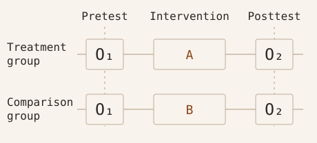

On 29 October 2026, I attended DBpia's webinar “Quantitative Research Methods for Beginning Researchers”. Its focus was on choosing comparison conditions and measurements that fit a research question, then drawing conclusions within the limits of that design, rather than on which buttons to press in statistical software.

In “Using AI for Research Paper Writing and Visualisation”, I described how to examine data and connect them with figures and a manuscript. This Note addresses the preceding question: which data need to be collected, and under which conditions, to answer the question? It connects the experimental examples with measurement, interpretation and the later discussion.

## Establish the question before choosing the method

Research starts with a problem to address. If something in practice seems difficult or puzzling, check which answers the literature already offers. Is the research dated? Does it concern a different population or setting? What remains unexplained? These distinctions help establish why another study is needed.

Then decide what evidence could answer the question. “What should be observed and measured to understand this problem?” comes before “I want to do quantitative research; what topic should I choose?”

Consider studying the act of closing and reopening one eye. Similar movements might signal a joke or attraction to another person, or arise from eye discomfort. Counting the movements can produce similar records, but understanding their meaning requires the relationship, circumstances and the person's account as well.

Questions about frequency or differences between situations can be addressed through counts and proportions. Questions about intention and how another person understood the action call for contextual evidence from observation and interviews. The behaviour can be the same while the question changes the evidence needed. Rather than classifying quantitative and qualitative research by particular words alone, check whether the question, evidence and analysis fit together.

| Focus of the question                   | Example of a quantitative approach                       | Scope to establish                                       |
| --------------------------------------- | -------------------------------------------------------- | -------------------------------------------------------- |
| How much or how often?                  | Describe a situation using counts, proportions and means | Population, period and respondent composition            |
| What is related to what?                | Analyse correlations or predictive relationships         | Direction and magnitude, and alternative explanations    |
| Does an intervention change an outcome? | Examine differences under comparison conditions          | Group formation, other conditions and measurement timing |

Expressing something numerically does not establish causation. Correlational research can show variables changing together, but the direction of causation and possible common influences require separate consideration.

## Distinguish variables and controlled conditions

Consider an experiment examining whether the number of shed hairs differs when people use shampoo A or B. The independent variable is the shampoo assigned, and the dependent variable is hair loss measured using a specified procedure. Separating the condition being compared from the outcome being measured makes the design clearer.

| Role                  | Shampoo comparison                                   | What to specify                                                     |
| --------------------- | ---------------------------------------------------- | ------------------------------------------------------------------- |
| Independent variable  | Shampoo A versus shampoo B                           | What will differ between conditions?                                |
| Dependent variable    | Number of shed hairs counted by a defined procedure  | What will be measured, when and in which units?                     |
| Controlled conditions | Duration, frequency of use and measurement procedure | How will differences other than the intended comparison be reduced? |

These definitions concern experiments that manipulate an intervention. A characteristic used as an explanatory variable in an observational study is not necessarily a cause manipulated by the researcher.

If one group washes its hair and the other does not, the shampoo comparison becomes entangled with washing itself. If the question concerns improvement over an existing shampoo, both groups need comparable conditions while using their assigned products. Similarly, giving only one group additional teaching time and attention makes it difficult to separate a game's content from those additional influences.

Not every condition can be made identical. Identify plausible influences in advance, then distinguish conditions to keep consistent, characteristics to record, and differences to address analytically.

## Why add a comparison group to pretest and posttest measurements?

In design notation, `X` represents an intervention and `O` an observation or measurement. Subscripts distinguish measurement occasions. `O₁ → X → O₂` means measuring first, intervening, then measuring again.

| Design                                              | What it reveals                                      | Remaining limitation                                                                       |
| --------------------------------------------------- | ---------------------------------------------------- | ------------------------------------------------------------------------------------------ |
| One measurement after intervention: `X → O₁`        | The subsequent state                                 | No initial state or amount of change                                                       |
| One-group pretest–posttest: `O₁ → X → O₂`           | Observed change within that group                    | Time, repeated testing and external events are difficult to separate from the intervention |
| Additional baseline measurement: `O₁ → O₂ → X → O₃` | Earlier trend and subsequent change                  | Other changes coinciding with the intervention may remain                                  |
| Two-group pretest–posttest comparison               | Initial states and patterns of change in both groups | Initial differences and other conditions still need scrutiny                               |

In the shampoo example, a reduction in hair loss might also be explained by changing seasons or stress. In education, maturation, practice from repeating a test, and teacher attention are alternative explanations.

A comparison group provides a reference for change over the same period under another condition. Whether it should receive no intervention, usual practice or an alternative intervention depends on the question. To examine a method's additional benefit, specify exactly what the comparison condition contains.

This conceptual diagram explains measurement timing and comparison conditions. It is not a results graph and does not indicate whether group allocation was randomised.

The analysis should go beyond a separate pretest–posttest comparison within the experimental group. If both groups improve, the question is whether their changes also differ. A significant result in one group and a non-significant result in the other do not by themselves establish a difference between the effects, as [Gelman and Stern explain](https://www.stat.columbia.edu/~gelman/research/published/signif4.pdf). The between-group comparison of change needs to fit the design.

## Random allocation and constraints in field research

A randomised experiment assigns participants to intervention conditions at random. Random allocation aims to reduce group differences in both known and unmeasured characteristics. It does not make every characteristic exactly equal in one allocation, so group composition and initial measurements still need reporting.

Existing classes or institutions may be difficult to reorganise. Such quasi-experimental designs require closer examination of initial attainment, participant characteristics, operating conditions and other group differences. Explain which characteristics were compared alongside the claim that similar groups were selected.

Random **allocation** and random **sampling** also serve different purposes. Allocation divides participants among experimental conditions; sampling selects participants from a population. Interpreting an intervention effect and deciding how widely findings generalise are separate questions.

## Small-sample studies and repeated measurement

When recruitment is difficult, a single-case design can systematically examine change through repeated observations of the same case. One participant does not automatically invalidate a study. However, a single pretest–posttest comparison differs from a design that systematically repeats baseline and intervention conditions.

In an ABAB design, A is baseline or the condition without intervention, and B is the intervention condition. Repeated measurements across A → B → A → B examine whether outcomes repeatedly correspond to condition changes. The webinar's calculator example alternated paying without a calculator and paying with one, observing performance in each condition.

Acquired knowledge may persist after the intervention is removed, preventing a return to the earlier A condition. Withdrawing a beneficial intervention also needs consideration. Other approaches, such as multiple-baseline designs that stagger intervention onset across cases or settings, may be appropriate.

More measurements also change burden and practice effects. Repeating the same questionnaire or test can cause fatigue or familiarity, so intervals and procedures need planning. Repeated observations from one person must not be treated as independent data from several people.

## Check measurement scales before entering numbers

First establish what a number in the analysis file means. Participant numbers and group codes may be identifiers rather than quantities.

| Scale    | Meaning                               | Example                                      | Interpretive caution                                           |
| -------- | ------------------------------------- | -------------------------------------------- | -------------------------------------------------------------- |
| Nominal  | Distinguishes categories              | Blood group, occupation category, group code | Numerical code size or mean has no quantitative interpretation |
| Ordinal  | Represents an order                   | Rank, educational stage                      | Do not assume equal intervals between positions                |
| Interval | Equal differences are meaningful      | Celsius temperature                          | Zero does not mean absence; ratio interpretations need care    |
| Ratio    | Equal intervals and a meaningful zero | Length, mass, time interval                  | Check units and measurement range                              |

The same values, 1, 2 and 3, can support different summaries and analyses depending on whether they represent codes, ranks or measurements. Retain variable names, code meanings, units and missing-value conventions with the data description to reduce confusion during entry and analysis.

## Examine reliability and validity separately

Reliability concerns consistency; validity concerns whether measurement results support the intended interpretation of a concept. An instrument can give consistent results while measuring something other than the intended construct.

Self-reported agreement with “I am creative” differs from demonstrated creative performance. The appropriate instrument depends on whether the question concerns self-perception or performance.

Reliability can be examined through test–retest stability, agreement between observers or raters, and internal consistency across items. The relevant evidence depends on the measurement and construct; a high value for one indicator does not establish overall measurement quality.

| Aspect             | Question                                                       | Examples of relevant evidence                                      |
| ------------------ | -------------------------------------------------------------- | ------------------------------------------------------------------ |
| Construct validity | Does the measurement reflect the intended concept?             | Concept definition and relationships with related measures         |
| Content validity   | Are necessary areas covered?                                   | Mapping items to domains and expert review                         |
| Internal validity  | Can the observed difference be attributed to the intervention? | Comparison conditions, allocation and alternative explanations     |
| External validity  | Do findings apply to other people and settings?                | Sample composition, context and replication under other conditions |

Consider both measurement validity and design validity without treating them as substitutes. Even a sound instrument cannot resolve an imbalanced comparison condition on its own.

### Adapting or translating a questionnaire

Develop items from prior research and concept definitions. For an existing instrument, establish the population, language and conditions in which it was examined, and record adaptations for the new population. Appearance in a thesis appendix does not establish unrestricted reuse: check conditions for use, adaptation and translation.

Revising or translating items can change their meaning to respondents. Expert review and preliminary testing with people similar to the intended participants should examine ambiguous wording, reading level and missing domains. Font size, instructions and total response time also matter for children, older adults and speakers of other languages.

Too many items can reduce later response quality through fatigue; too few may fail to cover the construct. Set length according to the measurement purpose and response burden rather than the desired length of the paper.

## Plan the analysis before collecting data

The lecture and discussion repeatedly returned to planning analysis before collection. The question, unit of observation, instrument, required sample and analytical method need to connect in advance.

| Planning item                   | What to record                                                                                  |
| ------------------------------- | ----------------------------------------------------------------------------------------------- |
| Question and hypotheses         | Differences or relationships to examine; primary outcome                                        |
| Participants and data structure | Eligibility, groups and units such as individuals, classes or repeated measurements             |
| Measurement procedure           | Instrument, occasions, units and scoring or coding rules                                        |
| Analysis and sample size        | Methods appropriate to the design and variable types, assumptions and sample-size justification |
| Exceptions                      | How missingness, attrition and procedural changes will be recorded and addressed                |

Pretest and posttest scores from the same person form paired data, unlike two groups of different people. Where interventions are delivered by class, observations within a class may be related. The analysis needs to reflect these structures.

Sample size should be justified through the difference to be detected, variability, analytical method, significance level and power rather than a fixed headcount. Power is the probability that a specified test detects a specified effect when that effect is present. [UCLA's introduction to power analysis](https://stats.oarc.ucla.edu/other/mult-pkg/seminars/intro-power/) also considers assumptions, design and estimation precision alongside sample size.

A larger sample and a representative sample are different achievements. Recruitment through one channel can leave people outside that channel poorly represented even with many responses. Describe both the intended population and the recruitment method.

Digitise observations promptly while retaining original records separately from analytical data. Document codes and values, and record the reasons and timing of corrections so that the analysis can be traced back to the evidence.

## Separate mean differences, statistical significance and practical meaning

Descriptive statistics summarise the data collected. Counts, proportions, means, standard deviations and plots can show observed sample differences. Extending those differences to a population or interpreting them as intervention effects requires attention to design and uncertainty.

A p-value is the probability, assuming the null hypothesis and model assumptions hold, of obtaining a test statistic at least as extreme as the observed one. For a test of no difference between conditions, it assesses how unusual the result would be under that assumption. [JMP's explanation of p-values](https://www.jmp.com/en/statistics-knowledge-portal/inferential-statistics/hypothesis-testing/p-values) covers the definition and interpretation.

`p < .05` does not mean that the research hypothesis has a 95% probability of being true or that this result has less than a 5% probability of being due to chance. The [American Statistical Association statement](https://www.amstat.org/asa/files/pdfs/P-ValueStatement.pdf) explains that p-values measure neither a hypothesis's probability of being true nor effect size, and that conclusions should not depend on a threshold alone.

Report the direction and magnitude of a difference, uncertainty and design limitations. A statistically significant small difference may have little practical importance. A non-significant result does not establish no effect: sample size or measurement precision may leave insufficient evidence to decide.

## Connect design and interpretation through research examples

### Robots and language behaviour: does initial interest persist?

The language-behaviour example used **LENA** to record indicators such as vocalisations and conversational turns. This turns an impression of greater talkativeness into observable units that can be examined across time and settings.

The comparison of robot use, special-class and mainstream-class settings examined trends over time alongside initial responses. Novelty can temporarily increase attention to a new tool, so an early response should not immediately be interpreted as sustained learning or behavioural change.

These observations concern particular cases and settings. Distinguish repeated observation counts from participant counts, and identify the measures and period involved. An observed trend cannot establish that every robot is ineffective for every learner.

### Educational games: knowledge, interest and performance are separate outcomes

The vocational-training example assessed actual task performance rather than only in-game scores. To examine transfer from game practice to real work, the outcome must address that question.

Another educational-game example measured attainment, subject interest and perceptions of games separately. A difference in knowledge scores does not establish corresponding changes in interest or attitudes. Report what each outcome measured, and the analysis and period supporting its interpretation.

Educational goals, content errors, usability and difficulty can also affect interpretation. Short duration and content characteristics can be discussed as possible explanations, but require further evidence before being treated as established causes.

### AI writing: measure revision as well as the finished text

[Kwon and Lee's writing study](https://doi.org/10.30564/fls.v7i6.9985) involved 15 female undergraduates completing ChatGPT-assisted tasks under quick, minimal-effort and thorough-review conditions. It examined Google Docs revision traces and prompts, addressing how similar final text lengths can accompany different revision behaviours and writing characteristics.

The measures went beyond whether AI was used to examine what was requested and how text was added, deleted and revised. More varied prompts or more edits should be interpreted within the task and conditions rather than turned into universal criteria for good writing.

The separate slide example [Your Brain on ChatGPT](https://arxiv.org/abs/2506.08872) compared LLM, search-engine and unaided writing conditions using EEG, essays, recall and interviews. It is distinct from the editorial-footprints study. Its findings concern a particular essay task and should not be extended to a general claim of long-term cognitive decline from all AI use.

## Include ethics and AI analysis in the design

Human-participant research needs an explanation of purpose, participation, withdrawal rights and handling of personal information. Establish any required IRB review or exemption determination before collection, according to the institution's procedures and the research. A particular university's requirements described in the webinar cannot be assumed to apply to every institution or degree.

Replacing names with research codes may still leave people identifiable through combinations of information. Decide access and storage arrangements as well. Before submitting material to an external AI service, examine identifiers and sensitive content and follow institutional and service conditions.

AI-generated analysis code or plots still require checking variables, excluded observations, calculations and plotted values. Retain source data, executable code and analytical settings for reproduction. Distinguish images synthesised by generative AI from statistical plots drawn from actual data using code, and check the relevant publication policy.

## Questions and answers

### What does a comparison group control?

The word “control” can suggest a group that is specially restrained or managed. Its central role here is to provide a reference for interpreting change in the experimental group. If scores rise after a new educational programme, comparison with people receiving the usual teaching over the same period helps assess the programme's effect.

A controlled variable is a condition held consistent or addressed in the analysis; a control or comparison group supplies the reference participants. Matching teaching time or measurement procedures serves a different purpose from including a comparison group. Explain whether that group received usual teaching, another activity or no intervention, since these conditions change what the comparison can mean.

### Does adding interviews after quantitative data make a mixed-methods study?

Interviews are sometimes added when a survey or experiment seems insufficient to explain the findings. Adding a few quotations does not establish adequate integration. Specify why interviews are needed, how participants will be selected, what will be asked, how accounts will be analysed and where they connect with the quantitative findings.

For example, participants with similar score improvements might have used a programme differently. Explaining that difference through interviews requires a defined comparison of experiences and analysis of similarities and differences across accounts. Selecting only quotations that fit the result can obscure contrary experiences.

[NIH guidance on mixed-methods research](https://obssr.od.nih.gov/sites/g/files/mnhszr296/files/Best_Practices_for_Mixed_Methods_Research_developing_an_R_series_plan_that_incorporates_mixed_methods_research.pdf) likewise emphasises a question-led approach and integration of quantitative and qualitative data and findings. Rather than assuming the approaches cannot be combined in principle, plan the time and work required for each analysis and their connection.

### Who should be interviewed after a survey, and how many people are needed?

One question concerned surveying educators who had implemented a newly developed programme, then interviewing cases that matched expectations and contrasting cases. This design needs a connection between the patterns the survey will establish and the differences the interviews will explain.

Including unexpected responses in interview selection can help examine both enabling conditions and difficulties. Explain the selection criteria and which survey findings the accounts illuminate. A few interview cases should not be interpreted as proportions or distributions across all participants.

Survey numbers need to follow from the target population, recruitment, analysis, differences to be detected and desired precision. No single number is a universal minimum. If few people have implemented a programme and the question concerns its implementation process, in-depth interviews and observation may fit better. A larger number alone does not establish representativeness.

### What if prior research is too limited to develop survey items?

When the types of experience are poorly understood, even defining response options can be difficult. Guessing the categories without knowing the experiences, their timing or routes into participation can omit important answers.

Interviews or observation can establish what people experience and how they describe it, providing a foundation for items. Extending this into a survey also requires examining item meanings and response formats. Transferring expressions from exploratory work does not by itself establish an instrument's reliability or validity.

Assess whether exploration, instrument development and review, and a main survey are feasible within one study. A study can focus on understanding experiences and processes, leaving survey development for follow-up research. Check whether the question has an adequate foundation before committing to a questionnaire.

### Is exploratory factor analysis the same as exploratory research?

The shared word “exploratory” does not make the aims or procedures equivalent. Exploratory factor analysis is a statistical procedure for examining latent factor structure through relationships among measured variables, for example when examining how questionnaire items group together.

Exploring reasons for choices or poorly understood experiences through interviews is a broader research aim. Investigating motives or background does not mean that factor analysis has been performed. A proposal needs to specify the evidence and analytical procedure as well as what is being explored.

### When should the analysis and thesis structure be decided?

A question about statistical software returned to the analysis plan. Waiting until collection is complete to choose a test can reveal that a necessary variable is missing or that groups and measurement occasions do not support the intended comparison.

Connect the research question, participants and sample size, instruments, data structure and analysis before collection. Measuring the same people twice, comparing separate groups and examining relationships between variables require different evidence and analyses. Proposal review should examine whether these connections are feasible.

The methods section needs to explain participants, design, instruments, collection and analysis; the results should address the research questions. Chapter numbering and order follow departmental or journal requirements, but readers must be able to trace how findings were obtained. Necessary changes should undergo relevant review or approval and be recorded; distinguish changed analyses from the original plan when reporting.

### Should I use SPSS, jamovi or R?

Questions also concerned using **SPSS**, **jamovi** and R. The answer described using jamovi in student research, but the required analysis comes before the program choice. Results can differ when programs use different missing-value rules, variable types or test options.

Being able to select a test does not establish that it fits the data. Interpreting results requires understanding group construction, repeated observations from the same people and analytical assumptions. Statistical concepts and software operation need to be learnt together.

When checking AI output in another program, compare the variables, analysis and settings rather than numbers alone. If values differ, trace the inputs and processing before deciding which result is correct.

### Can AI be used to create statistical graphs?

One question asked about supplying data to AI to produce charts or graphs. First distinguish statistical plots drawn from actual values using code from images synthesised by generative AI. A picture resembling a graph does not provide an adequate way to verify the underlying values.

Check which rows and variables the code used, which values were excluded or transformed, and whether axes and legends represent the numbers correctly. Retain code and settings so the figure can be regenerated from the source data.

Check the journal's AI-use and image policies as well. Avoid assuming that an entire discipline permits or prohibits every use; assess the type of output against the intended journal's rules. AI involvement does not establish analytical accuracy.

### Is content analysis just counting occurrences?

Analysis of textbooks or curricula can count occurrences of particular content. For discriminatory expressions, for example, define the material and classification criteria before examining frequencies or differences between sources.

The same word can appear in a passage reproducing discrimination or one criticising it. Explaining what a count means requires reading the surrounding sentences and situations. Distinguish questions about frequency from questions about meaning, and specify the classification and analysis appropriate to each.

### How can interview accounts be checked against other evidence?

An example concerned comparing interview claims that certain facilities were concentrated in a particular area with official statistics. Even when several people agree, establish whether the claim concerns total counts or population-adjusted rates.

An area with more facilities can have a lower rate once population is used as the denominator. Match facility definitions, geographical scope, reporting dates and denominators. Differences between perceived concentration and statistical distribution also require interpretation.

Triangulation uses different evidence to examine the same phenomenon; it should not automatically treat one source as conclusive proof of another. Examine each source's scope and where accounts agree or diverge. Official statistics do not replace an explanation of participants' experiences or their meaning.

### Can an account of implementation be research?

Examining how a method is put into practice can be worthwhile research. Establish why the process needs to be understood before listing what was done.

For example, educators may struggle to apply an approach intended to make lessons accessible to diverse learners. Examining the decisions and actions of someone who implements it well can reveal difficulties and ways of addressing them. This connects the practical case to the research problem and its significance.

Explain why the case was selected, what evidence was examined and how it was analysed. Calling a case successful does not establish effectiveness; distinguish understanding implementation from testing its effects.

### What should a beginning researcher check first?

The final question asked what a novice should prepare after choosing a topic and what is easily overlooked. The answer emphasised piloting the programme and questionnaire before the main study.

Try items and procedures with people similar to the intended participants. Check understanding of instructions and wording, missing response options and the time needed for responses or activities. For experiments, also check equipment, recording procedures and whether the planned conditions can be maintained.

Correct problems and record the reasons for changes before starting the main study. Participants who have experienced a programme or test cannot easily be restored to their initial state, so invest in preliminary checks rather than relying on repairs after collection. A successful small pilot does not by itself establish the main study's effects or the instrument's validity.

## More decisions belong before collection

The webinar placed the preparation for quantitative research well before opening statistical software. Comparison conditions and instruments need to fit the question, and the available analysis and interpretive scope need to be considered before collection.

A finished graph or significant p-value cannot substitute for the design. Explaining a result requires connecting what was collected and why, what it was compared with, and how far alternative explanations were reduced. Piloting and an analysis plan test those connections in advance.
