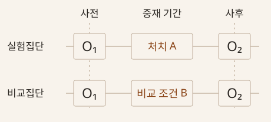

2026년 10월 29일 DBpia의 「초보연구자를 위한 양적연구방법론」 웨비나를 들었습니다. 통계 프로그램에서 어떤 버튼을 누르는지보다, 연구 질문에 맞게 비교 조건과 측정 방법을 정하고 그 설계가 허용하는 범위에서 결론을 쓰는 과정이 중심이었습니다.

앞 글 「AI를 활용한 논문 작성과 시각화」에서는 데이터를 살피고 그림과 원고로 연결하는 방법을 정리했습니다. 이번 글은 그보다 앞선 단계, 즉 어떤 데이터를 어떤 조건에서 수집해야 질문에 답할 수 있는지를 다룹니다. 강의의 실험 예제부터 측정과 해석, 후반 질의응답까지 이어서 정리했습니다.

## 방법을 고르기 전에 연구 질문부터 정하기

연구는 해결할 문제를 찾는 데서 시작합니다. 현장에서 불편하거나 이상하다고 느낀 일이 있다면, 관련 문헌에서 이미 어떤 답을 제시했는지 확인해야 합니다. 연구가 오래됐는지, 다른 대상이나 조건에서 수행됐는지, 기존 설명으로도 여전히 남는 문제가 있는지를 살펴야 연구의 필요성을 구체화할 수 있습니다.

그다음에 그 질문을 어떤 자료로 답할지 정합니다. ‘나는 양적 연구를 할 것인데 주제는 무엇으로 할까’보다 ‘이 문제를 밝히려면 무엇을 관찰하고 측정해야 할까’가 먼저입니다.

한쪽 눈을 감았다 뜨는 행동을 연구한다고 생각해 보면 차이가 분명해집니다. 겉으로 비슷한 움직임도 상대에게 보내는 장난이나 호감의 신호일 수 있고, 눈이 불편해서 나온 반응일 수도 있습니다. 움직인 횟수만 세면 비슷한 기록이 남지만, 그 행동의 의미를 알려면 상대와의 관계, 당시 상황과 당사자의 설명도 살펴야 합니다.

얼마나 자주 나타나는지, 상황별 빈도에 차이가 있는지를 묻는다면 횟수와 비율을 비교할 수 있습니다. 반면 어떤 의도로 행동했고 상대가 어떻게 받아들였는지를 묻는다면 관찰과 인터뷰로 맥락을 이해하는 접근이 필요합니다. 같은 행동을 다뤄도 질문에 따라 필요한 자료가 달라집니다. 양적·질적 연구를 특정 단어만으로 나누기보다 질문과 자료, 분석 방법이 맞물리는지 봐야 합니다.

| 질문의 초점                 | 양적 접근의 예                        | 확인할 범위                            |
| --------------------------- | ------------------------------------- | -------------------------------------- |
| 무엇이 얼마나 있는가        | 빈도·비율·평균으로 현황을 기술        | 조사 대상과 기간, 응답자 구성          |
| 무엇과 무엇이 관련되는가    | 변수 사이의 상관이나 예측 관계를 분석 | 관계의 방향과 크기, 다른 설명의 가능성 |
| 어떤 처치가 결과를 바꾸는가 | 비교 조건을 둔 실험으로 차이를 검토   | 집단 구성, 처치 외 조건, 측정 시점     |

숫자로 표현했다는 사실만으로 인과관계가 성립하지는 않습니다. 상관연구는 두 변수가 함께 변하는 양상을 보여줄 수 있지만, 어느 쪽이 원인인지나 공통된 다른 요인이 있는지는 별도로 검토해야 합니다.

## 독립변인·종속변인·통제 조건을 구분하기

샴푸 A와 B 중 어느 쪽을 사용했을 때 빠지는 머리카락 수가 달라지는지 알아보는 실험을 생각해 볼 수 있습니다. 이때 독립변인은 사용하게 한 샴푸이고, 종속변인은 일정한 방식으로 측정한 탈모량입니다. 비교하려는 조건을 정하는 일과 결과를 측정하는 일을 나누면 연구 설계도 더 분명해집니다.

| 역할      | 샴푸 비교 예제                    | 설계에서 정할 내용                           |
| --------- | --------------------------------- | -------------------------------------------- |
| 독립변인  | 샴푸 A와 샴푸 B                   | 무엇을 다르게 제공할 것인가                  |
| 종속변인  | 정해진 절차로 센 빠진 머리카락 수 | 무엇을 언제, 어떤 단위로 측정할 것인가       |
| 통제 조건 | 사용 기간·횟수·측정 절차 등       | 비교하려는 것 외의 차이를 어떻게 줄일 것인가 |

이 정의는 처치를 조작하는 실험의 맥락입니다. 관찰연구에서 설명변수로 사용한 특성이 곧 연구자가 조작한 원인이라는 뜻은 아닙니다.

한 집단은 머리를 감고 다른 집단은 전혀 감지 않는다면, 특정 샴푸의 차이와 씻는 행위의 차이가 섞입니다. 비교하려는 질문이 ‘기존 샴푸보다 나은가’라면 양쪽이 같은 조건에서 각각의 샴푸를 사용해야 합니다. 교육용 게임도 한쪽에만 추가 수업과 관심을 제공하면 게임 내용의 효과와 수업 시간·관심의 효과를 구분하기 어렵습니다.

모든 조건을 완전히 같게 만들 수는 없습니다. 대신 결과에 영향을 줄 만한 차이를 미리 찾고, 같게 유지할 조건과 기록할 특성, 분석에서 다룰 차이를 구분해야 합니다.

## 사전·사후 측정에 비교집단을 더하는 이유

실험 설계에서 `X`는 처치, `O`는 관찰이나 측정을 뜻합니다. 아래첨자는 측정 시점을 구분합니다. `O₁ → X → O₂`는 먼저 측정하고 처치한 뒤 다시 측정한다는 의미입니다.

| 설계                                 | 알 수 있는 내용              | 남는 문제                                                     |
| ------------------------------------ | ---------------------------- | ------------------------------------------------------------- |
| 처치 후 한 번 측정: `X → O₁`         | 처치 뒤의 상태               | 처치 전 상태와 변화량을 모름                                  |
| 한 집단 사전·사후: `O₁ → X → O₂`     | 같은 집단에서 관찰한 변화    | 시간 경과·반복 검사·외부 사건과 처치의 영향을 구분하기 어려움 |
| 기초선 측정 추가: `O₁ → O₂ → X → O₃` | 처치 전 추세와 이후 변화     | 처치 시점에 함께 일어난 다른 변화가 남을 수 있음              |
| 두 집단 사전·사후 비교               | 각 집단의 출발점과 변화 양상 | 집단의 초기 차이와 처치 외 조건을 계속 점검해야 함            |

강의에서는 샴푸 사용 뒤 빠지는 머리카락 수가 줄어도 계절이나 스트레스 변화가 설명이 될 수 있다는 예를 들었습니다. 교육 실험에서는 자연스러운 성장, 같은 문제를 다시 푸는 연습 효과, 교사의 관심도 대안 설명이 됩니다.

비교집단은 같은 기간에 다른 조건을 경험했을 때 어떤 변화가 나타나는지 보여주는 기준입니다. 아무것도 하지 않는 집단, 기존 방법을 사용하는 집단, 다른 처치를 받는 집단 중 무엇이 적절한지는 연구 질문에 따라 달라집니다. 특정 방법의 추가 이득을 보려면 비교 조건에 무엇이 포함되는지 분명해야 합니다.

이 도식은 측정 시점과 비교 조건을 설명한 개념도입니다. 실제 결과 그래프가 아니며, 집단을 무작위로 배정했는지까지 나타내지는 않습니다.

분석에서는 실험집단 내부의 사전·사후 차이만 따로 보고 끝내지 않아야 합니다. 두 집단이 모두 좋아졌다면, 연구 질문은 그 변화가 집단 사이에서도 다르게 나타났는지입니다. 한쪽에서 유의하고 다른 쪽에서 유의하지 않았다는 사실만으로 두 효과의 차이가 검증된 것은 아닙니다. [Gelman과 Stern의 논문](https://www.stat.columbia.edu/~gelman/research/published/signif4.pdf)도 이 구분을 설명합니다. 설계에 맞는 집단 간 변화 비교가 필요합니다.

## 무작위 배정과 현장 연구의 제약

진실험설계에서는 참여자를 처치 조건에 무작위로 배정합니다. 무작위 배정은 알려진 특성뿐 아니라 측정하지 못한 특성의 차이도 집단 사이에서 줄이려는 방법입니다. 다만 한 번의 배정에서 모든 특성이 정확히 같아지는 것은 아니므로 집단 구성과 출발점도 보고해야 합니다.

학교의 기존 학급이나 이미 정해진 기관을 비교하면 참여자를 다시 섞기 어려울 수 있습니다. 이런 준실험설계에서는 초기 성취도나 대상자의 특성, 운영 조건 등 집단 간 차이를 더 면밀하게 검토해야 합니다. 비슷한 집단을 골랐다는 설명과 어떤 특성을 비교했는지가 함께 있어야 합니다.

무작위 **배정**과 무작위 **표집**도 역할이 다릅니다. 배정은 참여자를 실험 조건에 나누는 절차이고, 표집은 모집단에서 연구할 대상을 뽑는 절차입니다. 처치 효과의 해석과 결과를 어느 범위까지 일반화할지는 별도의 질문입니다.

## 소수 대상 연구와 반복 측정

대상을 많이 모집하기 어려울 때는 단일대상연구처럼 같은 대상의 변화를 반복적으로 관찰하는 설계를 검토할 수 있습니다. 대상이 한 명이라는 이유만으로 연구가 성립하지 않는 것은 아닙니다. 다만 한 번의 사전·사후 비교와, 기초선과 중재를 체계적으로 반복하는 설계는 구분해야 합니다.

ABAB 설계에서 A는 기초선 또는 중재가 없는 조건, B는 중재 조건입니다. A → B → A → B로 조건을 바꾸며 측정해, 조건 변화와 결과 변화가 반복해서 대응하는지 봅니다. 강의의 계산기 예제는 계산기 없이 돈을 내는 조건과 계산기를 사용하는 조건을 번갈아 두고 수행을 관찰하는 방식이었습니다.

이미 배운 지식처럼 중재를 없애도 남는 효과는 A 조건으로 되돌리기 어렵습니다. 도움이 되는 중재를 철회하는 일이 적절한지도 검토해야 합니다. 이런 경우에는 여러 대상이나 상황에서 중재 시작 시점을 달리하는 다중기초선 설계 등 다른 접근을 살펴볼 수 있습니다.

측정 횟수를 늘리면 부담과 연습 효과도 달라집니다. 같은 설문이나 시험을 반복해서 수행하게 하면 피로하거나 문제에 익숙해질 수 있으므로, 측정 간격과 절차까지 설계해야 합니다. 한 사람을 여러 번 측정한 관측값을 서로 독립적인 여러 사람의 자료처럼 취급해서도 안 됩니다.

## 숫자를 입력하기 전에 측정척도 확인하기

분석용 파일에 들어 있는 숫자가 무엇을 뜻하는지부터 확인해야 합니다. 참여자 번호나 집단 코드는 수량이 아니라 식별자일 수 있습니다.

| 척도     | 의미                              | 예                         | 해석에서 주의할 점                                        |
| -------- | --------------------------------- | -------------------------- | --------------------------------------------------------- |
| 명목척도 | 범주 구분                         | 혈액형·직업 분류·집단 코드 | 코드값의 크기나 평균에 수량적 의미를 부여하지 않기        |
| 서열척도 | 순서가 있음                       | 석차·교육 단계             | 순위 사이의 간격이 같다고 가정하지 않기                   |
| 등간척도 | 같은 간격의 차이에 의미가 있음    | 섭씨온도                   | 0이 측정 대상의 부재를 뜻하지 않으며 비율 해석에 주의하기 |
| 비율척도 | 같은 간격과 의미 있는 영점이 있음 | 길이·질량·시간 간격        | 단위와 측정 범위를 확인하기                               |

같은 1·2·3이라도 범주 코드인지 순위인지 실제 측정값인지에 따라 가능한 요약과 분석이 달라집니다. 변수명, 코드의 의미, 단위, 결측값 표시를 데이터 설명과 함께 보관하면 입력과 분석 단계의 혼동을 줄일 수 있습니다.

## 신뢰도와 타당도를 따로 점검하기

신뢰도는 측정 결과의 일관성이고, 타당도는 그 결과를 측정하려는 개념의 근거로 해석할 수 있는지에 관한 문제입니다. 일정하게 같은 결과를 내는 도구라도 엉뚱한 것을 측정하고 있다면 목적에 맞지 않습니다.

자기보고식으로 ‘나는 창의적이다’에 응답하게 한 결과와 실제 창의적 수행은 구분해야 합니다. 연구 질문이 자기 인식에 관한 것인지, 실제 수행에 관한 것인지에 따라 적절한 도구가 달라집니다.

신뢰도는 검사–재검사의 안정성, 관찰자·평가자 사이의 일치, 여러 문항의 내적 일관성 등으로 살펴볼 수 있습니다. 어떤 신뢰도 근거가 필요한지는 측정 방식과 개념에 따라 정해야 하며, 한 수치가 높다는 이유로 측정의 적절성 전체가 확인되는 것은 아닙니다.

| 점검 대상   | 질문                                  | 확보할 근거의 예                           |
| ----------- | ------------------------------------- | ------------------------------------------ |
| 구성타당도  | 이 측정이 의도한 개념을 반영하는가    | 개념 정의, 관련 측정과의 관계              |
| 내용타당도  | 필요한 영역을 빠뜨리지 않았는가       | 문항과 영역의 대응, 전문가 검토            |
| 내적 타당도 | 관찰한 차이를 처치로 설명할 수 있는가 | 비교 조건, 집단 배정, 대안 설명의 검토     |
| 외적 타당도 | 다른 대상·상황에도 적용할 수 있는가   | 표본 구성, 연구 맥락, 다른 조건에서의 반복 |

측정도구의 타당도와 연구 설계의 타당도를 함께 보되, 서로를 대신하지 않게 해야 합니다. 좋은 검사지를 사용해도 비교 조건이 불균형하면 인과 해석은 약해질 수 있습니다.

### 설문지를 수정하거나 번역할 때

문항은 선행연구와 개념 정의를 바탕으로 구성해야 합니다. 기존 도구를 찾았다면 어떤 대상과 언어, 사용 조건에서 검토됐는지 확인하고, 연구 대상에 맞게 수정한 부분을 기록해야 합니다. 학위논문 부록에 실려 있다는 사실만으로 자유롭게 재사용할 수 있다고 판단하지 말고, 사용·수정·번역 조건을 확인해야 합니다.

문항을 수정하거나 번역하면 응답자가 이해하는 의미가 달라질 수 있습니다. 전문가 검토와 실제 대상과 비슷한 사람을 통한 사전 점검으로 표현의 모호함, 읽기 수준, 누락된 영역을 확인해야 합니다. 어린이·고령자·다른 언어 사용자에게는 글자 크기와 설명 방식, 전체 응답 시간도 중요합니다.

문항이 너무 많으면 피로 때문에 뒤쪽 응답의 질이 떨어질 수 있고, 너무 적으면 필요한 개념을 충분히 담지 못할 수 있습니다. 분량은 논문 길이보다 측정 목적과 응답 부담을 기준으로 정해야 합니다.

## 자료를 수집하기 전에 분석 계획까지 세우기

강의와 질의응답에서 반복된 내용은 ‘모은 다음 분석 방법을 찾지 말라’는 것이었습니다. 연구 질문, 관찰 단위, 측정도구, 필요한 대상 수, 분석 방법이 수집 전에 연결돼 있어야 합니다.

| 미리 정할 항목   | 기록할 내용                                             |
| ---------------- | ------------------------------------------------------- |
| 연구 질문과 가설 | 어떤 차이나 관계를 확인할지, 주요 결과변수가 무엇인지   |
| 대상과 자료 구조 | 모집 기준, 집단 구성, 개인·학급·반복 측정 중 분석 단위  |
| 측정 절차        | 도구, 시점, 단위, 채점·코딩 기준                        |
| 분석과 표본 수   | 설계와 자료형에 맞는 분석, 가정, 표본 수의 근거         |
| 예외 처리        | 결측·중도 이탈·절차 변경이 생겼을 때 기록하고 다룰 방법 |

같은 사람의 사전·사후 점수는 짝을 이룬 자료이고, 서로 다른 사람으로 구성한 두 집단은 다른 구조입니다. 학급 단위로 처치를 제공했다면 같은 학급 안의 관측이 서로 관련될 수 있습니다. 분석 방법은 이런 자료 구조를 반영해야 합니다.

필요한 표본 수는 ‘몇 명이면 된다’는 고정 숫자보다 검출하려는 차이의 크기, 변동성, 분석 방법, 유의수준과 검정력을 근거로 정해야 합니다. 검정력은 정해진 효과가 실제로 있을 때 해당 검정이 이를 찾아낼 확률입니다. [UCLA의 검정력 분석 안내](https://stats.oarc.ucla.edu/other/mult-pkg/seminars/intro-power/)도 표본 수뿐 아니라 가정과 설계, 추정의 정밀도를 함께 검토하도록 설명합니다.

표본이 많아지는 것과 모집단을 잘 대표하는 것도 별개입니다. 특정 경로로만 모집하면 응답자가 많아도 그 경로 밖의 사람들을 충분히 반영하지 못할 수 있습니다. 목표로 하는 대상과 모집 방법을 함께 밝혀야 합니다.

수집 후에는 자료를 미루지 않고 디지털화하되, 원기록과 분석용 자료를 구분해 보존해야 합니다. 코드와 값의 의미를 기록하고, 수정한 내용이 있다면 이유와 시점을 남겨야 결과를 되짚을 수 있습니다.

## 평균 차이, 통계적 유의성, 효과의 의미 구분하기

기술통계는 수집한 자료의 모습을 요약합니다. 빈도·비율·평균·표준편차나 그래프로 표본에서 관찰한 차이를 보여줄 수 있습니다. 그 차이를 모집단에 대한 결론으로 넓히거나 처치에 따른 효과로 해석하려면 설계와 불확실성을 함께 검토해야 합니다.

p값은 귀무가설과 분석 모형의 가정이 성립할 때, 관찰한 검정통계량만큼 또는 그보다 더 극단적인 결과를 얻을 확률입니다. 두 조건의 차이가 없다는 가설을 검토하는 경우라면, 그 가정 아래 관찰 결과가 얼마나 드문지 보는 것입니다. [JMP의 p값 설명](https://www.jmp.com/en/statistics-knowledge-portal/inferential-statistics/hypothesis-testing/p-values)에서 정의와 해석을 확인할 수 있습니다.

`p < .05`를 ‘연구 가설이 95% 확률로 맞다’거나 ‘이번 결과가 우연일 확률이 5% 미만이다’로 읽으면 안 됩니다. [미국통계학회(ASA)의 성명](https://www.amstat.org/asa/files/pdfs/P-ValueStatement.pdf)은 p값이 가설의 참일 확률이나 효과의 크기를 나타내지 않으며, 특정 문턱값만으로 결론을 정하지 말아야 한다고 설명합니다.

결과를 쓸 때는 차이의 방향과 크기, 불확실성, 연구 설계의 한계를 함께 제시해야 합니다. 통계적으로 유의한 작은 차이가 실제로 중요한 차이인지는 별도 판단이고, 유의하지 않은 결과도 곧 ‘효과가 없다’는 입증은 아닙니다. 표본 수와 측정 정밀도 때문에 판단할 근거가 부족했을 수 있습니다.

## 연구 사례에서 확인한 설계와 해석의 연결

### 로봇과 언어 행동: 처음의 관심이 계속되는가

아동의 언어 행동을 다룬 사례에서는 **LENA**로 발화와 대화 주고받기 같은 지표를 기록했습니다. ‘말이 많아 보인다’는 인상을 관찰 가능한 단위로 바꾸고, 시간과 상황에 따라 어떻게 달라지는지 살피는 접근입니다.

로봇 사용, 특수학급, 일반학급 상황을 비교한 사례에서는 로봇과 만났을 때의 초기 반응뿐 아니라 시간에 따른 추세를 봤습니다. 새 도구에 대한 관심이 일시적으로 높아지는 신기성 효과를 생각하면, 처음의 반응을 곧 지속적인 학습·행동 변화로 해석하기 어렵습니다.

이 사례가 보여주는 것은 특정 대상과 상황에서의 관찰입니다. 반복 관측 횟수와 참여자 수를 구분하고, 어떤 지표와 기간에서 나타난 양상인지 한정해서 읽어야 합니다. 관찰한 추세만으로 모든 로봇이나 학습자에게 효과가 없다고 일반화해서는 안 됩니다.

### 교육용 게임: 지식·흥미·실제 수행은 다른 결과변수

게임 기반 직업훈련 사례에서는 화면 안에서의 성적만이 아니라 실제 과제 수행을 측정했습니다. 게임에서 연습한 것이 현실의 작업으로 이어지는지 보려면 결과변수도 그 질문에 맞아야 합니다.

다른 교육용 게임 사례에서는 학업성취도, 교과 흥미, 게임에 대한 인식을 따로 측정했습니다. 지식 점수의 차이가 나타났다고 흥미나 태도까지 같은 방식으로 변했다고 볼 수는 없습니다. 결과변수마다 무엇을 측정했고 어떤 분석과 기간에 근거한 결과인지 나눠 써야 합니다.

게임의 교육 목표, 내용 오류, 사용성이나 난이도 문제도 해석에 영향을 줍니다. 짧은 기간과 콘텐츠의 특성이 결과를 설명할 가능성은 논의할 수 있지만, 이를 확인된 원인처럼 쓰려면 추가 근거가 필요합니다.

### AI 글쓰기: 완성문뿐 아니라 편집 과정을 측정하기

[Kwon과 Lee의 글쓰기 연구](https://doi.org/10.30564/fls.v7i6.9985)는 여자 대학생 15명이 ChatGPT를 사용해 빠르게 최소한으로 작성하는 조건과 충분히 검토하는 조건의 과제를 수행하도록 했습니다. Google Docs의 수정 흔적과 프롬프트를 함께 살펴, 완성문의 길이가 비슷해도 편집 행동과 글의 특성이 달라질 수 있음을 다뤘습니다.

이 사례에서는 ‘AI를 썼는가’라는 구분을 넘어, 어떤 요청을 했고 어떻게 추가·삭제·수정했는지를 측정 대상으로 삼았습니다. 프롬프트가 다양하거나 수정이 많다는 관찰 자체를 모든 상황에서의 좋은 글쓰기 기준으로 일반화하기보다, 해당 과제와 조건에서 어떤 차이를 설명하는지 읽어야 합니다.

슬라이드의 또 다른 사례인 [Your Brain on ChatGPT](https://arxiv.org/abs/2506.08872)는 LLM, 검색엔진, 도구 없는 글쓰기 조건을 비교하고 EEG, 글, 회상과 인터뷰 등 여러 자료를 함께 분석했습니다. 앞의 편집 흔적 연구와는 별개의 연구입니다. 특정 에세이 과제에서 관찰한 차이를 다루므로, 그 결과를 모든 AI 사용의 장기적인 인지능력 저하로 확대해서는 안 됩니다.

## 연구윤리와 AI 분석도 설계 안에 포함하기

사람을 대상으로 자료를 모을 때는 연구 목적과 참여 내용, 철회 권리, 개인정보 처리 방식을 설명해야 합니다. 소속 기관의 절차와 연구 내용에 따라 IRB 심의나 면제 확인 등 필요한 절차를 수집 전에 확인해야 합니다. 강의에서 소개한 특정 학교의 기준을 모든 학교나 학위과정에 적용할 수는 없습니다.

이름 대신 연구용 코드를 사용해도 다른 정보와 결합해 사람이 식별될 수 있으므로, 자료의 접근 권한과 보관 방식도 정해야 합니다. 외부 AI 서비스에 입력할 자료는 식별정보와 민감한 내용을 검토하고 기관·서비스의 이용 조건에 맞게 다뤄야 합니다.

AI가 분석 코드나 그래프를 만들어 주더라도 변수 선택, 제외한 관측, 계산과 그림의 값이 맞는지 확인해야 합니다. 근거가 되는 원자료와 실행 코드, 분석 설정을 남겨 같은 결과를 재현할 수 있어야 합니다. 생성형 AI가 합성한 이미지와 실제 데이터를 코드로 그린 통계 그래프는 구분하고, 투고처의 해당 규정을 확인해야 합니다.

## 질의응답 내용

### 비교집단은 무엇을 통제하는가

‘통제’라는 말 때문에 비교집단을 특별히 억제하거나 관리하는 집단으로 이해하기 쉽습니다. 여기서 중요한 역할은 실험집단의 변화를 해석할 기준을 제공하는 것입니다. 새 교육 프로그램을 적용한 집단의 점수가 올랐다면, 같은 기간 기존 수업을 받은 집단도 올랐는지 비교해야 프로그램의 효과를 판단할 근거가 생깁니다.

통제변인은 일정하게 유지하거나 분석에서 고려하려는 조건이고, 통제·비교집단은 비교 대상이 되는 집단입니다. 수업 시간이나 측정 절차를 맞추는 일과 비교집단을 두는 일은 역할이 다릅니다. 비교집단이 기존 수업을 받았는지, 다른 활동을 했는지, 아무 처치도 받지 않았는지에 따라 해석할 수 있는 차이도 달라지므로 그 조건을 함께 밝혀야 합니다.

### 양적 자료 뒤에 인터뷰를 붙이면 혼합연구인가

설문이나 실험 결과만으로 설명이 부족해 인터뷰를 덧붙이는 경우가 있습니다. 이때 인터뷰 인용문 몇 개를 추가하는 것만으로 두 접근이 충분히 통합되지는 않습니다. 인터뷰가 필요한 이유, 참여자를 고르는 기준, 질문과 분석 방법, 양적 결과와 연결할 지점을 설계해야 합니다.

예를 들어 점수가 비슷하게 오른 참여자라도 프로그램을 사용한 방식은 다를 수 있습니다. 인터뷰로 그 차이를 설명하려면 어떤 경험을 비교할지 정하고, 응답 전체에서 공통점과 차이를 분석해야 합니다. 결과에 잘 맞는 말만 골라 붙이면 예상과 어긋나는 경험을 놓칠 수 있습니다.

[NIH의 혼합연구 안내](https://obssr.od.nih.gov/sites/g/files/mnhszr296/files/Best_Practices_for_Mixed_Methods_Research_developing_an_R_series_plan_that_incorporates_mixed_methods_research.pdf)도 질문에 맞는 접근과 양적·질적 자료 및 결과의 통합을 강조합니다. 두 방법이 원칙적으로 결합 불가능하다는 뜻으로 받아들이기보다, 각각의 분석과 둘을 연결하는 데 필요한 시간과 작업량까지 계획해야 합니다.

### 설문 뒤 누구를 인터뷰하고, 몇 명을 조사해야 하는가

교육 프로그램을 개발한 뒤, 이를 실행한 교육자에게 설문하고 예상과 일치하는 사례와 대비되는 사례를 심층 면담하려는 질문이 있었습니다. 이 설계에서는 설문으로 실행 양상을 어느 범위까지 파악할지, 면담으로 어떤 차이를 설명할지가 연결돼야 합니다.

예상과 다른 응답도 면담 대상으로 살피면 프로그램이 작동한 조건과 어려움을 함께 검토할 수 있습니다. 참여자를 어떤 기준으로 골랐는지 밝히고, 면담에서 확인한 경험이 설문 결과의 어느 부분을 설명하는지 보여줘야 합니다. 인터뷰 사례 몇 개를 전체 참여자의 비율이나 분포처럼 해석해서는 안 됩니다.

설문에 필요한 인원은 목표 모집단과 모집 경로, 분석 방법, 검출하려는 차이와 정밀도를 근거로 정해야 합니다. 특정 숫자를 모든 연구의 최소 인원으로 사용할 수는 없습니다. 프로그램을 실행한 사람이 적고 실행 과정 자체가 질문의 중심이라면, 심층 면담과 관찰 중심의 설계가 더 적절할 수도 있습니다. 인원이 많다는 사실만으로 대표성이 확보되는 것도 아닙니다.

### 선행연구가 부족해 설문 문항을 만들기 어렵다면

어떤 경험의 종류가 있는지조차 충분히 알려지지 않았다면 선택지를 정하는 단계부터 막힐 수 있습니다. 경험의 유형과 시기, 참여 경로를 모르는 상태에서 연구자의 짐작만으로 선택지를 만들면 중요한 응답이 빠질 수 있습니다.

이럴 때는 인터뷰나 관찰로 사람들이 실제로 어떤 경험을 하고 어떤 표현을 쓰는지 탐색해 문항의 기초를 마련할 수 있습니다. 이후 설문으로 넓혀 가려면 문항의 의미와 응답 방식도 점검해야 합니다. 탐색에서 나온 표현을 그대로 옮겼다는 이유만으로 측정도구의 신뢰도와 타당도가 확보되지는 않습니다.

탐색, 도구 개발과 검토, 본조사를 한 연구에서 모두 수행할 수 있는지도 따져야 합니다. 당장은 경험과 과정을 깊이 이해하는 데 범위를 두고 설문 개발을 후속 연구로 나누는 선택도 가능합니다. 설문부터 하기로 정하기보다 현재 질문에 답할 기초가 갖춰져 있는지 확인해야 합니다.

### 탐색적 요인분석과 탐색적 연구는 같은 말인가

‘탐색적’이라는 말이 같아도 연구 목적과 분석 절차는 다릅니다. 탐색적 요인분석은 여러 측정 변수 사이의 관계에서 잠재적인 요인 구조를 살피는 통계 분석입니다. 설문 문항들이 어떤 묶음을 이루는지 검토하는 경우가 이에 해당합니다.

반면 사람들이 어떤 선택을 하는 이유나 아직 잘 알려지지 않은 경험을 인터뷰로 알아보는 것은 더 넓은 의미의 탐색적 연구입니다. 동기나 배경을 탐색한다고 해서 곧 요인분석을 한 것은 아닙니다. 연구계획에는 탐색하려는 대상뿐 아니라 어떤 자료를 어떤 절차로 분석할지 구체적으로 써야 합니다.

### 분석 방법과 논문 구성은 언제 정하는가

통계 프로그램의 사용법을 묻는 질문에서도 먼저 확인할 것은 분석 계획이었습니다. 자료를 다 모은 뒤 가능한 검정을 찾으면, 필요한 변수를 수집하지 않았거나 비교하려는 집단과 측정 시점이 맞지 않는 문제가 생길 수 있습니다.

수집 전에 연구 질문, 참여자와 표본 수, 측정도구, 자료 구조, 분석 방법을 연결해야 합니다. 같은 사람을 두 번 측정하는지, 서로 다른 집단을 비교하는지, 변수 사이의 관계를 보는지에 따라 필요한 자료와 분석이 달라집니다. 연구계획 검토에서는 이 연결이 가능한지 확인해야 합니다.

논문의 방법 부분에는 대상, 설계, 도구, 수집과 분석 절차를 설명하고, 결과 부분에서는 연구 질문에 대응하는 결과를 제시해야 합니다. 장 번호와 순서는 학과·학술지의 형식에 따르되, 독자가 어떤 절차로 결과를 얻었는지 따라갈 수 있어야 합니다. 계획을 바꿔야 한다면 필요한 검토·승인과 변경 기록을 거치고, 원래 계획과 달라진 분석은 구분해 보고해야 합니다.

### SPSS·jamovi·R 중 무엇을 쓰면 되는가

**SPSS**, **jamovi**, R을 사용하는 방법에 관한 질문도 있었습니다. 답변에서는 학생 연구에 jamovi를 활용하는 사례를 들었지만, 먼저 정할 것은 프로그램보다 필요한 분석입니다. 같은 자료라도 결측값 처리, 변수 유형, 검정 옵션이 다르면 결과가 달라질 수 있습니다.

프로그램에서 검정을 선택할 수 있다는 것과 그 검정이 자료에 맞는다는 것은 별개입니다. 집단을 어떻게 구성했는지, 같은 사람의 반복 측정인지, 분석의 가정을 충족하는지 이해해야 결과를 해석할 수 있습니다. 통계의 개념과 프로그램 조작은 함께 익혀야 합니다.

AI의 분석 결과를 다른 프로그램으로 대조할 때도 숫자만 맞추지 말고 사용한 변수와 분석, 설정이 같은지 확인해야 합니다. 값이 다르면 어느 쪽이 맞는지 곧바로 정하기보다 입력 자료와 처리 과정을 되짚어야 합니다.

### AI로 통계 그래프를 만들어도 되는가

데이터를 AI에 넣어 도표나 그래프를 만들어도 되는지에 대한 질문이 있었습니다. 먼저 실제 수치를 코드로 그린 통계 그래프와 생성형 AI가 합성한 이미지를 구분해야 합니다. 그래프처럼 보이는 그림만으로는 원자료의 값을 정확히 표현했는지 확인하기 어렵습니다.

분석 코드와 그래프를 만들었다면 어떤 행과 변수를 사용했는지, 제외하거나 변환한 값은 무엇인지, 축과 범례가 수치를 제대로 나타내는지 확인해야 합니다. 원자료에서 같은 그림을 다시 만들 수 있도록 코드와 설정을 남기는 것이 중요합니다.

학술지의 AI 이용·이미지 규정도 확인해야 합니다. 특정 분야는 모두 허용하거나 금지한다고 일반화하지 말고, 제출할 결과물의 종류와 투고처의 규정에 맞춰 판단해야 합니다. AI가 만들었다는 사실만으로 분석의 정확성이 보장되지는 않습니다.

### 내용분석은 횟수만 세면 되는가

교과서나 교육과정의 표현을 분석할 때는 특정 내용이 몇 번 나타나는지 셀 수 있습니다. 예를 들어 차별적 표현을 다룬다면 자료의 범위와 분류 기준을 정한 뒤 출현 횟수나 자료별 차이를 살필 수 있습니다.

그러나 같은 단어도 차별을 재현하는 장면과 차별을 비판하는 장면에서 쓰일 수 있습니다. 횟수가 무엇을 뜻하는지 설명하려면 문장과 장면의 맥락도 읽어야 합니다. 빈도를 비교하는 질문과 의미를 해석하는 질문을 구분하고, 각각에 맞는 분류·분석 절차를 밝혀야 합니다.

### 인터뷰 내용은 다른 자료로 어떻게 확인하는가

인터뷰 참여자들이 특정 시설이 어느 지역에 많다고 말했을 때, 그 설명을 공식 통계와 비교하는 사례가 있었습니다. 여러 사람이 비슷하게 말하더라도 그 말이 전체 건수를 뜻하는지, 인구 대비 비율을 뜻하는지부터 확인해야 합니다.

시설 수가 더 많은 지역도 인구를 분모로 삼으면 비율은 낮을 수 있습니다. 비교할 때는 시설의 정의, 지역의 범위와 집계 시점, 분모를 맞춰야 합니다. 인터뷰에서 느낀 집중도와 통계상의 분포가 다르다면 그 차이도 해석할 내용입니다.

서로 다른 자료로 같은 현상을 살피는 삼각검증의 핵심은 한 자료의 말을 다른 자료로 무조건 확정하는 데 있지 않습니다. 각 자료가 보여주는 범위와 일치하거나 어긋나는 지점을 검토해야 합니다. 공식 통계가 참여자의 경험이나 그 의미까지 대신 설명하는 것은 아닙니다.

### 실천 과정을 보여주는 사례도 연구가 되는가

특정 방법을 현장에서 어떻게 실천하는지 보여주는 사례도 의미가 있습니다. 다만 무엇을 했는지 나열하기에 앞서, 그 과정을 알아야 하는 이유가 분명해야 합니다.

예를 들어 다양한 학습자가 참여할 수 있도록 수업을 설계하는 방법을 현장 교육자들이 적용하기 어려워한다면, 이를 잘 실천하는 사람의 판단과 실행 과정을 살펴볼 수 있습니다. 어떤 지점에서 어려움이 생기고 이를 어떻게 해결하는지 설명하면 연구가 다루는 문제와 사례의 필요성이 연결됩니다.

이때도 사례를 고른 이유, 살펴본 자료, 분석 절차를 밝혀야 합니다. 잘된 사례라는 평가만으로 효과가 입증되는 것은 아니므로, 실행 과정을 이해하려는 질문과 효과를 검증하려는 질문을 구분해야 합니다.

### 초보 연구자가 가장 먼저 점검할 것은 무엇인가

마지막 질문은 주제를 정한 초보 연구자가 무엇을 준비하고 무엇을 놓치기 쉬운지에 관한 것이었습니다. 답변에서 강조한 것은 본조사 전에 프로그램과 설문지를 시험해 보는 파일럿이었습니다.

본조사 대상과 비슷한 사람에게 문항과 절차를 먼저 적용해 설명과 표현을 이해하는지, 빠진 선택지는 없는지, 응답이나 활동에 얼마나 시간이 걸리는지 살펴야 합니다. 실험이라면 장비와 기록 방식이 작동하는지, 계획한 조건을 실제로 유지할 수 있는지도 확인해야 합니다.

파일럿에서 드러난 문제를 수정하고 변경 이유를 기록한 뒤 본조사를 시작해야 합니다. 이미 프로그램을 경험하거나 검사를 받은 참여자를 처음 상태로 되돌리기는 어려우므로, 수집 후 수정에 의존하기보다 사전 점검에 시간을 들여야 합니다. 다만 소규모 파일럿이 잘됐다는 사실만으로 본조사의 효과나 측정도구의 타당성까지 확보되는 것은 아닙니다.

## 수집 전에 확인할 것이 더 많다

이번 웨비나는 양적 연구의 준비가 통계 프로그램을 여는 시점보다 훨씬 앞에서 시작된다는 점을 다뤘습니다. 질문에 맞는 비교 조건과 측정도구를 정하고, 그 자료로 가능한 분석과 해석의 범위를 수집 전에 검토해야 합니다.

완성된 그래프나 유의한 p값만으로 연구의 설계를 대신할 수는 없습니다. 어떤 자료를 왜 모았고 무엇과 비교했으며, 다른 설명을 얼마나 줄였는지까지 이어져야 결과의 의미를 설명할 수 있습니다. 파일럿과 분석 계획은 그 연결을 미리 점검하는 과정입니다.
